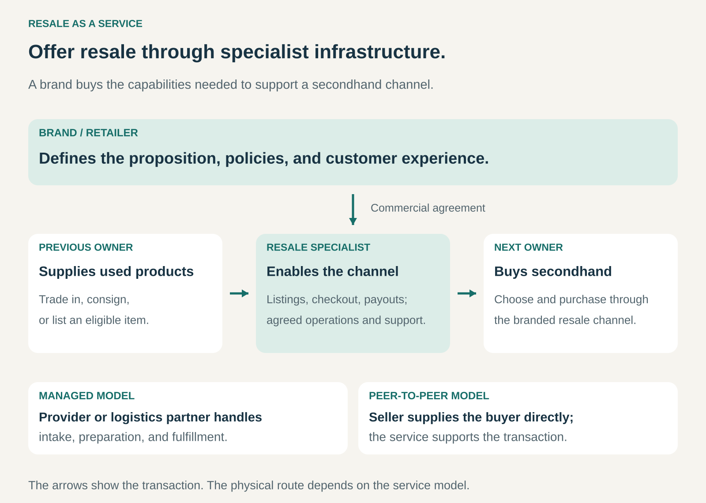

## What it is for

A brand’s products already have a secondhand market. Customers sell them through marketplaces, pass them on, or leave them unused.

The brand would like to offer its own resale channel. But handling used products introduces unfamiliar work: identifying individual items, assessing condition, pricing, photographing, arranging payouts, and managing returns.

Resale as a Service lets the brand obtain those capabilities from a specialist provider.

It is useful when a business wants to participate in its products’ secondhand market without developing every part of the operation itself.

## The core idea

**Provide the resale proposition; buy the specialist capabilities needed to deliver it.**

The brand or retailer becomes the service provider’s business customer. Previous owners supply products, and new owners buy them through the resulting channel.

The service can include technology, physical operations, or both:

- **Technology:** listings, product identification, pricing tools, checkout, payments, and reporting.
- **Operations:** intake, inspection, cleaning, repair, photography, storage, fulfillment, and customer support.
- **Program support:** trade-in workflows, store-credit integration, merchandising, and performance management.

The commercial agreement defines the scope. Some providers deliver a managed operation. Others enable a marketplace in which owners list products and supply buyers directly.

The service being purchased is the capability to run resale. Buyers still purchase secondhand goods through the channel.

Provider income may come from platform charges, processing fees, transaction commissions, revenue sharing, or a combination. Inventory ownership and financial risk depend on the arrangement.

## How it works

**Define the proposition.** The brand decides which products qualify, how customers participate, and what buyers can expect. It establishes the offer with the provider, including condition standards and customer policies.

**Choose the supply model.** Products might come from customer trade-ins, consignment, direct owner listings, or the brand’s own returns and other inventory. Each source creates different costs and obligations.

**Connect the systems.** The provider integrates the resale channel with relevant product information, payments, customer accounts, gift cards, and other services.

**Prepare and present individual items.** Used products vary. The same jacket model can appear in several sizes and conditions, with different defects or missing accessories. Listings need to communicate those differences.

**Complete the transaction.** The service coordinates checkout, payouts, and the agreed fulfillment process. In a managed model, goods pass through an operator or logistics partner. In a peer-to-peer model, the seller supplies the buyer.

**Handle exceptions.** Rejected trade-ins, inaccurate descriptions, unsold stock, refunds, and disputed condition assessments need explicit processes.

The brand remains accountable for the promise customers associate with its name. Outsourcing tasks does not remove the need to manage the customer experience.

## Why it works

Resale requires different capabilities from selling standardized new products.

A new-product warehouse may hold thousands of interchangeable units. A resale operation may handle thousands of individually described items. Specialist systems and processes can make that variation more manageable.

A provider can also spread development and operating expertise across several brand clients. Product identification, payout infrastructure, and warehouse tools do not need to be reinvented for each program.

The brand contributes recognition, product knowledge, and access to existing customers. Those assets can help bring sellers and buyers into the channel.

The potential benefits include resale income, recovery value from existing inventory, customer retention, and a more affordable entry point into the brand.

These benefits require evidence. A branded storefront alone does not guarantee enough supply, demand, or margin to sustain the operation.

## Famous examples

### Madewell Forever — resale supported by ThredUp

Madewell Forever offers secondhand Madewell products through a storefront powered by ThredUp’s Resale-as-a-Service platform.

Madewell’s trade-up program directs used denim into assessment. Its official explanation identifies ThredUp as the specialist assessing condition and value, with suitable pairs moving into resale. Other items follow recycling routes.

The brand also connects participation with shopping incentives, while its mail-in program allows customers to earn shopping credit for qualifying items that resell.

This example combines a recognizable retail proposition with specialist resale infrastructure. It also shows why collection and resale must be distinguished: accepting an item does not mean it will qualify for a secondhand listing. [Madewell: trade-up and assessment](https://www.madewell.com/c/do-well-recycling/), [Madewell Forever storefront](https://madewellforever.thredup.com/collections/all)

### Canada Goose Generations — a branded trade-in and resale channel

Trove lists Canada Goose Generations among its resale partners.

In the program’s US and Canadian trade-in offering, customers check eligible outerwear, send items for assessment, and receive a gift card when an item is accepted. Condition grading determines the applicable credit.

Customers encounter a Canada Goose program, while the partnership supplies specialist resale capabilities behind it.

The example demonstrates how a premium brand can make secondhand participation part of its customer relationship. Eligibility, inspection, grading, and rewards form a coherent offer rather than leaving customers to arrange an independent sale. [Trove: brand partners](https://trove.com/partners/), [Canada Goose Generations: trade-in process](https://generations.canadagoose.com/pages/tradein)

### Peloton Repowered — supporting transactions between owners

Peloton partners with Archive Resale to offer Repowered, a marketplace for used Peloton equipment.

Owners create listings, provide condition information and photographs, and set their asking price with support from a recommendation. Buyers can review listings and an equipment history summary.

The platform supports payment and buyer protection, while the transaction can involve direct collection or an available delivery service.

This illustrates a lighter physical model. Resale as a Service can provide the marketplace and transaction infrastructure without requiring every product to enter a central resale warehouse.

That distinction matters for bulky equipment, where moving and storing each item can be expensive. [Peloton: how Repowered works](https://www.onepeloton.com/blog/peloton-repowered), [Repowered marketplace](https://repowered.onepeloton.com/)

## The economics

Consider a hypothetical managed program that receives 1,000 items and completes 800 sales averaging €60 after refunds.

Assume its agreement allocates 40% of sales proceeds to previous owners, 30% to the provider, and 30% to the brand.

| Program item                                         |      Amount |
| ---------------------------------------------------- | ----------: |
| Completed resale transactions                        |     €48,000 |
| Payments to previous owners                          |    −€19,200 |
| Provider fees                                        |    −€14,400 |
| **Brand’s retained share**                           | **€14,400** |
| Brand marketing and program-management costs         |     −€4,000 |
| **Brand contribution before other overhead and tax** | **€10,400** |

These figures are illustrative, not standard industry terms.

The €48,000 is transaction value. It is not automatically the brand’s revenue or the provider’s income; reporting depends on their roles and agreements.

The provider receives €14,400. Suppose processing and storage for all 1,000 items cost €7,000, fulfillment for the 800 sales costs €4,000, and payment handling and support cost €2,000.

That leaves the provider **€1,400 before platform development, other overhead, and tax**.

Both perspectives matter. A program can look attractive to the brand while leaving its operating partner with an unsustainable margin.

Unsold and rejected items still generate costs. Store-credit rewards introduce further considerations, including who funds them and what happens when customers redeem them.

## Useful when

- **Products retain resale value.** Expected prices can support preparation, transactions, and fulfillment.
- **Customers already buy and sell used items.** There is evidence of demand and potential supply.
- **The brand wants a dedicated channel.** It values the customer relationship and presentation.
- **Specialist capabilities would be costly to build.** Resale requires unfamiliar systems or operating processes.
- **Product information is available.** Catalog records and identifiers can simplify matching and listing.
- **Responsibilities can be defined clearly.** Ownership, payouts, returns, grading, and unsold inventory have agreed treatment.

## Common mistakes and limits

**Treating a resale website as the entire operation.** Supply, item quality, pricing, fulfillment, and exceptions determine whether the channel works.

**Assuming every provider offers the same service.** Software, marketplace support, and physical processing are different capabilities. Scope must be explicit.

**Counting transaction value as income.** Seller payouts, provider charges, incentives, refunds, and other costs can consume much of the selling price.

**Ignoring low-value items.** Inspection and photography can cost more than an item’s likely contribution. Acceptance rules protect the economics.

**Losing control of the customer promise.** Outsourced delays or grading disputes can still damage the brand’s reputation.

**Assuming resale automatically reduces consumption.** Environmental outcomes depend on additional use, displaced new purchases, logistics, preparation, and the effects of trade-in incentives.

## Related patterns

- [[resale|Resale / Recommerce:]] The underlying activity of selling products to another owner; this pattern supplies the capabilities as a service.
- [[managed-service|Managed Service:]] A provider assumes responsibility for agreed operational tasks.
- [[white-label|White Label:]] Specialist infrastructure appears within another business’s branded experience.
- [[consignment|Consignment:]] One possible inventory arrangement, with the owner receiving proceeds when an item sells.
