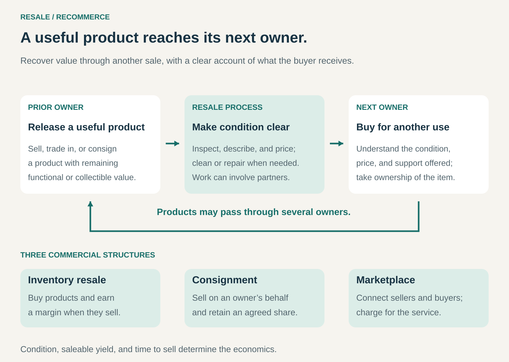

## What it is for

Resale / Recommerce creates a new transaction around a product that still has value after its first purchase or period of use.

It is useful when owners no longer need products that someone else would buy: clothing, electronics, furniture, vehicles, equipment, or collectibles.

The business helps those products reach another owner. It may purchase inventory, manage sales for existing owners, or connect buyers and sellers. Its contribution is making the exchange convenient and credible enough for both sides to participate.

## The core idea

**Recover a product’s remaining value by selling it to its next owner.**

The product retains much of its identity and usefulness. A jacket remains a jacket; a laptop remains a laptop. Inspection, cleaning, repair, or refurbishment may prepare it for another sale, but extensive restoration is not required in every case.

Three common commercial structures are:

- **Inventory resale:** buy products, prepare them, and earn a margin on subsequent sales.
- **Consignment:** sell on the owner’s behalf and retain an agreed fee or share.
- **Marketplace:** connect independent sellers and buyers, charging for transactions or supporting services.

A brand can also operate its own resale channel, sourcing products through trade-ins or buybacks.

Buyers may seek affordability, discontinued models, distinctive items, or collectible value. Secondhand does not always mean inexpensive; scarcity can make some products more valuable over time.

## How it works

The process connects five elements.

**A dependable source of products.** Supply might come from individual owners, trade-ins, business equipment replacements, returns, or other resale businesses. Acquisition terms must leave room for the work and uncertainty that follow.

**An assessment of condition.** Buyers need to understand authenticity, functionality, wear, missing components, and other relevant differences. Categories require different checks.

**Appropriate preparation.** Some products need only accurate photographs and descriptions. Others require cleaning, testing, repairs, replacement parts, or refurbishment.

**A suitable buyer and price.** The business matches a particular item with demand. Condition, model, age, rarity, available alternatives, and selling speed all influence pricing.

**Clear delivery and support arrangements.** Both parties need to know who ships the item, handles problems, accepts returns, and provides any promised warranty.

These activities can be divided among the owner, reseller, marketplace, and specialist partners. The commercial structure determines who bears inventory and service costs.

## Why it works

A product’s usefulness often lasts longer than its usefulness to a particular owner.

Someone may change size, upgrade equipment, move home, or stop pursuing a hobby. Another buyer can value what remains.

Resale businesses reduce the friction between those two situations. They make products discoverable, establish condition, organize payment and delivery, and help resolve uncertainty.

Trust is particularly valuable because used items vary. Two examples of the same model can have different histories and remaining useful lives. Reliable descriptions, inspection, and support make those differences easier to assess.

A resale channel can also support the original brand by keeping products visible and providing an entry point for buyers who would not purchase new. Whether it expands the total business or substitutes for new-product sales depends on customer behavior and the economics of each channel.

## Famous examples

### Patagonia Worn Wear — a brand operates its own resale channel

Patagonia buys eligible used gear from customers in exchange for gift cards. Its employees inspect products for eligibility, authenticity, condition, functionality, and cleanliness. Used and new products can now be purchased through the same Patagonia checkout. [Patagonia’s description of its resale business](https://www.patagoniaworks.com/press/2026/10/14/a-new-milestone-for-patagonias-resale-business).

The Worn Wear offering includes professional cleaning, condition grading, and repairs when needed. Products are backed by Patagonia’s Ironclad Guarantee. [Worn Wear’s product standards](https://www.patagonia.com/worn-wear/).

This illustrates resale built around an existing brand’s products and customer relationships. Trade-ins generate supply, while product knowledge and a defined preparation process help make used inventory understandable to the next buyer.

### Back Market — a managed marketplace for refurbished electronics

Back Market connects customers with professional sellers offering refurbished devices. It explicitly states that it does not refurbish devices itself; that work is performed by the sellers using its marketplace. [Back Market’s explanation of its role](https://help.backmarket.com/en-us/articles/844918-does-back-market-refurbish-devices).

The company describes seller selection and continuing quality monitoring as part of its service. Its U.S. customer guidance also specifies a return window and a limited warranty provided by the seller. [Back Market’s quality and support arrangements](https://help.backmarket.com/en-us/articles/844979-is-back-market-legit).

The example shows how recommerce can scale through specialist partners. The platform organizes discovery and transaction confidence, while sellers supply and prepare the products. Clear responsibilities remain essential when problems arise.

### eBay — broad resale through independent sellers

eBay enables individuals and businesses to sell pre-owned products across many categories. Its recommerce business includes everyday used goods, refurbished equipment, vintage items, and collectibles. For eligible categories and purchases, authentication services add another layer of verification. [eBay’s recommerce overview](https://www.ebayinc.com/recommerce-report/).

Its selling fees include charges associated with listings and completed sales, with details varying by category and selling arrangement. [eBay’s selling-fee structure](https://www.ebay.com/help/selling/fees/fees-sellers?id=4822).

This illustrates recommerce through a broad marketplace. Sellers bring inventory and item knowledge; the platform provides access to demand and transaction infrastructure. The seller’s product margin and the platform’s service revenue are separate economics.

## The economics

The gap between purchase price and resale price is only the starting point.

Consider an illustrative reseller buying 100 used devices for $150 each. After assessment and preparation, 85 sell as working devices for $300 each. The remaining 15 generate $20 each through parts recovery.

| Batch economics                                        |     Amount |
| ------------------------------------------------------ | ---------: |
| Sales of 85 devices                                    |    $25,500 |
| Parts recovery from 15 devices                         |       $300 |
| Acquisition of 100 devices                             |   −$15,000 |
| Inbound logistics and intake                           |    −$1,500 |
| Testing and preparation across the batch               |    −$4,000 |
| Selling, delivery, and expected returns/warranty costs |    −$2,975 |
| **Remaining contribution**                             | **$2,325** |

These hypothetical figures assume $35 in selling, delivery, and expected after-sale costs per working device sold. They exclude shared overhead, financing, and tax.

If only 75 devices sell as working units, with the other assumptions unchanged, the batch produces a **$125 shortfall**.

Saleable yield, repair costs, realized prices, and time in inventory can therefore matter as much as the initial acquisition discount.

## Useful when

- Products retain meaningful value after their first owner releases them.
- Buyers can assess condition with suitable information or verification.
- Acquisition and preparation costs leave an adequate margin.
- Supply and demand can be matched without excessive delay.
- Delivery costs are proportionate to product value.
- The business can support the promises attached to the sale.

The pattern is particularly attractive for durable, identifiable products with established demand.

## Common mistakes and limits

**Buying against optimistic resale prices.** Asking prices are not completed sales. Slow stock may require markdowns while storage and financing costs continue.

**Underestimating item-level work.** Used inventory often requires individual testing, photographs, descriptions, and pricing. One hundred items may mean one hundred distinct listings.

**Treating appearance as functionality.** Cosmetic grading does not establish that every relevant function works.

**Ignoring rejected inventory.** Acquisition costs apply to items that fail inspection as well as those successfully resold. Parts recovery and disposal need realistic assumptions.

**Making unclear promises.** Terms such as “refurbished,” condition grades, return rights, and warranties need understandable definitions and responsibilities.

**Assuming every trade-in is attractive.** A predictable acceptance process and disciplined offers help prevent the business from accumulating expensive, unsaleable stock.

**Equating another sale with guaranteed environmental savings.** Longer use can preserve product value, but transport, preparation, additional consumption, and displacement of new purchases influence the overall result.

## Related patterns

- [[consignment|Consignment:]] supports resale without requiring the operator to purchase every item upfront.
- [[managed-marketplace|Managed Marketplace:]] adds selection, standards, and service coordination to transactions between sellers and buyers.
- [[guaranteed-buyback|Guaranteed Buyback:]] can create a future supply route for resale while offering the original buyer a defined exit.
- [[waste-to-value|Waste-to-Value / Trash-to-Cash:]] finds value in discarded resources; recommerce preserves value primarily through another sale of the product itself.
