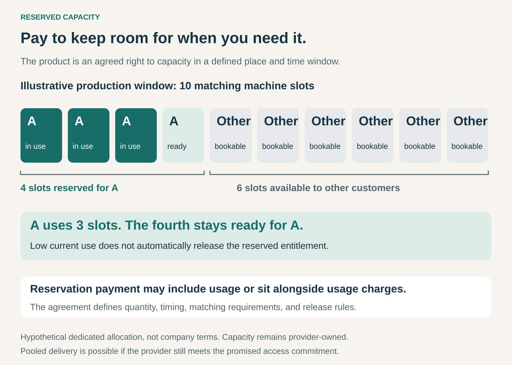

## What it is for

A customer needs resources at a particular moment: computing power for a major launch, manufacturing capacity for a production run, or space on a ship before a seasonal deadline.

Buying access only when the need arrives creates uncertainty. Other customers may already have taken the available capacity.

Reserved Capacity turns that uncertainty into an explicit commercial arrangement. The customer pays or makes a contractual commitment in exchange for a defined entitlement to capacity.

The proposition is: **we keep an agreed amount available for you when you need it.**

## The core idea

Sell an access commitment alongside—or separately from—actual consumption.

The customer buys the right to call on specified resources within agreed limits. Those limits might concern quantity, timing, location, technical characteristics, or notice requirements.

The provider accepts an obligation to preserve that access when allocating resources to other customers.

This does not necessarily require a particular machine, employee, or vehicle to sit idle. The provider can sometimes fulfil the commitment from a pool of interchangeable resources. What matters is whether it can deliver the promised capacity when called upon.

Payment can take several forms: a reservation fee, payment for the entire capacity block, a charge credited against subsequent use, or a broader purchasing commitment.

The defining feature is the **capacity entitlement**, rather than a particular billing method.

## How it works

Imagine a provider with ten matching machine slots during a particular production window.

Customer A reserves four but initially uses only three. In a dedicated allocation, the fourth remains available to A. The provider can offer the remaining six to other customers.

Low current use does not automatically release A’s entitlement. Selling that fourth slot elsewhere would require A’s release or another way to preserve the promised access.

A workable arrangement defines:

- **The resource:** its quantity, specifications, location, and suitability.
- **The window:** when capacity is available and for how long.
- **Activation:** how much notice the customer must provide.
- **Payment:** reservation charges, usage charges, credits, and minimum commitments.
- **Release:** cancellation, rescheduling, expiry, and transfer rules.
- **Failure:** what happens if the provider cannot fulfil the reservation.

A reservation request may also need acceptance before it becomes a commitment. A provider cannot reliably promise capacity it has not secured or scheduled.

## Why it works

The customer gains planning certainty without necessarily owning and maintaining the underlying assets.

That certainty can be valuable even when some capacity goes unused. A production delay, missed shipment, or inability to launch a critical workload may cost much more than the reservation.

The provider receives a clearer signal of committed demand. It can use that information to plan staffing, equipment, purchasing, and expansion.

Reservation charges can also compensate it for keeping resources available instead of selling them elsewhere.

The relationship works best when the customer values certainty and the provider can deliver it efficiently. Pooling interchangeable resources, coordinating schedules, and establishing sensible release rules can make the commitment less expensive to provide.

## Famous examples

### Amazon Web Services: reserving computing capacity

Amazon EC2 On-Demand Capacity Reservations let customers reserve matching computing capacity in a particular Availability Zone. The reservation specifies attributes such as instance type and platform.

AWS charges for the reserved capacity whether or not it is used. When a matching instance uses the reservation, the customer pays for that instance without an additional reservation charge for the same capacity. Immediate-use and future-dated reservations have different commitment and cancellation provisions. [AWS capacity-reservation documentation](https://docs.aws.amazon.com/AWSEC2/latest/UserGuide/ec2-capacity-reservations.html), [AWS pricing explanation](https://aws.amazon.com/ec2/faqs/)

This example separates capacity assurance from discounted pricing. AWS Savings Plans and regional Reserved Instances can provide billing benefits without themselves reserving capacity.

The lesson is to identify exactly what an offer secures: a price, a spending commitment, or access to resources.

### Maersk: reserving space for a shipment

Maersk Spot combines a confirmed freight booking with a loading commitment. Its terms require the customer to meet documentation and delivery cut-offs, while Maersk commits to loading under the specified conditions.

The arrangement allows an alternative vessel within a defined departure window. Cancellation, no-show, amendment, and compensation provisions establish consequences when plans change or commitments are missed. [Maersk Spot](https://www.maersk.com/transportation-services/maersk-spot), [Spot booking terms](https://terms.maersk.com/terms-spot-booking)

Here, the reserved resource is space for a defined shipment rather than continuing access to an entire vessel.

The transferable lesson is that a reservation creates obligations on both sides. A carrier’s loading commitment depends partly on the customer presenting suitable cargo and information on time.

### GlobalFoundries and Qualcomm: securing manufacturing capacity

In 2022, GlobalFoundries and Qualcomm announced an extension of their long-term semiconductor manufacturing agreement, including expanded capacity reservations and wafer-supply commitments through 2028.

The announcement connected Qualcomm’s supply requirements with expansion at GlobalFoundries’ manufacturing facility in Malta, New York. [GlobalFoundries and Qualcomm announcement](https://investors.gf.com/news-releases/news-release-details/globalfoundries-and-qualcomm-announce-extension-long-term)

This illustrates Reserved Capacity at an industrial scale. The arrangement concerns future production capability, supported by a continuing commercial relationship.

It also shows how reservation and purchasing commitments can reinforce one another: the customer secures access to manufacturing resources, while the supplier gains demand commitments that support capacity planning and investment.

## The economics

For the customer, the relevant comparison includes the consequences of capacity being unavailable.

A reservation can be worthwhile even if buying opportunistically would have a lower expected purchase cost. Avoiding a critical interruption may justify paying for certainty.

However, the customer must assess the reservation’s usefulness. Capacity with the wrong specifications, location, timing, or activation rules may provide little protection.

For the provider, the price must account for maintaining readiness and restricting alternative uses of the resource.

That includes equipment, staffing, maintenance, backup arrangements, and the opportunity cost of declining other business.

Unused capacity does not necessarily mean the provider failed to deliver value. Keeping it available may be precisely what the customer purchased. Nevertheless, persistent underuse can make the relationship unattractive to the customer at renewal.

Release deadlines and resale arrangements can help both parties. A customer who gives early notice may allow the provider to sell the capacity again, potentially supporting a partial credit or a more flexible agreement.

## Useful when

- Resources become scarce at commercially important times.
- Waiting would disrupt production, delivery, or another critical activity.
- The customer can specify its needs sufficiently in advance.
- The provider can measure and manage capacity commitments.
- Reserved access costs less than maintaining equivalent resources internally.
- Customers will pay for certainty as well as consumption.
- Cancellation and release rules can recover value from changed plans.

## Common mistakes and limits

**Confusing a spending commitment with reserved access.** Paying a minimum amount does not automatically require the supplier to hold particular capacity.

**Selling priority as certainty.** Moving a customer ahead in a queue is different from committing to fulfil a defined capacity request. The entitlement needs to match the promise.

**Measuring only average demand.** Ten customers who each use little capacity on average may all need it simultaneously. Peak requirements and correlated demand determine whether pooled delivery is credible.

**Reserving the wrong resource.** An allocation is useful only if it fits the customer’s actual work. Technical specifications and location can be as important as quantity.

**Ignoring connected bottlenecks.** Reserved production machinery cannot complete an order without materials, staff, or downstream processing. The commitment must cover a useful part of the operation.

**Making release unnecessarily difficult.** Rigid terms can leave customers paying for unusable capacity while the provider turns away other demand.

**Overpromising recovery.** A refund or service credit may be much smaller than the customer’s loss from missing a critical window. The remedy and the operational capability behind the promise both matter.

## Related patterns

[[take-or-pay|Take-or-Pay]] establishes the customer’s minimum payment obligation. Reserved Capacity establishes the supplier’s access commitment. They can appear together, but neither automatically implies the other.

[[retainer|Retainer]] pays for continuing access to expertise or services. A retainer becomes more specific when it includes a defined amount of protected capacity.

[[guaranteed-availability|Guaranteed Availability]] focuses on keeping a function usable. Reserved Capacity protects access to an agreed amount of resources; maintenance, recovery, and broader service continuity may require additional commitments.

[[shared-access|Shared Access]] lets several customers use provider-managed resources. Reserved Capacity can carve out protected entitlements within that shared pool, with scheduling rules that preserve each promise.
