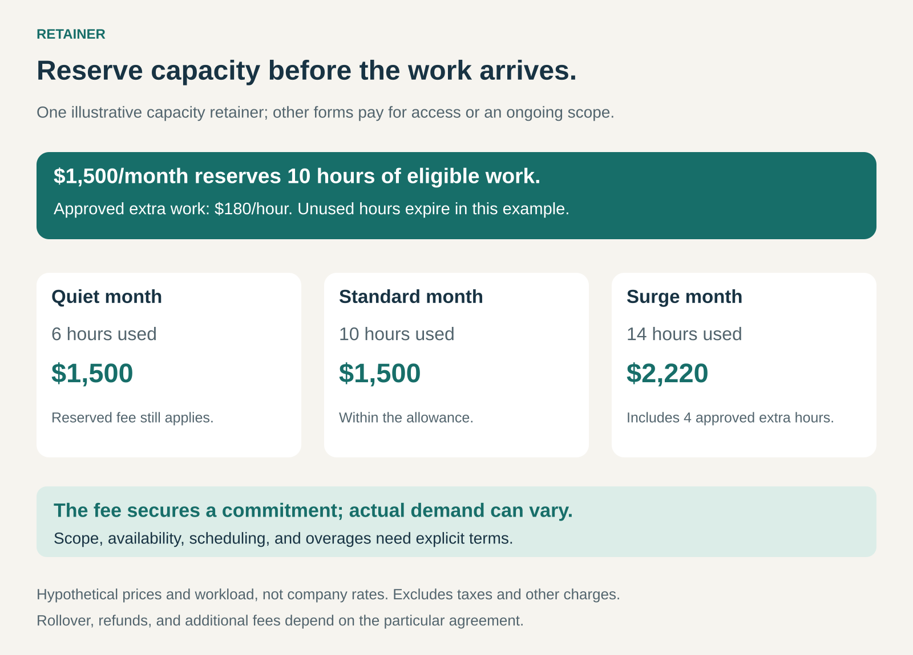

## What it is for

Use Retainer when customers need continuing access to expertise or capacity, even though the exact workload varies.

A company needs communications advice throughout the year. A leadership team wants a specialist who already understands its situation. An organization wants incident-response arrangements established before an emergency.

Finding a provider and negotiating a new assignment every time can introduce delay and uncertainty.

A retainer establishes the relationship in advance. The customer pays an agreed fee for availability, reserved capacity, or a defined ongoing service commitment.

The central proposition is: **secure the help before each individual need arises.**

## The core idea

A retainer pays a provider to maintain a particular commitment over an agreed period.

That commitment commonly takes three forms:

- **Availability:** access to expertise under defined response and engagement terms.
- **Capacity:** an allowance of hours, days, or service credits.
- **Ongoing scope:** responsibility for a continuing set of activities.

These forms can be combined. An advisory retainer might include scheduled meetings, a work allowance, and agreed response times for urgent requests.

The fee can be paid in advance, periodically, or according to another schedule. What matters is the commitment it purchases.

Some providers also use “retainer” to mean an advance credited against later invoices. The name alone therefore does not establish whether the customer is purchasing availability, included work, or simply prepaying future charges.

## Why it works

Specialist help has value beyond the minutes spent performing a task.

A provider who knows the customer’s priorities, history, and constraints can begin with useful context. Established contacts and commercial terms can reduce the work required to start an assignment.

Reserved capacity can also make access more dependable. The provider can plan staffing around an existing commitment rather than treating each request as entirely new business.

For the customer, this can improve continuity and budgeting. For the supplier, it can improve demand visibility and reduce repeated selling and negotiation.

Those benefits depend on a real commitment. A recurring invoice with unclear access, responsibilities, or capacity gives the customer little certainty.

## Famous examples

### WPP: an obligation to remain ready

WPP’s annual report describes retainer arrangements as an obligation to remain ready to perform services on an ongoing basis throughout the contract. It also identifies retainers as a revenue source for public relations and specialist agency services. [WPP’s 2025 annual report](https://www.sec.gov/Archives/edgar/data/806968/000162828026019652/wpp_annualxreportx2025.htm)

This illustrates a retainer organized around a continuing service relationship rather than a single isolated deliverable.

The provider maintains the ability to respond and perform within the arrangement. Individual tasks can change while the broader commitment continues.

The commercial question is therefore larger than the number of items produced in a particular week: what ongoing responsibility and readiness has the agency agreed to provide?

### Mandiant: prepare access before an incident

Mandiant’s retainer combines pre-negotiated terms with access to cybersecurity specialists and prepaid service capacity. Its published offering includes incident response and the ability to use prepaid units for eligible proactive consulting services within the contract term. [Mandiant Retainer](https://cloud.google.com/security/consulting/mandiant-retainer)

The customer establishes the relationship before urgently needing it. That can avoid starting procurement and contract negotiations during an incident.

The prepaid capacity can also support preparation, assessment, or training rather than remaining exclusively reserved for emergency work.

This is a combination of access and an allowance. Response commitments, covered services, and the amount of work purchased remain distinct parts of the agreement.

### Aon Investments: retainer does not necessarily mean advance payment

Aon Investments USA’s 2024 disclosure describes negotiated retainer fees that can be billed quarterly in arrears or through installments agreed for the engagement. Fees depend on the services requested. [Aon Investments USA’s fee disclosure](https://assets.aon.com/-/media/files/aon/capabilities/investments/aon-investments-usa-inc---form-adv-part-2a--august-2024.pdf)

The example demonstrates why payment timing should be separated from the service arrangement.

A retainer can establish an agreed fee for an engagement without requiring the entire amount upfront. Understanding the offer requires reading the service commitment and payment schedule together.

### What happens when demand changes

Consider the hypothetical capacity retainer in the graphic.

A customer pays $1,500 per month to reserve ten hours of eligible work. Additional work requires approval and costs $180 per hour. Unused hours expire under this particular arrangement.

In a quiet month, the customer uses six hours and still pays $1,500. The fee secured the agreed capacity.

In a standard month, ten hours cost the same $1,500.

In a surge month, fourteen hours cost $2,220: the retainer plus four approved additional hours.

Other arrangements might allow limited rollover, use credits instead of hours, or charge separately for all substantive work while the retainer covers availability. None of these rules follows automatically from the word “retainer.”

### The economics behind reserved capacity

The supplier needs to price the commitment it is making, including the ability to meet requests when they arrive.

A quiet period can still involve staffing costs, maintaining familiarity, scheduled reviews, and capacity that cannot confidently be promised elsewhere.

The opposite problem arises when several retained customers need substantial help simultaneously. Selling more commitments than the team can fulfill undermines the very access customers purchased.

Profitability therefore depends on workload patterns, staffing, service boundaries, and how additional work is handled.

For the customer, value includes useful work, continuity, reduced delay, and appropriate access. Low usage may still be reasonable when readiness is valuable. Persistent low usage without a meaningful availability benefit can indicate a poor fit.

### Making the commitment concrete

A useful retainer explains what the customer can rely on.

That includes the services covered, the people or team available, scheduling arrangements, response expectations, and any capacity allowance.

It also distinguishes responding from resolving. A promise to acknowledge or begin handling a request within a certain time does not automatically promise completion within that time.

Additional work needs an understandable path: how it is scoped, approved, scheduled, and charged.

Regular reviews help keep the commitment appropriate. A customer’s needs can grow beyond the original allowance or shrink until a smaller arrangement makes more sense.

Continuity also benefits from shared records and team knowledge. It should remain useful when an individual specialist changes roles.

## Useful when

Retainer is especially useful when needs recur unpredictably, context matters, and delays in obtaining help are costly.

It fits ongoing advisory relationships, agency work, specialist support, and preparedness arrangements.

It is less attractive when the customer has a single clearly defined project, rarely needs the expertise, or cannot identify a valuable continuing commitment.

A retainer can improve access and continuity, but it does not automatically guarantee unlimited work, exclusive staffing, or a particular business outcome.

## Common mistakes and limits

**Leaving availability vague.** “Priority access” needs a practical meaning.

**Treating a fixed fee as unlimited service.** Capacity and scope still require boundaries.

**Focusing only on consuming the allowance.** Work should remain useful; unnecessary tasks do not create value merely because hours are available.

**Ignoring unused capacity rules.** Expiry, rollover, credits, and refunds need explicit treatment.

**Overselling readiness.** The provider must be able to meet its commitments during busy periods.

**Letting the arrangement drift.** A retainer needs periodic review as responsibilities and demand change.

## Related patterns

- [[subscription|Subscription:]] provides a recurring commercial relationship; many retainers use subscription billing.
- [[time-and-materials|Time and Materials:]] can price work beyond the retainer or draw down a prepaid allowance.
- [[flat-rate-access|Flat-Rate Access:]] emphasizes a fixed access price; a retainer can reserve scarce expertise with specific service boundaries.
- [[solution-provider|Solution Provider:]] can combine retained expertise with responsibility for coordinating a broader customer need.
