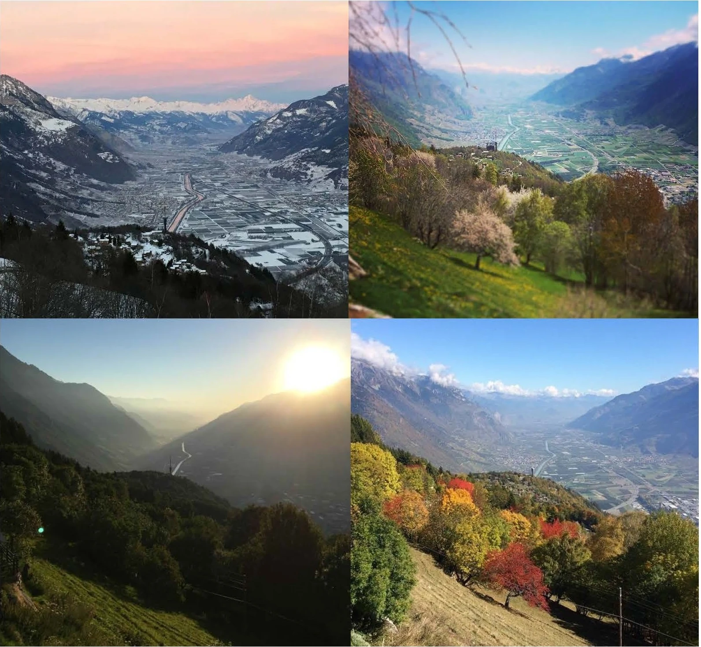

A familiar view feels finished after you photograph it once. Then you pass it on a cloudy
morning and see that the distant hills separate more clearly. Later, low sun brings out
foreground texture. The location has not become a new place, but different relationships
have become available to photograph.

Return to a place you can reach comfortably and observe what changes. Light direction,
weather, season, water level, human activity, and your own attention can all alter the image.
Familiarity reduces the work of finding your way and recognizing the scene, leaving more
attention for the conditions and choices that make each visit distinct.

[Original series and credit](https://commons.wikimedia.org/wiki/File:Four_seasons_Version_2.jpg)
· [CC BY-SA 4.0](https://creativecommons.org/licenses/by-sa/4.0/). Converted to WebP; source arrangement retained.

## Replace novelty with knowledge

Think of the location as something you gradually learn. On the first visit, you may spend
most of your attention recognizing its obvious features. On later visits, you know where
the path bends, where a foreground object sits, and which direction opens toward the distance.
You can notice differences that would have been invisible among all the new information before.

This does not guarantee that every return yields a stronger photograph. Conditions may be
less useful, and your first image may remain the one you prefer. The benefit is a better
understanding of possibilities and causes. An unproductive visit can still reveal why a
particular light relationship mattered.

[[follow-the-light|Follow the Light]] helps interpret illumination. [[review-one-thing-at-a-time|Review One Thing at a Time]] helps turn a comparison into a specific observation rather than a
general ranking of visits. Returning provides continuity; review gives that continuity a question.

## A landscape across conditions

In the valley series, snow changes broad tonal areas and makes some field patterns visible.
Spring growth introduces a different texture and color. Haze reduces contrast with distance,
while low light can emphasize the shape of slopes. A leafy foreground becomes a larger
part of the picture in some views than in others.

Because framing and viewpoint also change, you cannot attribute every difference to season
or exposure. The series is useful precisely when you keep that limitation visible. It shows
how one location can support several interpretations, not how to isolate a single physical
variable in a laboratory comparison.

For your own comparisons, a familiar landmark can help you repeat a viewpoint when that
is useful. A modest note about direction, conditions, and what interested you may be enough.
Do not invent dates from memory or assume an upload date is a capture date. If you later
share a documentary series, keep its actual history clear.

## A street across rhythms

A neighborhood square can be a delivery space early in the morning, a meeting place at
midday, and a quieter passage later. Returning lets you learn those rhythms without treating
every event as interchangeable. A frame that works with one isolated figure may become
confusing when a crowd fills it.

You can keep a composition and see how different activity changes it, as in [[find-the-frame-then-wait|Find the Frame, Then Wait]]. Or choose a new position because the point of interest has changed.
Neither approach is inherently more consistent. Decide whether you want comparable views
or a developing visual account of the place.

Respect the people who use the location. Repeated visits do not grant special access or
make strangers permanent subjects. Ask when appropriate, avoid obstructing routines, and
accept changes in access. A familiar place belongs to more lives than the photographer's
project.

## A small place can be enough

The place can be a windowsill, a garden corner, or a view from your usual seat. A cup
beside a window may receive hard sun one day and broad soft light another. A plant develops
new leaves; rain changes the glass; the background shifts with everyday activity. A small
accessible location can provide substantial visual change without travel.

This can be especially useful when time, money, mobility, or weather restricts options.
You do not need to wait for an exceptional destination to learn how light and framing
interact. [[use-a-creative-constraint|Use a Creative Constraint]] can temporarily narrow the
view or subject, while [[work-the-scene|Work the Scene]] develops alternatives within each
visit.

Avoid reducing the place to a checklist of conditions you must collect. A four-season
series is one possible structure, but a sequence about ordinary daily change may be more
meaningful and more feasible. Let actual observation shape the project rather than staging
differences to fill missing slots while presenting them as found events.

## Let your understanding change too

This pattern helps when you believe better photographs require new destinations, when a
location's light confuses you, or when you want continuity in a small body of work. Compare
what the place offered with what you chose to notice. The change may be in the weather,
in the available activity, or in your growing ability to recognize a relationship.

A return need not repeat the same picture. It can lead from an expansive view to a small
detail, from a building to the way people use it, or from a dramatic sky to quiet reflected
light. The reusable habit is sustained observation of somewhere real, with enough familiarity
to recognize both its changes and your own changing photographic intentions.
