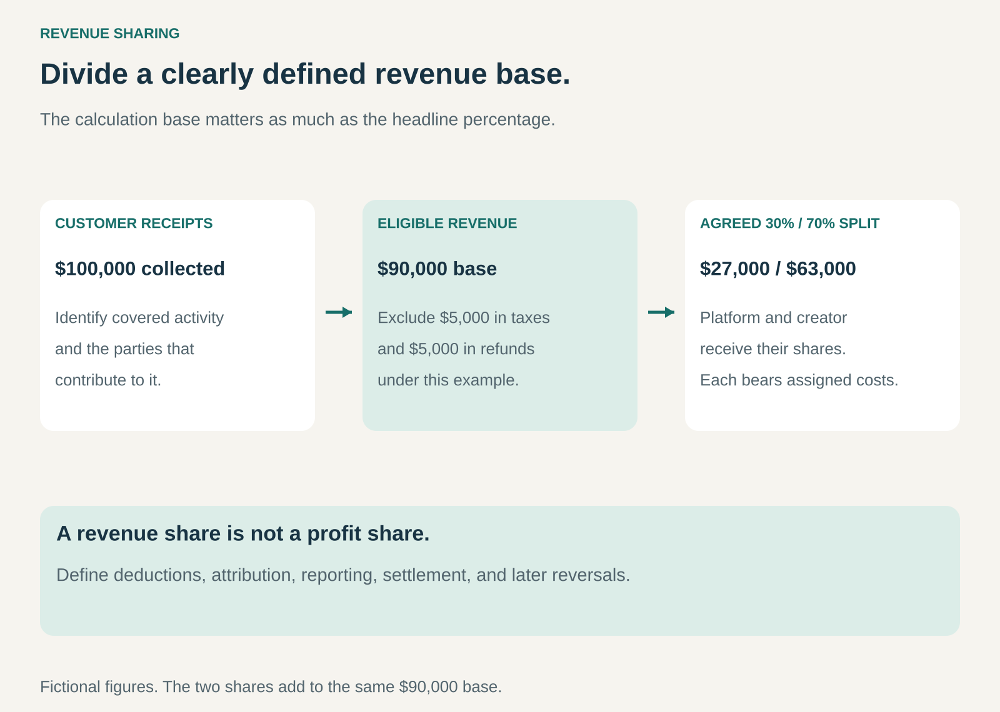

## What it is for

A creator supplies work, a platform supplies distribution, and customers pay for the result. Neither participant wants the entire commercial relationship to depend on a fixed payment made before demand is known.

Revenue Sharing divides a defined revenue base among the parties that help generate it. Payments rise and fall with the activity covered by the agreement.

It is useful when participants provide complementary capabilities and can agree on a measurable, auditable source of income to share.

## The core idea

**Connect compensation to an agreed share of jointly generated revenue.**

The percentage is only one part of the arrangement. The agreement must also define what it applies to: customer receipts, sales excluding transaction taxes, revenue after refunds, or another stated base.

A 30% share of one base can pay less than a 20% share of another. Deductions, eligibility, attribution, timing, and reversals can matter as much as the headline percentage.

Revenue sharing does not itself establish joint ownership, a partnership entity, or a share of profit. Parties can retain different rights and bear very different costs while dividing the same revenue stream.

## How it works

Identify the relevant offering and each participant's role. Define which transactions, territories, channels, customers, or uses qualify for sharing. Specify the calculation base and the treatment of taxes, refunds, discounts, payment costs, and disputed transactions.

Set the percentages or allocation rules. Some arrangements use a simple split; others use thresholds, different products, or a pool allocated according to a stated measure. The mechanism should be understandable enough for participants to predict and reconcile payment.

The operating system tracks the revenue, applies adjustments, reports the calculation, and settles the resulting amounts. Agreements also need rules for late reversals, termination, and continuing revenue from earlier work.

Participants then pay their own assigned costs. Receiving a large share does not establish a high profit if producing the offering or serving customers is expensive.

## Why it works

The arrangement can reduce a participant's upfront cash commitment. A distributor may carry a creator's work without buying all the rights outright. A creator can gain access to an established distribution system without building it independently.

Both sides gain from additional eligible revenue, which can support promotion, product improvement, and broader availability. That alignment is real but incomplete. One party may prefer heavy discounting or expensive acquisition while the other bears costs the revenue formula does not recognize.

Sharing also distributes demand uncertainty. If sales disappoint, payments based on sales fall. The participant carrying fixed production or infrastructure costs still faces those costs, so risk is rarely divided in exactly the same proportions as revenue.

Transparency becomes a source of trust. A reliable statement showing the revenue base and deductions can matter more than a favorable percentage that nobody can verify.

## Famous examples

### YouTube — advertising income shared with creators

Under YouTube's Watch Page Monetization Module, eligible partners receive 55% of net revenue from relevant advertising on their public videos. Other monetization modules use different arrangements; Shorts, for example, uses a creator-pool allocation mechanism.

The example shows both the appeal and the importance of scope. A creator contributes content while the platform supplies distribution and advertising infrastructure. The headline watch-page rate is not a universal share of all money associated with a channel. [YouTube partner earnings](https://support.google.com/youtube/answer/72902?hl=en)

### Amazon Kindle Direct Publishing — royalties from ebook sales

KDP offers 35% and 70% ebook royalty options, with conditions affecting eligibility and calculation. The 70% arrangement includes applicable delivery-cost deductions and territory rules.

This connects the author's remuneration to sales through Amazon's distribution system. It also demonstrates why the base matters: applicable taxes, delivery costs, territory, and other terms can change the amount paid. The royalty is not the author's profit after writing, editing, design, or marketing costs. [KDP ebook royalties](https://kdp.amazon.com/en_US/help/topic/G200644210)

### Bandcamp — a platform share of music and merchandise sales

Bandcamp describes its business as taking a share of sales while artists and labels retain the remainder after applicable charges. Its published policy distinguishes digital and physical items and identifies payment-processing fees separately.

The arrangement lets the platform earn when artists make sales through its service. It remains necessary to distinguish the platform's share, other deductions, and the artist's own costs. A percentage retained by a platform is revenue to cover its operations, rather than an automatic profit margin. [Bandcamp's policy](https://bandcamp.com/fair_trade_music_policy)

## The economics

Consider a fictional distribution arrangement that collects $100,000 from customers. After $5,000 of transaction taxes and $5,000 of refunds, the agreement's eligible revenue base is $90,000.

If the platform receives 30%, its share is $27,000 and the creator receives $63,000. Suppose the platform incurs $18,000 of assigned processing, distribution, and support costs. Its contribution is $9,000 before other overhead and tax. If the creator's production and marketing costs are $40,000, its corresponding remainder is $23,000 before other overhead and tax.

The two shares add to the $90,000 base; they are not two separate pools of new revenue. Different reporting and accounting arrangements may present receipts differently, so the example describes the commercial allocation rather than prescribing financial-statement treatment.

If the same percentage were applied to the original $100,000 instead, payments would differ. A useful agreement makes that distinction explicit before sales occur.

## Useful when

- Participants contribute complementary assets, rights, distribution, or service capabilities.
- The covered revenue can be identified and reconciled.
- Parties prefer compensation that responds to demand.
- Each participant understands its costs and can remain viable at plausible sales levels.
- Reporting, audit, settlement, and dispute processes are workable.

## Common mistakes and limits

An attractive percentage can hide an unfavorable definition of revenue. Unclear deductions and discretionary reallocations can make expected payments difficult to evaluate.

Revenue is also different from profit and savings. A participant paid from revenue may earn while the overall activity loses money. That can be an intentional risk allocation, but it should be understood.

Attribution becomes difficult when several partners influence the same customer. Double counting, conflicting referral claims, and unclear renewal rights can cause disputes. A shared percentage does not resolve them automatically.

The pattern can fit poorly when one party cannot influence the relevant revenue or cannot survive the delay before settlement. Minimum guarantees or fixed payments may be needed, changing the risk allocation.

## Related patterns

[[licensing|Licensing]] can use revenue-based royalties to pay for rights. [[affiliate-commerce|Affiliate Commerce / Affiliation]] shares income through attributable referrals. [[joint-venture|Joint Venture]] creates a jointly owned vehicle, which revenue sharing alone does not require. [[shared-savings|Shared Savings]] divides verified savings rather than sales revenue.
