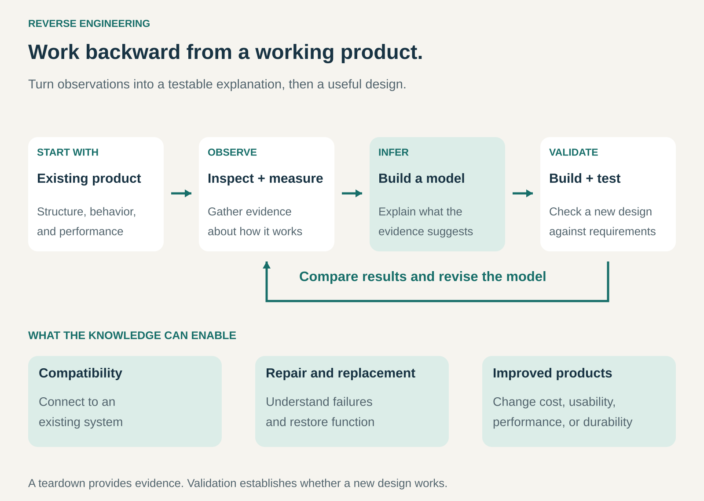

## What it is for

Understanding how an existing product or system works so that a business can develop compatible products, improve designs, enable repairs, or make better technical decisions.

A manufacturer may have an obsolete component without its original drawings. A software company may need to connect with an existing system. A product team may want to understand how a competitor achieves a particular result.

Reverse Engineering starts with the finished thing and works backward toward an explanation.

Its commercial value comes from the products, services, and decisions that this knowledge enables.

## The core idea

**Study an existing implementation, infer how it works, and test that understanding.**

Conventional engineering moves from requirements and designs toward a working product. Reverse Engineering begins with the product, its components, or its observable behavior.

The investigation might reveal dimensions, materials, interfaces, assembly methods, operating principles, or performance characteristics.

The goal can be understanding, compatibility, repair, or improvement. It does not require reproducing every feature of the original.

A useful distinction is between **benchmarking** and **reverse engineering**. Benchmarking establishes how something performs relative to alternatives. Reverse engineering investigates the mechanisms that produce its behavior.

The two often work together: a performance difference identifies what deserves closer examination.

## How it works

The pattern connects four activities.

**Observe the existing system.** Establish what it does, how its parts interact, and where its boundaries lie. Depending on the question, useful evidence may come from disassembly, measurement, imaging, material analysis, or controlled observation of inputs and outputs.

**Infer an explanation.** Turn observations into a model: a drawing, interface specification, component map, description of behavior, or hypothesis about an operating principle.

Observations and interpretations need to remain distinguishable. Seeing a component establishes its presence; explaining why the designer selected it requires additional evidence.

**Develop an application of that knowledge.** The result might be a compatible replacement, a repair method, an integration, or an improved design.

**Validate the result.** Test whether the explanation predicts behavior and whether the new implementation meets its requirements.

This is usually iterative. Unexpected results expose missing assumptions and direct the next round of investigation.

A teardown provides evidence. It does not automatically produce a complete design specification.

## Why it works

A finished product embodies many engineering decisions.

Studying it can narrow the range of plausible solutions and reveal constraints that are difficult to recognize from marketing materials or external appearance alone.

For compatibility work, observing actual behavior can expose requirements that documentation omits. For repair, understanding construction can reveal how to reach a failed component. For product development, analysis can show which design choices affect performance, assembly, or cost.

The method can reduce uncertainty, but substantial engineering work remains.

An existing product does not reveal every manufacturing process, tolerance, supplier requirement, or quality-control method. A successful implementation may depend on knowledge that cannot be recovered from one sample.

The business advantage comes from combining investigation with its own design, testing, and delivery capabilities.

## Famous examples

### Compaq: making compatibility part of a new product proposition

Compaq’s early portable computer illustrates the commercial importance of understanding an established system.

The Computer History Museum describes the company’s approach as reverse engineering the IBM PC to create a compatible portable machine. Its account emphasizes the customer need: taking work home while retaining compatibility with workplace software. [Computer History Museum: Compaq’s early approach](https://computerhistory.org/blog/bcs-1982-dawn-of-the-business-personal-computer-and-cost-efficient-home-pc/)

Compatibility reduced the disruption associated with choosing a different computer manufacturer.

The commercial proposition combined that compatibility with portability. Understanding the established system enabled Compaq to offer something customers wanted beyond the original format.

### Toyota: learning from an existing engine, then improving the design

Toyota’s company history records that its early Model A engine development began with sketches of a 1933 Chevrolet engine.

The first prototype used locally produced cast components alongside imported Chevrolet parts. Testing showed that it produced less power than the reference engine. Toyota then redesigned the cylinder head, drawing on additional technical information, and reported improved output. [Toyota’s account of early engine development](https://www.toyota-global.com/company/history_of_toyota/75years/text/taking_on_the_automotive_business/chapter2/section2/item3.html)

The example shows that studying a working design does not make successful reproduction immediate.

The team still had to develop manufacturing capability, test performance, identify shortcomings, and revise the design.

Reverse engineering supplied a starting point for learning and development.

### iFixit: turning product investigation into repair knowledge

iFixit’s teardown of the original AirPods used disassembly and imaging to document internal construction. It explicitly distinguishes the teardown from a repair guide. [iFixit’s original AirPods teardown](https://www.ifixit.com/Teardown/AirPods+Teardown/75578)

That distinction matters: understanding what is inside a product does not establish that it can be repaired economically or reassembled successfully.

Across its business, iFixit combines technical information with replacement parts and tools. Its commercial-link policy explains that sales and affiliate links help fund its work. [iFixit’s commercial-link policy](https://about.ifixit.com/Wiki/Commercial_Link_Policy)

This illustrates a business built partly around making product knowledge useful to others, rather than manufacturing a competing copy.

## The economics

Consider a hypothetical project to develop a compatible replacement component.

Analyzing the existing interface, developing the replacement, and validating it cost **$40,000**.

Each unit sold produces **$25 contribution** after manufacturing, fulfillment, and expected warranty costs.

The project needs:

## $40,000 ÷ $25 = 1,600 units

to recover those project costs.

At **2,000 units**, contribution totals **$50,000**, leaving **$10,000** after the initial project expenditure.

At **1,000 units**, contribution totals **$25,000**, leaving **$15,000 unrecovered**.

These figures exclude general overhead and tax. They show why technical feasibility and commercial viability require separate judgments.

Discovering how a component works may be valuable, but the market still needs sufficient demand for the resulting offer.

## Useful when

- Original drawings or documentation are missing or incomplete.
- Compatibility with an installed system has commercial value.
- Repair or replacement requires understanding internal construction.
- A product team needs evidence about an existing design’s strengths and limitations.
- An obsolete component supports equipment that customers still use.
- Technical uncertainty can be reduced through observation and controlled testing.

It is less useful when documentation already answers the relevant questions, access is impractical, or the important advantage depends on processes that cannot readily be inferred.

## Common mistakes and limits

**Copying visible features without understanding their purpose.** A design choice may reflect constraints that differ from those of the new product. Reproducing it can reproduce unnecessary cost or complexity.

**Treating an inference as a fact.** Several explanations may fit the same observation. Further testing is needed to distinguish them.

**Testing only normal conditions.** Compatibility may fail on unusual inputs, timing differences, temperature extremes, or accumulated wear.

**Assuming a sample reveals production capability.** Dimensions and materials do not fully explain how to manufacture reliably at scale.

**Chasing estimated cost without accounting for quality.** An apparent component saving can disappear through assembly difficulty, failures, or warranty claims.

**Confusing understanding with permission.** WIPO identifies reverse engineering as a generally legitimate way to discover information embodied in marketed products, while noting jurisdictional differences. That does not establish permission to reproduce patented functionality or disregard other applicable rights and obligations. [WIPO: reverse engineering and trade secrets](https://www.wipo.int/web-publications/wipo-guide-to-trade-secrets-and-innovation/en/part-iii-basics-of-trade-secret-protection.html), [Canadian Trade Commissioner guidance](https://www.tradecommissioner.gc.ca/en/market-industry-info/search-country-region/country/canada-united-states-export/intellectual-property-considerations-canadian-smes/reverse-engineering-considerations-protecting-inventions.html)

**Forgetting the customer’s problem.** Recreating an existing implementation is useful only when it supports a worthwhile product, service, or decision.

## Related patterns

- [[licensing|Licensing:]] Provides permissions that technical understanding alone does not supply.
- [[open-source|Open Source:]] Can provide direct access to implementation details, changing the investigation required.
- [[oem-design-in|OEM Design-In:]] May involve understanding interfaces and constraints so a component works within another manufacturer’s product.
- [[productized-service|Productized Service:]] Can package teardown, compatibility analysis, or technical assessment into a defined commercial offering.
