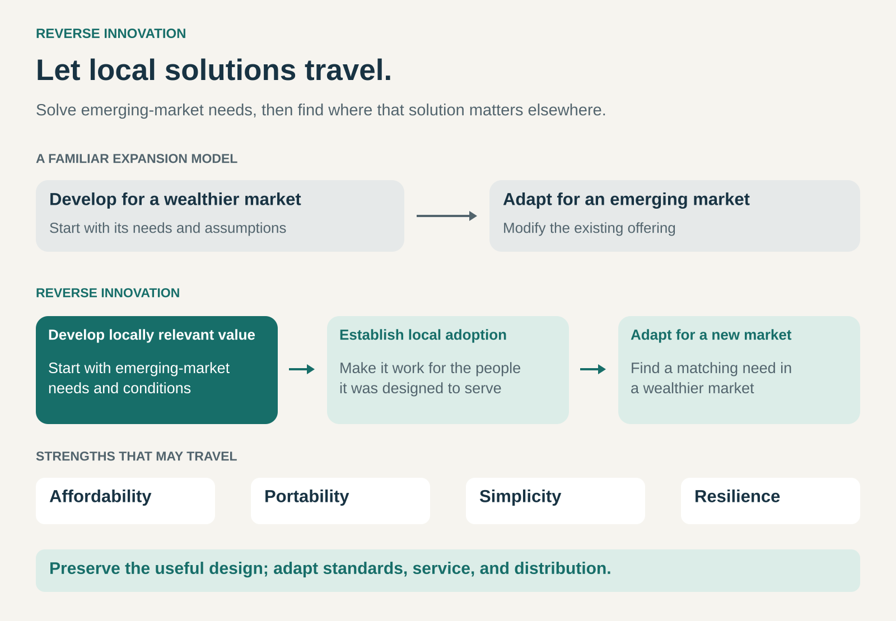

## What it is for

Use this pattern when established products assume more money, infrastructure, specialist knowledge, or supporting services than many customers have—and solving those constraints could reveal opportunities in other markets.

A company may spend years adding features for its most demanding customers. Elsewhere, people need something different: equipment they can carry, a product they can maintain locally, or an essential function at a much lower total cost.

Meeting those needs can require a different design. That design may later appeal to customers in wealthier markets who also value simplicity, portability, or affordability.

Reverse Innovation turns learning from one market into a new proposition for another.

## The core idea

Develop and establish a solution for emerging-market needs, then adapt it for adoption in wealthier markets.

This reverses a familiar multinational expansion model: develop a product for affluent customers, then modify it for other countries. The concept is closely associated with the work of Vijay Govindarajan and his collaborators. [Tuck School of Business: Going Forward in Reverse](https://tuck.dartmouth.edu/news/articles/going-forward-in-reverse)

The important starting point is a particular customer’s situation.

A rural clinic, an urban small business, and a middle-income household in the same country may face very different constraints. Useful innovation begins with those specific conditions.

The opportunity for transfer appears when another customer group shares a relevant need—even if its surroundings and purchasing power are different.

## The graphic

The transferable advantage may be a lower cost, a different way of working, or an ability the established offering lacks.

## Why it works

Established products carry assumptions about their users.

A machine may assume stable electricity, a dedicated room, trained operators, and a maintenance contract. A service may assume a bank account, reliable connectivity, and time to complete a complicated application.

When those assumptions fail, removing a few features may accomplish little. The business has to reconsider how it delivers the underlying benefit.

That can produce useful changes:

- A portable design can bring the service to the customer.
- Simpler operation can reduce training and setup.
- Repairable construction can reduce dependence on distant support.
- A different cost structure can make previously uneconomic purchases possible.

Those advantages can matter elsewhere. Wealthier countries also contain small organizations, remote locations, mobile workers, and customers whose needs are poorly served by expensive, complex offerings.

The commercial opening often comes from finding that shared need.

## Famous example: GE’s compact ultrasound systems

GE’s compact ultrasound systems are a classic example.

The company developed a lower-cost, portable offering for hospitals and rural clinics in China. The design addressed conditions that differed from those assumed by its larger, more expensive systems.

Tuck’s account of Govindarajan’s research describes subsequent adoption in other markets, including the United States. [Tuck School of Business: GE and Reverse Innovation](https://tuck.dartmouth.edu/news/articles/going-forward-in-reverse)

The strategic lesson is that portability can become a reason to buy in its own right. A customer may value equipment that can move to the point of use, even when a larger system is financially accessible.

This also shows why reverse innovation can involve a different performance balance. A compact device need not replace every capability of a premium machine to serve a valuable purpose.

The transferable proposition is a particular combination of function, mobility, usability, and cost. Its suitability still depends on the intended application.

## Famous example: Dacia Logan

The Dacia Logan demonstrates the pattern in a familiar consumer market.

Renault describes the Logan, launched in 2004, as a robust, accessible family car initially designed for emerging markets. It subsequently went on sale in Western Europe in 2005 and found commercial success there. [Renault Group: Dacia’s History](https://www.renaultgroup.com/en/magazine/our-group-news/dacia-the-small-brand-that-thinks-big//)

The design process treated affordability as a starting requirement. Renault’s retrospective explains that teams worked toward a target cost and used proven group components and technologies to control expenditure. [Renault Group: The Dacia Model](https://www.renaultgroup.com/en/magazine/energy-and-powertrains/dacia-15-years-disrupting-the-car-industry-for-groupe-renault/)

The wider opportunity was a group of customers who wanted an affordable new car with practical essentials.

This is a useful distinction: the innovation concerned the product concept and its economics. Advanced technology was not the only route to a new proposition.

It also illustrates that development can involve international teams. The pattern follows the needs that shaped the offering and the direction of market adoption; it does not require every design activity to happen in one country.

## The business-model dimension

A transferable product still needs a viable way to reach and serve its new customers.

The original market may depend on local distributors, different payment arrangements, or a particular maintenance network. Those arrangements may need to change when the offering travels.

The business must preserve the advantage while adapting the surrounding model.

For example, an affordable machine may lose its appeal if distribution margins, service requirements, and added features make ownership expensive again. Conversely, a higher selling price may be justified if the destination requires additional support and the overall proposition remains attractive.

Reverse Innovation therefore involves two linked achievements: solving the original problem and establishing a viable offering in the destination market.

## The economics

The potential reward is access to demand that the existing portfolio misses.

A simpler offering might reach customers who previously bought nothing, relied on used equipment, or paid for a more elaborate solution than they needed. A design created for mobility might also open a new use case.

Expansion adds costs. Certification, adaptation, distribution, training, warranties, and support can absorb much of the apparent price advantage.

There may also be competition with the company’s existing products. A lower-cost offering can attract some customers who would otherwise have purchased a premium version.

The relevant comparison includes both effects: additional demand gained and existing business displaced. Keeping an established product untouched can also carry a cost if another company serves the overlooked need first.

## Useful when

This pattern is especially useful when a business operates across markets with substantially different conditions and gives local teams room to develop appropriate solutions.

It fits situations where constraints encourage a meaningful redesign, and where customers elsewhere share part of the same problem.

Promising connections include portability, low operating costs, straightforward maintenance, modest space requirements, and reduced dependence on infrastructure.

The first market needs to matter commercially in its own right. Treating it seriously produces better learning than using it merely as a preliminary stop before a wealthier destination.

## Common mistakes and limits

**Equating low-cost manufacturing with reverse innovation.** Producing an existing product abroad changes where it is made. Reverse Innovation concerns an offering shaped by emerging-market needs and subsequently adopted elsewhere.

**Assuming cheaper means transferable.** Customers in the destination market still need a compelling reason to choose it. Affordability alone may not overcome unsuitable performance or inadequate support.

**Restoring every familiar feature.** Headquarters may gradually add back the complexity that the original design avoided. Adaptation needs a clear understanding of which choices created the advantage.

**Ignoring local expertise.** Teams close to customers need influence over requirements, resources, and decisions. Govindarajan’s research emphasizes the importance of local teams and capabilities. [Tuck School of Business: Local Innovation Teams](https://tuck.dartmouth.edu/news/articles/going-forward-in-reverse)

**Assuming standards transfer automatically.** Safety requirements, interfaces, purchasing processes, and service expectations can differ. Success in one setting provides evidence to investigate, rather than proof of suitability everywhere.

## Related patterns

**Frugal Innovation** develops useful solutions under resource constraints. Reverse Innovation adds a particular direction of market adoption.

[[bottom-of-the-pyramid|Bottom of the Pyramid]] focuses on serving customers with very low incomes. Reverse Innovation can begin with a broader range of emerging-market customers.

[[no-frills|No Frills]] builds an offering around essential benefits and a simpler cost structure. That proposition can sometimes travel through reverse innovation.

**Disruptive Innovation** examines how offerings gain a foothold and challenge established businesses over time. Reverse Innovation describes where an offering is adopted first and how it crosses markets; disruption is a possible outcome.
