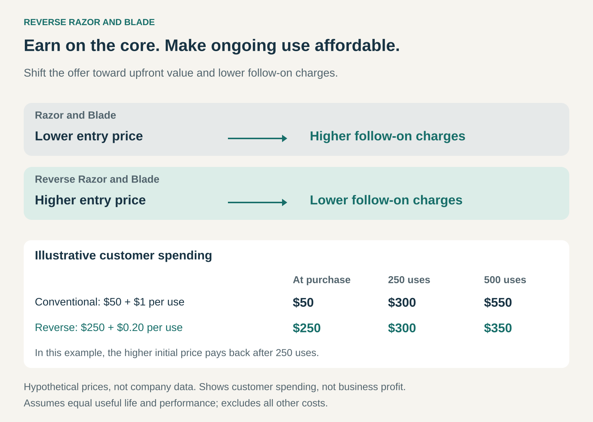

## What it is for

Use Reverse Razor and Blade when affordable ongoing use can make a higher-priced core product more attractive.

Customers may hesitate to buy a cheap printer because they expect expensive ink. They may value a music player more when obtaining and organizing music is easy and inexpensive. They may accept a substantial initial purchase when it comes with useful services at little additional charge.

This pattern puts more of the business’s earning power into the core product and makes its complementary products, content, or services affordable.

The proposition is: **pay more to enter the system, then enjoy better value while using it.**

## The core idea

Reverse Razor and Blade changes where the business captures value across a connected offering.

In the conventional Razor and Blade model, an attractive starter price helps establish demand for profitable repeat purchases.

The reverse model charges enough for the core product to support the business, while inexpensive or included complements strengthen the reason to buy it.

Those complements might be consumables, software, content, or services. Their role is to make ownership more useful, affordable, or appealing.

A high-priced product beside a cheap accessory does not establish the pattern by itself. The relationship matters: accessible complements help customers justify purchasing the core product.

## Why it works

Customers evaluate more than the initial price. They also anticipate what ownership will cost and what they will be able to do with the product.

Affordable complements can improve that calculation in two ways.

First, they can reduce ongoing expenditure. A customer expecting frequent use may willingly pay more for equipment that costs less to operate.

Second, they can increase the product’s usefulness. An accessible library of content, included software, or a supporting service can make the core product worth owning.

The business captures some of that increased value through the initial sale. Complementary products can still earn revenue and profit; the model does not require every follow-on purchase to be sold at cost.

## Famous examples

### Epson EcoTank: make affordable ink part of the printer proposition

Epson’s EcoTank printers use refillable tanks and bottled ink. Epson emphasizes the large number of pages supplied by replacement bottles and their lower cost compared with cartridges, under its stated comparison conditions. [Epson’s EcoTank replacement ink](https://epson.com/For-Home/Ink/Epson%C2%AE-532%C2%AE-Ink-Bottle/i/T532)

The customer-facing reversal is clear: affordable ongoing printing becomes a reason to choose the machine. A buyer expecting substantial printing can evaluate the printer and its ink together, rather than selecting primarily by the initial hardware price.

Epson describes its high-capacity tank printers as a transformation of the printer business model. [Epson’s account of the ink-tank business](https://press.epson.eu/en_GB/news/epson-high-capacity-ink-tank-inkjet-printers-surpass-100-million-units-in-cumulative-global-sales1/)

This illustrates the pricing proposition without establishing the exact profit margin on a printer or ink bottle. Lower running costs also matter less to someone who prints very little.

### Apple iPod and iTunes: accessible music strengthens the device

In 2003, Apple offered iPod models at suggested US prices of $299, $399, and $499. That year, it launched the iTunes Music Store with individual songs at 99 cents and no subscription requirement. [Apple’s 2003 iPod range](https://www.apple.com/newsroom/2003/07/15Apples-iPod-Coming-to-Bose-and-Circuit-City/), [iTunes Music Store launch](https://www.apple.com/newsroom/2003/04/28Apple-Launches-the-iTunes-Music-Store/)

The store made finding, buying, organizing, and transferring music more convenient. That supporting experience increased the appeal of owning an iPod.

The reverse pattern appears in the relationship between an affordable, convenient source of music and a substantial device purchase. Customers could also use their existing music collections; buying tracks from Apple was not a requirement for every listening session.

This is a historical example of the iPod–iTunes offering. It does not imply that Apple’s later content and service businesses have the same economics.

### Tesla’s early Supercharging offer: include a service that supports the vehicle sale

Tesla’s early Supercharger proposition offered free long-distance charging to eligible Model S owners. Its 2014 annual report specified that access was included for 85 kWh versions and available through an upfront option for 60 kWh versions. [Tesla’s 2014 annual report](https://ir.tesla.com/_flysystem/s3/sec/000156459015001031/tsla-10k_20141231.html)

Tesla explicitly explained that the network addressed concern about long-distance travel and removed a barrier to purchasing an electric vehicle. [Tesla’s explanation to the SEC](https://www.sec.gov/Archives/edgar/data/1318605/000119312515017866/filename1.htm)

Here, the complement was a supporting service. Including access made the vehicle more useful and reduced a concern surrounding ownership.

This historical offer illustrates the mechanism. Free Supercharging depended on eligibility; it should not be assumed for every Tesla vehicle.

### The economics of paying more upfront

Consider two hypothetical systems with equal performance and useful life.

One costs $50 initially and $1 per use. The other costs $250 initially and $0.20 per use.

After 250 uses, each has cost the customer $300. After 500 uses, the first has cost $550 and the second $350.

The higher initial price becomes worthwhile through sufficient use. An occasional user may never reach that point.

This calculation describes customer spending. Business profitability requires a separate calculation: how much contribution does the core sale generate, what do the complements cost to provide, and what continuing obligations accompany ownership?

Included digital content may be inexpensive to distribute but still involve development, licensing, and support costs. An included physical service can carry substantial costs every time someone uses it.

The business needs to fund those obligations even after the initial purchase revenue has been received.

### Making the proposition credible

Customers need a clear reason to believe the higher entry price will deliver value.

That reason might be a visible reduction in consumable costs, useful included capabilities, or access to a service they would otherwise need to purchase.

Comparisons need realistic assumptions. Expected usage, product lifetime, maintenance, and replacement costs can change the result substantially.

The offer also needs continuity. Customers may accept a higher price partly because they expect affordable supplies or included services to remain available. Unexpected charges or withdrawn support can undermine that decision.

## Useful when

Reverse Razor and Blade is especially useful when customers expect frequent or sustained use and can understand the benefits of lower ongoing costs.

It can also help when an expensive core product needs accessible complements to become compelling: content for a device, software for equipment, or infrastructure for a vehicle.

It is harder to sustain when customers prioritize the lowest initial payment, cannot afford the entry price, or face uncertain future usage. Financing can spread that payment, but adds costs and complexity to the business.

## Common mistakes and limits

**Charging a premium without improving ownership.** Customers need a meaningful benefit from the affordable complements.

**Assuming everyone uses the product enough.** An offer attractive to heavy users can be poor value for occasional users.

**Confusing low prices with low costs.** Cheap or included complements can still be expensive for the supplier to provide.

**Promising unlimited service without funding it.** Usage, maintenance, and support obligations may continue long after the initial sale.

**Treating the model as a company-wide label.** A business can use this pattern for one offering while earning substantial recurring margins elsewhere.

## Related patterns

- [[razor-and-blade|Razor and Blade:]] places greater emphasis on earning through repeat purchases after an attractive starter sale.
- [[bundling|Bundling:]] can package the core product with included content, software, or services.
- [[solution-provider|Solution Provider:]] can strengthen the offering by making its connected parts work together.
- [[freemium|Freemium:]] uses a useful free tier to attract adoption; Reverse Razor and Blade uses affordable complements to support the purchase of a paid core product.
