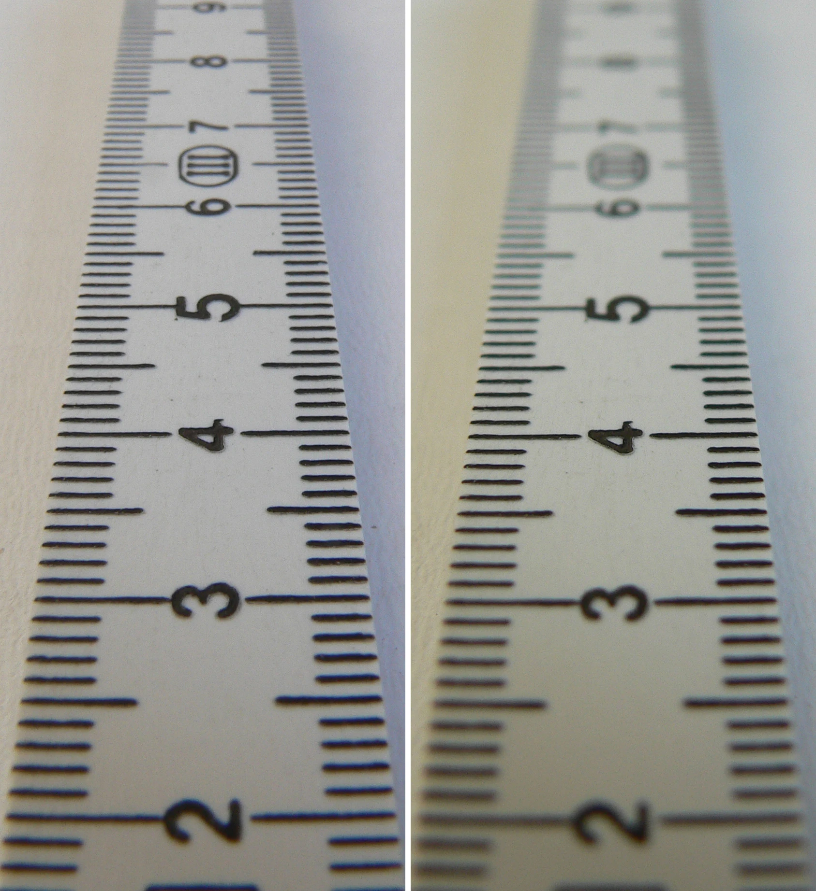

You open a set of photographs and conclude that they are not very good. Some are soft,
others cluttered, and several have awkward expressions. The judgment may describe your disappointment,
but it gives you little direction. Looking only at where focus landed can produce a more
useful observation: the camera repeatedly selected the hedge instead of the face.

Review one issue at a time. Choose a concrete aspect, compare relevant frames, describe what
you can actually see, and form a next experiment. You are trying to learn from the pictures,
including unsuccessful ones. That differs from selecting the best image to keep or publish.

[Original and credit](https://commons.wikimedia.org/wiki/File:Blenden_links_8.0_rechts_2.8_(fcm).jpg)
· [CC BY-SA 4.0](https://creativecommons.org/licenses/by-sa/4.0/). Converted to WebP.

## Turn a verdict into an observation

Think of review as producing information for the next attempt. “The photograph is bad” is
a verdict. “The important hand merges with a dark sleeve in four frames” is an observation.
“Next time I will choose a position where that hand falls against a lighter background”
is an experiment. Each statement has a different job.

Keeping the issue narrow reduces the temptation to explain everything at once. It also
makes comparisons more honest. If you want to understand focus placement, compare the intended
subject with what actually looks sharp. If you want to understand edge distractions, inspect
the boundaries before judging color. Other issues can wait for another review.

[[select-the-strongest-frame|Select the Strongest Frame]] asks which image serves a purpose.
A technically unsuccessful frame may be extremely useful here because it reveals a recurring
cause. A beautiful frame may tell you less if you cannot identify which choice helped.

## Review focus before blaming the camera

Suppose a portrait set contains sharp leaves behind soft faces. That pattern suggests an
unintended focus target. A next experiment might use a selected face or a smaller autofocus
area while keeping the distance and activity broadly similar. If the face is sharp but
hands smear, focus may be adequate and motion may be the separate issue.

Do not infer causes from softness alone. Camera shake, subject movement, limited depth of
field, and noise reduction can all change detail. Look for useful evidence: are stationary
edges also smeared, does sharpness appear at another distance, or are only moving parts affected?
[[focus-on-what-matters|Focus on What Matters]] and [[freeze-or-show-motion|Freeze or Show Motion]]
help separate those possibilities.

The next experiment does not need expensive equipment. Tapping a different subject, choosing
a brighter location, or photographing a natural pause may answer the question. Change enough
to test a plausible explanation without changing so much that the comparison becomes uninterpretable.

## Review a depth relationship

In the ruler comparison, focus on the extent of readable markings rather than the total
appeal of the pictures. The source reports different apertures. The comparison helps you
see how the acceptable sharp region differs under that setup, without proving that one aperture
would be best for every subject.

For your own object photograph, you might discover that the front label is clear while a
rear detail important to the record is soft. A next experiment could use a smaller opening
if available, a slightly greater camera distance, or an object orientation that puts both
details at more similar distances. [[choose-your-depth-of-field|Choose Your Depth of Field]]
explains those choices and their exposure tradeoffs.

Keep the goal tied to use. If the rear detail is irrelevant, a narrow sharp range may
already serve the photograph. A review should not turn a visible difference into a defect
without asking why the difference matters.

## Review composition through one relationship

Take a small set from a familiar street. Look only at whether the chosen subject separates
from the background. You may notice that one camera height repeatedly places heads against
bright signs, while a lower position gives cleaner outlines. The next experiment is about
height, not about simultaneously changing color, lens, and editing style.

Alternatively, inspect only the frame edges. Count the kinds of fragments that interrupt
your intended subject: partial arms, a bright sign corner, a line almost touching a roof.
This can suggest a brief edge check before the next photograph. [[check-the-edges|Check the Edges]] provides that shooting habit. You do not need to score every image or make a
formal spreadsheet for the observation to become useful.

## Preserve uncertainty when the evidence is weak

One successful picture does not prove a method always works. Light, movement, and your own
position may have changed together. Describe the possible cause as a hypothesis when the
images cannot distinguish it. A small deliberate comparison next time can provide better
evidence than a confident story about the previous session.

This pattern helps when review feels overwhelming, self-critical, or disconnected from improvement.
It also prevents endlessly admiring favorites without understanding your choices. [[use-a-creative-constraint|Use a Creative Constraint]] can narrow the next attempt, while [[return-to-the-same-place|Return to the Same Place]] makes comparisons easier in a familiar setting. End a review with
one useful observation and a feasible change, leaving other questions available for later.
