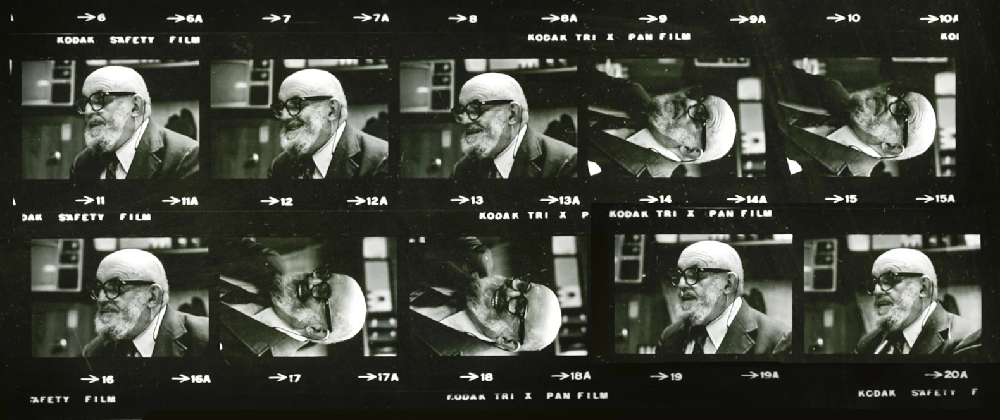

You have twenty portraits from one conversation. Some are sharp but expressionless; another
has a warm gesture and a slightly imperfect background. Two look almost identical until
you notice that a hand partly covers the face in one. Keeping every version avoids a
decision, but it also makes the set harder to use.

Choose the frame that best serves a specific purpose. Compare what the images actually show,
not merely how technically clean they look or how much effort each cost you. Intention,
gesture, composition, and technical adequacy all matter, with different weights for different
uses. A small profile picture and a documentary sequence may need different selections.

[Source and archival credit](https://commons.wikimedia.org/wiki/File:Ford_A2966_NLGRF_photo_contact_sheet_(1975-01-27)(Gerald_Ford_Library)-ansel-adams-portrait-only.jpg).
Converted to WebP. Film orientation and frame labels are retained.

## Define strong enough for what

Think of selection as matching an image to a job. “The strongest photograph” can hide an
unstated criterion. Do you want a recognizable person, an exchange between people, the shape
of a movement, an informative object view, or an atmosphere? A purpose makes comparison
more concrete and disagreement easier to understand.

The contact sheet offers alternatives rather than one obviously correct portrait. A turned
head can suggest attention outside the frame. A hand near the face can add gesture while
covering part of the expression. A more frontal view can be direct but less specific about
the interaction. The reasons for selection belong to the use we describe, not to a universal
ranking of those gestures.

[[choose-your-subject|Choose Your Subject]] establishes the intention at capture. Selection can
revisit it when the results reveal something you did not expect. [[work-the-scene|Work the Scene]] creates deliberate alternatives; this pattern chooses among them afterward.

## Compare similar images together

A contact sheet or small grid makes differences easier to see than opening each photograph
in isolation. Start at a size that reveals overall composition and gesture. Then inspect
the important detail in the strongest candidates. If you begin at extreme magnification,
you may choose the cleanest texture while overlooking a better expression.

For the archival portraits, compare the visible face, hands, and background around the head.
The source contains rotated frames because film strips were assembled for reference. Judge
the image's intended orientation, not the incidental layout of the sheet. A simple rotation
for viewing is different from changing the recorded scene.

Do not let a memorable moment outside the frame dominate the choice. You may remember a
funny conversation, but the photograph still needs visible clues to what you want it to
communicate. Conversely, a quiet expression may be valuable even if nothing dramatic happened
when you pressed the shutter.

## A moving subject and a readable gesture

In a skateboard sequence, an airborne frame can clearly show separation from the ground.
A neighboring frame might contain a more complete view of the board or a clearer landing
stance. If the purpose is to explain movement, a sequence may be stronger than one dramatic
instant. If the purpose is a poster about lift, the single airborne shape may be enough.

Check technical adequacy in relation to that purpose. Slight blur can communicate movement
or become a distraction. An important face that cannot be recognized may fail a family
portrait but work as an anonymous figure in a larger street scene. [[freeze-or-show-motion|Freeze or Show Motion]] helps distinguish deliberate motion appearance from an accident you are
trying to excuse afterward.

## A landscape and a small change in light

Several versions of a landscape may differ mainly in a cloud shadow. One gives the foreground
more attention; another makes a distant ridge readable; a third produces disconnected bright
patches. Choose the version whose light supports the intended relationship, not automatically
the brightest sky or most saturated color.

A minor crop may improve a candidate, but do not judge it only by an imagined perfect
edit. Ask whether the needed information is actually present. [[crop-with-a-purpose|Crop with a Purpose]] can refine a boundary; it cannot restore a missing hand or a view hidden
behind an obstruction. Keep enough honesty in the comparison to recognize when another capture
simply works better.

## Make a selection without destroying alternatives

This pattern helps when a burst or session produces many near-duplicates, when sharing feels
overwhelming, or when a set needs a clear focal image. Ratings, favorites, or a temporary
selection folder can record choices without deleting originals immediately. Similar frames
may serve different future purposes, and other people may value an expression differently.

Consult the subject's preferences for portraits when appropriate. Avoid assuming that the
most animated expression is the most truthful, or that a technically imperfect image is
automatically more authentic. Selection is a deliberate interpretation of what the photographs
offer. [[review-one-thing-at-a-time|Review One Thing at a Time]] has a different goal: learning
from a specific issue, including frames you would never publish. You can make a strong
selection and still retain the rejected frames as useful evidence for your next experiment.
