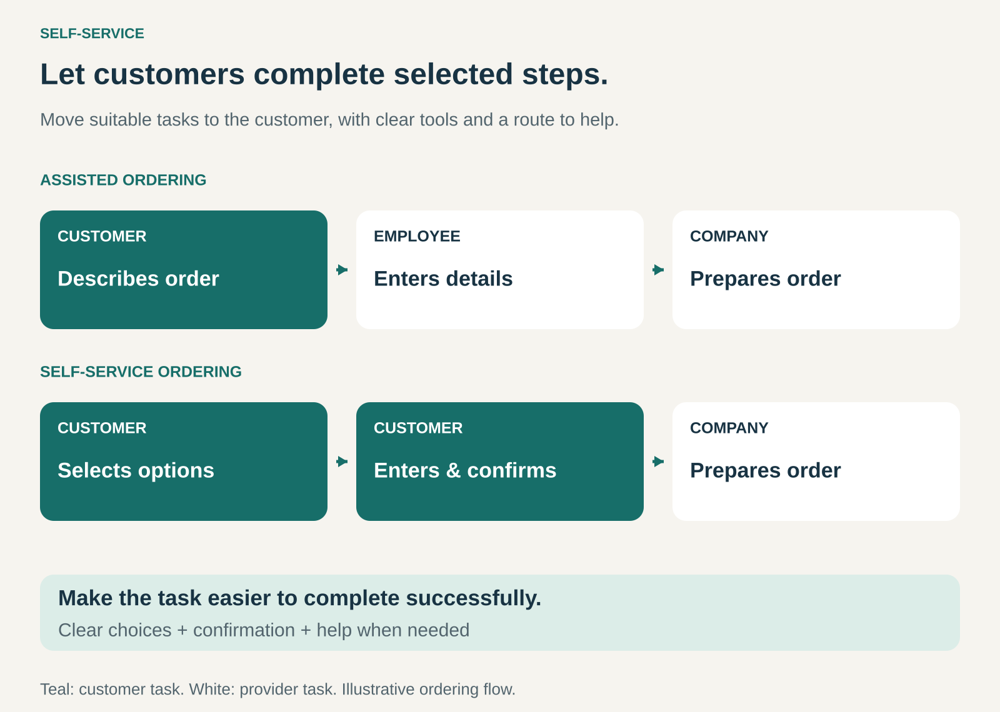

## What it is for

Let customers complete suitable parts of a purchase or service themselves, giving them more control while reducing the work required from employees.

Customers often know what they want and would prefer to act immediately: enter an order, check in for a flight, collect a product, or change an account setting. Waiting for someone to perform a straightforward task can add friction without adding much value.

Self-Service is useful when customers can perform those tasks successfully with clear information, suitable tools, and access to help.

The customer’s benefit might be a lower price, less waiting, greater privacy, or the freedom to act at a convenient time.

## The core idea

**Transfer selected activities to the customer and design the offering so those activities are manageable and worthwhile.**

Business Model Navigator describes Self-Service as transferring part of value creation to customers, typically supporting lower prices and potential efficiency or time benefits. [Business Model Navigator: Self-Service](https://www.businessmodelnavigator.com/pattern?id=45)

The work can be physical or digital. Customers might assemble furniture, scan groceries, enter booking details, or configure an account.

The business still provides the product, infrastructure, information, and support needed for the arrangement to work. A successful model depends on the division of work making sense for both sides.

Self-service and automation often operate together. The customer selects and confirms an action; a system processes it. Fully automatic replenishment involves a different allocation of work because the system can act without a fresh customer instruction.

## How it works

**1. Choose tasks customers can reasonably perform.**

Good candidates tend to have understandable choices, clear instructions, and a result customers can recognize.

Entering an address is usually straightforward. Diagnosing an unfamiliar technical failure may require expertise the customer does not possess.

Task complexity, physical effort, frequency, and the consequences of mistakes all affect suitability.

**2. Redesign the task around the customer.**

An employee may know product codes, internal terminology, and unwritten rules. Customers need an interface or process that supplies that missing knowledge.

Useful design includes clear labels, visible prices, understandable instructions, sensible defaults, and confirmation before consequential actions.

Physical self-service also depends on practical details: packaging, tools, signs, reachable equipment, and manageable handling requirements.

**3. Make the exchange worthwhile.**

Customers contribute time and effort. They need a recognizable benefit.

A lower price can compensate for assembling a product. Immediate access can make account management attractive. A visible order summary can give customers more control over their choices.

The benefit should survive the complete experience, including setup, corrections, collection, and any need to seek help.

**4. Support exceptions and recovery.**

Some customers will encounter unfamiliar situations, make mistakes, or need assistance.

The service needs a way to correct entries, recover interrupted progress, and reach someone who can resolve the problem. Employees supporting self-service may spend less time entering routine information and more time handling exceptions.

Self-service changes the work; it rarely removes every need for assistance.

## Why it works

**It can remove an unnecessary handoff.** Customers enter information directly instead of explaining it to someone who then records it.

**It can expand access.** A digital service may operate outside staffed hours, while several kiosks can allow customers to begin tasks in parallel.

**It gives customers control over pace and choices.** They can review options, check details, and confirm when ready.

**It can reduce repetitive employee work.** Staff capacity may become available for fulfilment, advice, or difficult cases.

**It can support lower prices.** When customers perform a meaningful share of the work, the provider may be able to deliver the offering at a lower operating cost.

These are potential advantages. A confusing interface, repeated failures, or a queue at the next stage can absorb the expected benefit.

## Famous examples

### IKEA — customers participate in collection and assembly

IKEA’s concept explicitly includes customers finding products, picking them up, taking them home, and putting them together. Product information and store arrangements support that participation as part of its affordability model. [The IKEA concept](https://www.ikea.com/in/en/this-is-ikea/the-ikea-concept-pubf3f3eee1/)

The pattern extends into product design: furniture intended for customer assembly requires an approach that makes assembly feasible.

Customers can also choose assistance. In the United States, IKEA offers furniture assembly through Taskrabbit. This shows how a self-service offering can coexist with separately purchased help. [IKEA assembly services](https://www.ikea.com/us/en/customer-service/knowledge/articles/6aada8f2-0f76-473f-95d9-b6a413aec984.html)

### McDonald’s — customers enter their own orders

McDonald’s uses self-ordering kiosks in many restaurants. Its US mobile ordering service also lets customers place and pay for orders themselves at participating locations, with collection or table-service options depending on the restaurant. [McDonald’s self-service kiosks](https://www.mcdonalds.com/gb/en-gb/help/faq/do-your-restaurants-have-self-service-facilities.html), [McDonald’s Mobile Order & Pay](https://www.mcdonalds.com/us/en-us/mobile-order-and-pay.html)

The customer performs order entry while restaurant staff prepare the food. Self-service ordering can therefore coexist with an employee bringing the finished order to the table.

The example illustrates selective participation: different stages of the same experience can use different service arrangements.

### Southwest Airlines — passengers complete routine travel tasks

Southwest passengers can check in through its website or app. Airport self-service kiosks support tasks such as printing boarding passes, paying applicable baggage fees, and printing bag tags where available. Some passengers and reservations require counter assistance. [Southwest online check-in](https://support.southwest.com/helpcenter/article/online-checkin), [Southwest self-service kiosks](https://support.southwest.com/helpcenter/article/self-service-kiosk)

Passengers complete selected administrative tasks while the airline continues to provide the flight and airport operations.

The eligibility limits also reveal an important boundary: a task suitable for many customers may still need an assisted route for particular situations.

## The economics

Self-service can reduce employee involvement in routine transactions, but it introduces costs for equipment, software, maintenance, guidance, and assistance.

Consider a hypothetical business handling 1,000 routine tasks each month. Initially, each assisted task costs $4 to handle, for a total of $4,000.

Suppose 700 tasks move to self-service:

| Monthly handling costs                                        |     Amount |
| ------------------------------------------------------------- | ---------: |
| 300 assisted tasks at $4                                      |     $1,200 |
| 700 self-service tasks at $1, including expected assistance   |       $700 |
| Additional fixed costs for self-service tools and maintenance |       $600 |
| Total                                                         | **$2,500** |

The potential operating improvement is **$1,500 per month**, before transition costs and assuming comparable completion quality.

That improvement becomes a cash saving only when expenditure actually falls. If staffing stays unchanged, the immediate benefit may be available capacity rather than lower payroll.

Customer effort also matters. A cheaper process for the business can weaken the offering if it makes customers spend substantially more time or abandon the task.

## Useful when

- **Tasks are frequent and understandable.** Customers can recognize the available choices and the result.
- **Customers already possess the necessary information.** Direct entry avoids a repetitive conversation.
- **Immediate access has value.** Waiting for staff creates an avoidable delay.
- **The offering supports participation.** Instructions, interfaces, equipment, and packaging make the task manageable.
- **Exceptions can be handled effectively.** Customers can obtain help without restarting the whole process.

## Common mistakes and limits

**Transferring work without simplifying it.** Giving customers access to an internal process can expose terminology and complexity that employees learned through training.

**Counting every self-service interaction as a success.** A customer may attempt the task repeatedly and then contact support. Completion, errors, repeat contacts, and total effort provide a fuller picture.

**Removing assistance too early.** Routine usage can look successful while customers with unusual needs become stranded.

**Ignoring differences between customers.** Language, confidence, disability, physical ability, device access, and familiarity affect whether a task is manageable.

**Moving the bottleneck.** Faster ordering may produce a longer collection queue if fulfilment capacity stays the same.

**Assuming customers always prefer independence.** Advice, reassurance, and personal attention can be valuable parts of an offering.

The pattern is less suitable when mistakes are difficult to reverse, expert judgment is central, or the effort required outweighs the customer’s benefit.

## Related patterns

- [[no-frills|No Frills:]] removes selected service elements to support a simpler, lower-cost offering. Self-service can contribute to that model.
- [[core-plus-add-ons|Core plus Add-Ons:]] can pair a self-service base offering with optional delivery, assembly, or expert assistance.
- [[e-commerce|E-Commerce:]] often enables self-service ordering, although self-service also works in physical settings.
- [[mass-customization|Mass Customization:]] can use customer-operated configuration tools to capture individual choices while the business produces the resulting offering.
