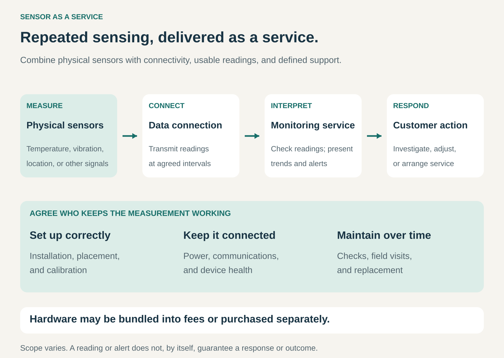

## What it is for

Giving customers an ongoing way to measure physical conditions without requiring them to assemble and operate every part of the sensing system themselves.

A warehouse needs temperature records. A factory needs information about machine vibration. A fleet operator needs visibility into vehicles and equipment.

Buying sensors addresses only part of those needs. The devices also need suitable placement, power, connectivity, maintenance, and a way to turn readings into useful information.

Sensor as a Service combines those elements into a recurring commercial offering.

## The core idea

**Sell a functioning measurement capability over time, supported by devices, connectivity, and software.**

The customer pays for continued visibility into an asset, location, or condition.

The sensor hardware may be included in recurring fees, rented, or purchased separately. Installation and maintenance may be bundled or assigned to the customer.

The defining feature is the ongoing service around measurement—not a particular ownership arrangement.

This overlaps with **Data as a Service**. The emphasis here extends into the physical process that produces the data: deployed devices, communication links, and the work required to keep measurements useful.

It also differs from selling a sensor with a basic companion app. A substantial service proposition includes continuing capabilities such as monitoring, records, alerts, analysis, or defined support.

## How it works

The pattern connects four activities.

**Measure the relevant condition.** Devices capture signals such as temperature, vibration, location, pressure, or occupancy. Placement, measurement range, accuracy, and sampling frequency determine what the readings can reveal.

**Move the readings reliably.** Connectivity carries information from devices to the service. Some systems transmit frequently; others report periodically or store readings until a connection becomes available.

**Make the measurements usable.** Software presents records, trends, exceptions, and alerts. Some offerings add specialist interpretation or recommendations.

**Connect information to a response.** Someone investigates an alert, changes an operating setting, schedules maintenance, or takes another appropriate action.

The last step requires explicit responsibility. Detecting a condition does not automatically mean the provider will intervene.

Pricing can be per device, asset, site, application, or monitored condition. Contracts also define the work included: installation, calibration, connectivity, support, replacement, and response coverage.

## Why it works

Reliable sensing requires several capabilities to work together.

A technically capable sensor provides little value if its battery fails unnoticed, its readings stop reaching the system, or nobody understands what an alert means.

A provider can combine hardware selection, communication infrastructure, software, and support into a repeatable offering.

For customers, this can reduce integration work and make ongoing monitoring easier to maintain across many assets or locations.

For providers, recurring fees can fund the continuing work that follows installation. Reusable software and shared operating processes can spread costs across customers.

The economics still depend heavily on physical delivery. Installation visits, calibration, damaged devices, connectivity problems, and replacements can consume substantial resources.

The service must remain useful after the initial deployment.

## Famous examples

### Samsara: subscriptions combining connected devices and applications

Samsara’s annual report describes subscriptions that include data collection from connected devices or third-party systems, cellular connectivity for its devices, cloud applications, support, and warranty coverage. It generally prices subscriptions per asset and application. [Samsara’s description of its business model](https://www.sec.gov/Archives/edgar/data/1642896/000162828026039507/iot2026ars.pdf)

Its monitored-asset offerings illustrate how measurement and connectivity can support an ongoing commercial relationship.

The customer receives continuing visibility and software capabilities around vehicles or equipment, rather than simply purchasing an isolated tracking device.

Samsara operates a broader connected-operations platform. Sensor-enabled monitoring is part of that wider offering.

### SKF: machine sensing combined with continuing interpretation

SKF’s SMART FAN program describes installing preconfigured condition-assessment sensors and using software and expert interpretation to identify changes that may require attention. The program is offered through a subscription arrangement. [SKF’s SMART FAN program](https://au.promo.skf.com/acton/media/23423/mainpage-eu-automatedpredictivemaintenancetechnology-au-all-smartfanprogram)

SKF also describes remote analysis services involving alarm reviews, diagnostic reports, recommended actions, and ongoing dialogue with specialists. [SKF Remote Analysis Services](https://cdn.skfmediahub.skf.com/api/public/0912056c0f655144/pdf_preview_medium/SKF_Remote-Analysis-flyer_710-954_Oct-2025_pdf_preview_medium.pdf)

The example shows how the service can extend beyond displaying measurements.

Expertise helps customers interpret machine behavior and decide what to investigate. The sensing system supplies evidence; maintenance decisions and work remain part of the broader operating process.

### Verkada: sensor hardware with recurring cloud access

Verkada offers air-quality sensors managed through its Command platform. Its documentation states that each managed sensor requires a license, while its pricing information identifies hardware charges separately from the required license. [Verkada’s sensor licensing](https://help.verkada.com/air-quality/getting-started), [Verkada’s hardware and licensing structure](https://www.verkada.com/pricing/)

This illustrates a hybrid version of the pattern: an upfront device purchase combined with an ongoing monitoring service.

The recurring relationship supports access to sensor information through the platform.

The measurement scope remains important. Verkada explicitly states that these sensors are not life-safety devices and do not replace emergency smoke or carbon-monoxide detectors.

## The economics

Consider a hypothetical provider deploying **100 sensors**.

Assume it funds **$12,000** of hardware and installation, with no separate upfront payment from the customer.

The customer pays **$900 per month**.

Average ongoing costs—including connectivity, cloud services, support, and a maintenance allowance—are **$400 per month**.

Monthly contribution toward recovering deployment costs is:

**$900 − $400 = $500.**

Simple deployment-cost recovery takes:

**$12,000 ÷ $500 = 24 months.**

If the relationship ends after **12 months**, only **$6,000** has been recovered through that contribution.

This illustration excludes fixed company overhead, financing, tax, and any recoverable equipment value.

It shows why contract duration, installation costs, maintenance requirements, and customer retention matter when providers fund the equipment.

Charging separately for hardware changes the financing burden. It does not eliminate the cost of delivering the ongoing service.

## Useful when

- Customers need repeated measurements across assets or locations.
- Manual checks create delays, gaps, or substantial effort.
- The provider can combine devices, connectivity, and monitoring effectively.
- Continuing records, alerts, or analysis have clear operational value.
- Maintenance and support can be delivered economically.
- Responsibilities for interpreting and responding to information can be defined.

It is less attractive when measurements are rarely needed, a simple standalone device is sufficient, or field-service costs overwhelm the recurring value.

## Common mistakes and limits

**Selling connectivity as if it guarantees measurement quality.** A connected device can still be poorly positioned, inaccurate, damaged, or unsuitable for the conditions.

**Ignoring the sensing equipment itself.** Batteries, calibration, environmental exposure, mounting, and replacement are continuing operational concerns.

**Confusing missing readings with normal conditions.** A quiet dashboard may indicate a communication failure. Device health and data gaps need visibility.

**Leaving response responsibilities unclear.** Customers need to know who receives alerts, who investigates, and whether intervention is included.

**Overstating what analysis can establish.** A changing signal may justify investigation without proving a particular fault. Interpretation depends on context and measurement quality.

**Underpricing field work.** A site visit can cost far more than processing months of readings. Deployment and maintenance assumptions deserve realistic budgets.

**Assuming every service includes the hardware.** Some offerings bundle equipment; others require a purchase and separate recurring licenses.

**Promising outcomes beyond the scope.** Monitoring can support better decisions. Guaranteed uptime, avoided losses, or automatic corrective action require additional capabilities and commitments.

## Related patterns

- [[data-as-a-service|Data as a Service:]] Supplies usable information; sensing services also address how measurements are produced.
- [[product-as-a-service|Product as a Service:]] Can include sensor hardware within an ongoing service relationship.
- [[managed-service|Managed Service:]] Applies when the provider operates defined parts of the monitoring system.
- [[outcome-based-pricing|Outcome-Based Pricing:]] Can connect payment to an agreed result, extending beyond access to readings and alerts.
