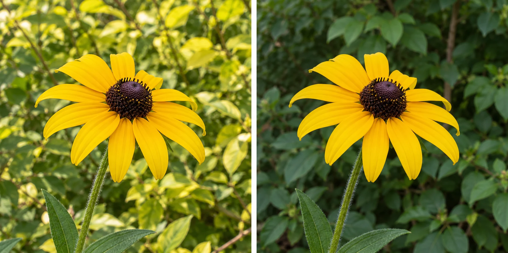

You have chosen a yellow flower as your subject. In one photograph, it sits against a busy
patch of yellow-green leaves and seems to disappear. From a slightly different position, the
same flower falls against a darker, quieter area. Its petals become easier to recognize even
though the camera and the flower have barely moved.

Once you know what matters, help it remain distinguishable from what surrounds it. Separation
can come from an open outline, a difference in brightness or color, a difference in sharpness,
or some combination. It does not require an empty background, a portrait mode, or a lens
that produces strong blur. A recognizable environment can support a clearly readable subject.

## Think about the boundary

A useful mental model is the boundary between the subject and its surroundings. Can you
recognize the important shape? Where do background lines cross it? Which adjacent areas have
nearly the same tone? The whole subject does not need a crisp border, but important details
should have the kind of distinction your intention requires.

Attention depends partly on differences. A light coat against dark foliage is easy to notice;
the same coat against a sunlit wall may merge. A red bicycle against a gray wall can stand
out through color even when both are sharp. A face can separate through a clear outline
without being the brightest thing in the picture. These are useful tendencies, not promises
about exactly where every viewer will look.

[[choose-your-subject|Choose Your Subject]] concerns intention: deciding that the flower matters.
Separation concerns whether the photograph communicates that decision. [[focus-on-what-matters|Focus on What Matters]] is a different control again: choosing the intended focus distance. A sharply
focused flower can still merge into a similarly detailed background.

## Solve the overlap before the blur

Suppose a friend's head overlaps a sign at a street market. A very blurry sign might become
a large bright patch that still competes with their face. Moving one step so the sign falls
beside the head can be more effective. The market remains recognizable, and the person's
expression becomes easier to read.

If you also move them a little farther from the stall, the background may become less sharp,
depending on the lens, distance, and camera. That can help, but it is an additional choice.
On many phones, ordinary Photo mode keeps more of the environment readable than Portrait mode.
Try geometric separation first if the environment is part of the portrait. Computational blur
can make mistakes around hair, glasses, mesh, and gaps between fingers. Inspect those edges
before relying on it.

[[change-your-position|Change Your Position]] explains why a camera movement changes overlaps.
[[choose-your-depth-of-field|Choose Your Depth of Field]] explains the range of acceptable
sharpness and the tradeoff between isolation and context.

## Use brightness without making everything dramatic

At home, a pale ceramic bowl sits on a pale counter. Turning toward a darker cabinet behind
it gives its upper rim a clearer outline. Alternatively, keep the pale background and let
a soft side shadow describe the bowl's shape. Both can work: one uses tonal contrast between
objects, the other uses gradients within and around them.

There is no need to make the bowl brilliant white and the cabinet black. Extreme contrast
may remove glaze detail or make the picture feel harsher than intended. If exposure is difficult,
prioritize the important surface in [[expose-for-what-matters|Expose for What Matters]]. If
the separation depends on a narrow bright outline, [[use-backlight|Use Backlight]] may help,
provided the light and background make that outline visible.

## Color can carry the distinction

On a rainy street, a blue umbrella stands among gray coats and buildings. The color difference
may be sufficient even when the umbrella is small. A nearby saturated advertisement can weaken
that effect by becoming a competing color subject. A modest reframe excluding the advertisement
can make the same umbrella feel more deliberate.

This is not a command to remove every competing color. A picture of a busy festival may
depend on abundance. You might instead use a clear gap around the umbrella, or wait until
its shape separates from another umbrella. [[limit-the-color-palette|Limit the Color Palette]]
considers the whole picture's color organization; here the concern is the distinction around
one chosen subject.

## Leave room for belonging

Separation helps most when important outlines merge, backgrounds compete with expressions, or
a photograph looks cluttered despite a clear intention. It can be useful in portraits, travel,
street scenes, and small objects. The tools work with any camera, although the available
sharpness controls differ. [[photography-foundations|Photography Foundations]] separates optical
effects from phone processing without making either the default answer.

A common mistake is to isolate so strongly that the picture loses its reason for being.
A cook's hands may be easier to see against an empty wall, but the counter and ingredients
can explain what they are doing. Preserve the context that matters. Sometimes partial merging
is itself expressive: a camouflaged animal or a person almost lost in a crowd may be exactly
the subject. Deliberate separation is one way to guide attention, and deliberate ambiguity
is another. Judge the choice against what you wanted the viewer to notice.
