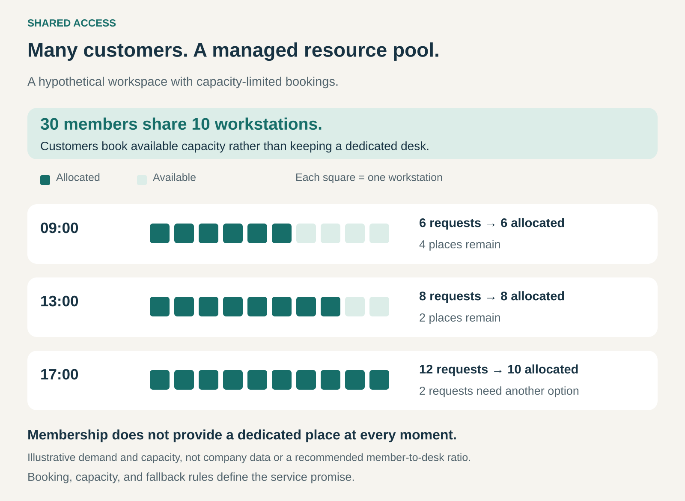

## What it is for

Let multiple customers use a managed pool of resources instead of reserving an entire resource permanently for each customer. Shared Access helps businesses make capacity more useful while giving customers access without the cost of dedicated provision.

A professional needs a workspace a few days a week. A rider needs a bicycle for a short journey. A business needs computing capacity without operating its own physical servers.

Their needs vary over time. Giving each customer a permanently dedicated resource can leave substantial capacity unused.

Shared Access organizes those needs around a common pool, with rules determining who can use what, when, and under which conditions.

## The core idea

Serve several customers from resources that can be allocated among them.

The customer obtains access under agreed conditions. The arrangement does not require an ownership stake in the underlying assets.

Sharing can happen in two ways:

- **Sequentially:** different customers use the same resource at different times, as with a shared bicycle.
- **Concurrently:** several customers use a facility or portions of its capacity at the same time, as with a coworking space or shared computing infrastructure.

Both can occur within one business. A coworking location serves many people simultaneously, while an individual meeting room moves between separate bookings.

Shared Access describes how resources are organized. Subscription, usage charges, passes, and credits describe possible ways to charge for them.

## How the pool works

In this hypothetical workspace, 30 members share ten workstations through capacity-limited bookings.

When six request a place, four remain available. When eight request one, two remain. When twelve request one simultaneously, ten can be accommodated and two need another option.

Membership therefore differs from having a dedicated desk.

The provider needs a clear response to excess demand: advance reservations, alternative locations, waiting lists, additional capacity, or another agreed arrangement.

The illustration shows why average demand is insufficient. A pool can have spare capacity much of the time and still disappoint customers during its busiest periods.

## Why it works

Pooling can make differences in customer demand economically useful.

One customer needs a resource while another does not. A single pool can meet those changing needs without duplicating every resource for every customer.

The provider also takes on coordination that individuals would otherwise handle themselves: finding availability, allocating capacity, maintaining assets, and restoring resources for further use.

Customers may gain variety and geographical flexibility. Access to a network of locations or vehicles can be more useful than a dedicated resource in one place.

These benefits depend on how well demand matches available capacity. If everyone wants the same resource at the same time, pooling provides less advantage.

The business must therefore manage both utilization and the customer’s practical chance of obtaining useful access.

## Famous examples

### WeWork All Access: workspace through a shared network

WeWork All Access provides access to eligible coworking locations, including hot desks and shared facilities. Customers reserve space through the booking system. Meeting rooms and private offices have separate booking arrangements, including the use of credits. Availability and eligible locations depend on the plan. [WeWork’s All Access offer](https://www.wework.com/solutions/wework-all-access), [WeWork’s booking guidance](https://help.wework.com/s/article/WeWork-All-Access-FAQs?language=en_US).

The customer joins a workspace network rather than acquiring a permanently assigned desk through this particular offer.

The operating task is to provide useful capacity where members need it. Booking rules, local availability, shared amenities, and support all contribute to the experience.

A broad location list is valuable only when suitable space is available at the relevant location and time.

### Citi Bike: bicycles circulating between riders

Citi Bike lets riders unlock a bicycle at one station and return it to an available dock elsewhere in the system. Customers can participate through memberships, day passes, or single rides. [Citi Bike’s explanation of the service](https://citibikenyc.com/how-it-works).

Each bicycle serves different riders over successive journeys.

The resource pool is also distributed geographically. Riders need an available bicycle near their departure point and an available dock near their destination.

This makes the network’s local condition important. A large total fleet does not establish that the right resources are available for a particular journey.

The service combines bicycles with stations, access controls, maintenance, and the coordination needed to keep the system usable.

### Amazon EC2: shared physical computing infrastructure

AWS explains that EC2 instances run on shared-tenancy hardware by default, meaning multiple customer accounts may use the same physical hardware. It also offers dedicated alternatives. [AWS documentation on shared and dedicated tenancy](https://docs.aws.amazon.com/AWSEC2/latest/UserGuide/dedicated-instance.html).

Businesses obtain virtual computing capacity while the underlying physical infrastructure can serve several customers.

The sharing concerns hardware allocation, rather than a jointly used customer account. Customers work with their own instances instead of each acquiring an entire physical server.

This extends the pattern beyond visible assets. Shared Access can operate through technical allocation of capacity as well as reservations and physical handovers.

## The economics

The provider aims to earn enough across the customer base to support the pool and its operation.

Costs include acquiring or leasing resources, maintenance, staffing, infrastructure, allocation systems, and unavailable capacity. Physical services may also require cleaning, collection, or redistribution.

Higher utilization can improve the economics, but pushing utilization too far can reduce reliability. Some spare capacity may be necessary to absorb unpredictable demand, maintenance, and disruptions.

The payment model changes the incentives.

A membership creates recurring income but may attract heavy users. Usage pricing connects revenue more closely to consumption but creates less predictable demand. A combined model can charge for participation while separately charging for scarce or intensive use.

None of these arrangements eliminates capacity limits. The service promise must match what the provider can deliver.

## Useful when

This pattern is especially useful when:

- **Customer needs vary:** people require resources at different times, places, or intensities.
- **Resources can serve successive or concurrent users:** sharing does not prevent the intended use.
- **Dedicated provision would leave capacity idle:** pooling can reduce unnecessary duplication.
- **Allocation is manageable:** bookings, queues, or technical controls can coordinate demand.
- **The provider can maintain dependable service:** availability, condition, and support remain acceptable.

Dedicated provision can be preferable when customers need constant availability, extensive customization, strict separation, or control over a particular asset.

## Common mistakes and limits

**Selling access without defining availability.** Customers need to understand whether access requires a reservation, depends on remaining capacity, or includes a stronger guarantee.

**Planning around averages alone.** Demand can concentrate at particular hours, locations, or resource types. Aggregate spare capacity may conceal a local shortage.

**Counting all resources as interchangeable.** A desk elsewhere, an unsuitable bicycle, or the wrong equipment specification may not meet the customer’s need.

**Ignoring restoration between users.** Cleaning, inspection, charging, repairs, and setup affect how much capacity is actually available.

**Allowing users to block scarce capacity.** Unused reservations and excessively long bookings can reduce access for others. Cancellation rules, booking limits, and release mechanisms help address this.

**Letting shared use degrade the experience.** Noise, privacy, wear, and competing demands need appropriate boundaries. Resource utilization is only one measure of service quality.

**Confusing access with ownership.** A membership or booking normally provides contractual rights to use resources. Any ownership interest requires a separate structure.

## Related patterns

- [[access-over-ownership|Access over Ownership:]] the broader pattern; Shared Access specifically organizes provision around resources serving multiple customers.
- [[rent-instead-of-buy|Rent instead of Buy:]] defines a temporary-use transaction. A rental service can use a shared pool to supply successive customers.
- [[fractional-ownership|Fractional Ownership:]] adds an ownership interest. Fractional owners may also use a managed pool, but shared access alone does not establish ownership.
- [[pay-per-use|Pay per Use:]] can charge for the capacity consumed, while Shared Access determines how that capacity is organized and allocated.
