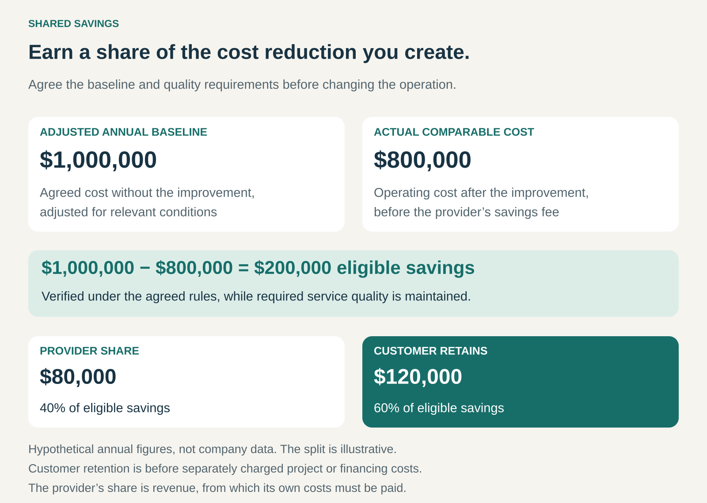

## What it is for

A specialist can reduce your energy bill, purchasing costs, or operating expenses. The opportunity looks promising, but you hesitate to pay for advice before knowing whether the savings will materialize.

Shared Savings connects the provider’s compensation to the cost reduction achieved. The customer keeps part of the agreed savings, and the provider receives another part as payment.

The proposition is: **if we help you spend less, we share the benefit.**

This pattern is useful when the provider has expertise the customer lacks, the improvement can be measured, and uncertainty about results makes a conventional fee difficult to justify.

## The core idea

Make an agreed share of verified savings the basis of compensation.

The provider might improve equipment, renegotiate supplier terms, remove waste, or change how an operation works. Its payment depends on the difference between an agreed baseline and the comparable cost after the intervention.

In a simple arrangement:

**Provider payment = eligible savings × agreed sharing percentage.**

The word _eligible_ matters. A lower bill does not automatically establish that the provider created savings. Spending might fall because production declined, prices changed, or the customer stopped receiving part of the service.

The parties therefore agree how savings will be calculated, which improvements count, and how long the sharing arrangement lasts.

Shared Savings can operate as a pure success fee or alongside fixed fees and other charges. Provider financing is possible, particularly in energy projects, but it is not a requirement of the broader pattern. [IEA: energy-service contract models](https://www.iea.org/reports/energy-service-companies-escos-2/esco-contracts)

## How it works

The arrangement begins with a credible baseline: an estimate of what the relevant operation would have cost without the improvement.

That baseline may need adjustments for production volume, weather, occupancy, input prices, or other conditions. The purpose is to compare equivalent circumstances.

The provider implements the improvement. The parties then measure performance, apply the agreed adjustments, and determine the savings available for sharing.

For example, suppose an operation’s adjusted annual baseline is **$1 million**. After the intervention, comparable operating costs are **$800,000**, producing **$200,000 in eligible savings**.

With an illustrative 40% provider share:

- The provider receives **$80,000**.
- The customer retains **$120,000**.
- The customer’s operating costs plus the provider’s fee total **$880,000**.

Any separately charged implementation, financing, or verification costs must also enter the customer’s financial assessment.

Quality requirements belong alongside the savings calculation. Reducing expenditure by delivering less than the customer needs should not qualify as successful improvement.

## Why it works

Shared Savings can reduce the customer’s concern about paying for an uncertain result. It gives the provider a commercial reason to turn recommendations into implemented, measurable improvements.

It also allows expertise to earn more than an hourly rate might suggest. A specialist who identifies a valuable change quickly can receive substantial compensation because the payment reflects savings rather than time spent.

Where the provider arranges financing, the model can help implement improvements that compete unsuccessfully for the customer’s capital budget.

The incentives become more closely aligned, but they do not become identical. The provider may prefer the largest measurable saving, while the customer also cares about flexibility, resilience, employee workload, and long-term quality. Those requirements need to be part of the arrangement.

## Famous examples

### General Motors: funding energy improvements through savings

In a case published in 2015 through the US Department of Energy’s Better Buildings programme, General Motors described using shared-savings energy performance contracts. Energy-service companies financed projects and received a pre-agreed share of the resulting energy-cost savings for a defined period.

The projects included lighting and controls upgrades. GM’s account emphasized that the arrangement expanded conservation investment beyond what its own funding could support. It also described the internal legal, purchasing, engineering, and financing work needed to make the model practical. [General Motors energy-performance contracting case](https://betterbuildingssolutioncenter.energy.gov/implementation-models/general-motors-funds-energy-conservation-projects-through-energy-performance)

The lesson is that an attractive savings opportunity still needs an implementation structure. Financing, production constraints, and internal approvals can determine whether the improvement happens.

### Medicare: sharing savings while requiring quality

The US Medicare Shared Savings Program allows participating Accountable Care Organizations—groups of healthcare providers—to share in eligible savings when spending performance meets programme requirements and quality standards are satisfied.

Financial performance is assessed against a defined benchmark. Depending on the participation option, organizations may also take responsibility for a share of losses. [CMS: Shared Savings Program](https://www.cms.gov/medicare/payment/fee-for-service-providers/shared-savings-program-ssp-acos), [CMS programme guidance](https://www.cms.gov/medicare/payment/fee-for-service-providers/shared-savings-program-ssp-acos/guidance-regulations)

This is more complex than splitting the difference between two annual bills. The benchmark, patient population, quality requirements, and reconciliation rules determine eligibility.

The transferable lesson is that lower expenditure must be evaluated alongside the service being delivered. In sensitive settings, quality requirements are central to the payment mechanism.

### ERA Group: earning from procurement savings

ERA Group, formerly Expense Reduction Analysts, uses a success-fee model for cost optimization. Its specialists work across expense categories such as freight, packaging, telecommunications, and facilities services.

ERA describes its remuneration as a share of achieved savings, with no savings-based fee when savings are not produced. Its franchise information describes a typical arrangement of 50% of savings in the relevant category over 36 months; this is its stated typical model, rather than a universal industry rate. [ERA Group’s model](https://franchise.eragroup.com/how-it-works)

The mechanism makes specialist purchasing knowledge commercially valuable without requiring the customer to buy consulting hours.

It also explains why implementation and follow-through matter. A proposed supplier discount creates little value until the customer actually receives the agreed goods or services at the improved cost.

## The economics

The sharing percentage is only one part of the deal.

A provider may accept a smaller percentage when savings are predictable, implementation is inexpensive, and payment arrives quickly. A larger share may be needed when it funds equipment, carries substantial delivery risk, or waits years to recover its investment.

Its share is revenue, from which it must pay its own costs.

For the customer, the relevant result is the benefit remaining after provider compensation and all additional project costs. A large reported saving can become much smaller once financing, transition work, new maintenance obligations, and measurement expenses are included.

Duration matters too. A modest percentage collected for many years can cost more than a larger percentage collected briefly.

A fixed repayment funded from savings is not automatically Shared Savings. The defining feature is that compensation depends on an agreed share of the savings, rather than simply being affordable because savings are expected.

## Useful when

- There is a substantial, identifiable opportunity to reduce costs.
- The provider can materially influence implementation and results.
- Both parties have access to reliable operating and financial data.
- Savings can be separated reasonably from unrelated changes.
- Required quality and service levels can be protected.
- The opportunity is large enough to justify measurement and administration.
- The provider can carry the cost and delay before payment.

## Common mistakes and limits

**Using an inflated baseline.** An unrealistic starting point can generate impressive savings on paper. The baseline and adjustment rules should be agreed before results are known.

**Confusing a smaller operation with greater efficiency.** Lower spending caused by fewer customers, reduced output, or shorter opening hours needs appropriate treatment.

**Treating released time as cash savings.** Saving employee hours can create useful capacity without reducing payroll. Capacity gains, avoided future costs, and actual expenditure reductions should be distinguished.

**Rewarding short-term cuts that create later costs.** Deferred maintenance, weaker suppliers, or reduced service can make the measured period look better while harming the business.

**Paying twice for the same improvement.** Overlapping internal initiatives and multiple providers can create competing claims. Attribution and existing projects need clear treatment.

**Assuming the customer carries no risk.** Success-based fees can reduce fee risk while leaving implementation disruption, financing obligations, or service consequences elsewhere in the arrangement.

## Related patterns

[[outcome-based-pricing|Outcome-Based Pricing]] is the broader approach of linking payment to results. Shared Savings specifies a particular result and payment basis: an agreed share of reduced costs.

[[product-as-a-service|Product as a Service]] can combine equipment, financing, and continuing operation. Shared Savings can provide its compensation mechanism, although either pattern can exist independently.

[[guaranteed-availability|Guaranteed Availability]] protects dependable access to a function. It can provide a service requirement that prevents savings from being achieved through unacceptable downtime.

[[time-and-materials|Time and Materials]] pays for resources consumed. Shared Savings instead links compensation to the agreed financial improvement, placing greater importance on baselines, measurement, and attribution.
