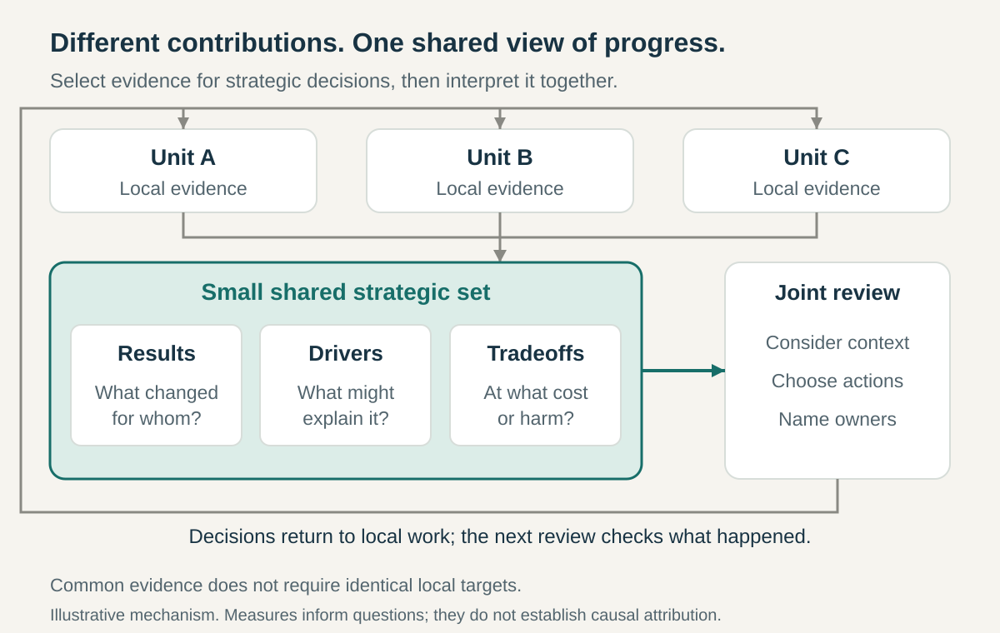

**Core question:** How can separate units judge strategic progress together without reducing success to disconnected local targets or one misleading number?

## What it is for

Imagine a hypothetical equipment-repair business. Dispatch celebrates completed visits, the warehouse reports cheap inventory, and the contact centre answers calls quickly. Customers still need repeat repairs because technicians arrive without the right parts. Each department can defend its numbers while the service disappoints.

Shared Strategic Measures gives these units a common basis for judging whether their combined work supports the strategy. It applies across departments, business units, partner networks, or an entire organization. Local operating measures remain useful, but a selected set brings the wider result into decisions about priorities and resources.

## The core idea

**Choose a few measures that express the strategy’s intended results, important drivers, and tradeoffs, then interpret them together before changing the work.**

A measure describes something observed. A target states an ambition for that measure. An action is a proposed response. Keeping these separate prevents “improve the score” from becoming the strategy.

The shared set might combine customer results, operating performance, capability, and cost. Its composition should follow the actual strategic choices, rather than a mandatory dashboard template. Some measures reveal results late; others provide earlier signals whose connection to those results still needs testing.

Shared Outcomes establishes what units want to achieve together. This pattern establishes the evidence they will use to judge progress. Shared Metric Definitions makes calculations consistent. Here, the central problem is selecting and interpreting the right evidence across organizational boundaries.

## How it works

**Start with strategic decisions.** Ask what leadership and contributing units need to decide together. In the repair business, the choice might concern investing in spare parts, technician training, or additional visits. Select measures that help evaluate those choices. Remove measures that nobody can connect to a consequential decision.

**Build a balanced set.** Alongside successful repairs, consider repeat failures, total service cost, and customers left waiting. Check whether an apparent improvement could conceal harm elsewhere. A faster average repair can coexist with neglected difficult cases. Include useful breakdowns instead of relying entirely on one organization-wide average.

**Assign different responsibilities.** Name someone accountable for the shared review, a steward for each measure’s quality, and unit leaders responsible for explaining their contributions. The steward maintains evidence; they do not automatically gain authority over everyone’s work. Identify who can resolve competing priorities or move resources between units.

**Agree enough meaning to compare.** Specify what counts, whose experience is included, the period covered, and known gaps. Use consistent definitions where comparisons require them. Show missing or unreliable data explicitly. Units can retain additional local measures and different targets when their circumstances differ; shared evidence need not mean identical quotas.

**Review the set together.** At a cadence suited to the decisions, examine trends, differences between groups, customer observations, and external conditions. Ask what changed and what competing explanations remain. A worsening result may reflect demand or case complexity rather than weaker execution. An improved process measure may not yet have improved the outcome.

**Turn interpretation into accountable action.** Decide which contribution changes, who owns it, and when to revisit the evidence. Within delegated authority, units choose their methods. Cross-unit resource conflicts go to the authorized leader or forum. Record disputed interpretations and temporary exceptions rather than quietly changing definitions to make results look better.

## Why it works

A common set can make dependencies visible. Dispatch and the warehouse can discuss repeat visits and total repair cost together, instead of defending separate activity counts. Different expertise then informs the same decision.

Measures also make a strategic hypothesis discussable: will better parts availability reduce repeat repairs enough to justify the inventory? Tracking both helps teams investigate that proposition. Their movement together does not establish causation.

The benefits depend on credible data, permission to discuss unwelcome findings, and authority to act. Without those conditions, the dashboard can become a reporting ceremony. Numbers also need observation and conversation: a declining satisfaction score identifies a question, not its answer.

## Examples

### Mobil’s scorecards in the 1990s

Kaplan and Norton’s account of Mobil’s North American marketing and refining business describes shared-service leaders joining strategic discussions, with the scorecard connected to planning and budgeting. In a reported first-quarter 1995 review, leadership considered improved customer-segment market share, lower refinery expenses, and employee satisfaction alongside disappointing financial results attributed to unusually warm weather. Annual meetings subsequently brought business and shared-service managers together around objectives, measures, and targets. [Kaplan and Norton, _The Strategy-Focused Organization_, excerpt published in 2000](https://www.library.hbs.edu/working-knowledge/the-strategy-focused-organization)

Their separate account describes measures for the buying experience and targeted customers, including mystery-shopper scores and dealer profitability. Independent dealers mattered because they delivered the customer experience. [Kaplan and Norton, _Partnering and the Balanced Scorecard_](https://www.library.hbs.edu/working-knowledge/partnering-and-the-balanced-scorecard)

Together, these accounts illustrate evidence spanning organizational boundaries and a review that considered context. They are the framework authors’ interpretation of historical arrangements, not independent proof that scorecards caused Mobil’s performance or evidence of present practice.

### GDS’s common service measures in 2013

In March 2013, the UK Government Digital Service described four measures for new and redesigned services: digital take-up, cost per transaction, user satisfaction, and completion rate. These addressed its aims for channel adoption, cost, and experience. Service managers could add measures for their particular needs; GDS planned to work with exemplar teams on goals and milestones and publish performance data. [Clifford Sheppard, _Beating performance anxiety_, 2013](https://gds.blog.gov.uk/2013/03/28/beating-performance-anxiety/)

The arrangement offered separate services a common reference without making every local question identical. In his reply to comments, Sheppard explicitly distinguished service-performance measurement from broader public-value measurement and explained why speed would not suit every service.

That boundary matters: a common set can support comparisons while leaving important strategic questions unanswered. This account documents the framework and intended reporting at that time, not a current requirement or demonstrated improvement in public outcomes.

## Useful when

- **Departments report success while the overall result stalls.** Their local numbers conceal dependencies or transferred costs.
- **Strategy reviews drown in unrelated indicators.** Leaders need evidence connected to a few consequential choices.
- **Units disagree about progress.** Different evidence supports incompatible interpretations of the same strategy.
- **One dominant target hides damage elsewhere.** Cost, access, quality, or future capability needs visibility alongside the headline result.

## Common mistakes and limits

**Collecting everything.** Keep the strategic set small enough to discuss. Detailed operating measures belong close to the work.

**Making one score decisive.** A composite ranking can conceal conflicting movements and encourage convenient tradeoffs. Preserve the underlying evidence.

**Rewarding numbers before understanding behavior.** Strong incentives can encourage excluding difficult cases or shifting costs. Investigate how the measure could be improved without improving the result.

**Confusing comparison with attribution.** Differences in demand, population, or resources can make identical targets unfair or misleading. Shared responsibility still needs identifiable contributions.

**Keeping obsolete measures.** Review whether the set still represents the strategy. Change definitions openly and preserve the meaning of historical comparisons.

Where outcomes emerge slowly or resist reliable quantification, combine indicators with qualitative evidence and explicit judgment. Measures cannot settle a disagreement about whose interests the strategy should serve.

## Related patterns

- [[shared-outcomes|Shared Outcomes]] establishes the result and contributions that the shared evidence should illuminate.
- [[data-shared-metric-definitions|Shared Metric Definitions]] supplies consistent meanings and calculations when units compare or combine evidence.
- [[hoshin-kanri|Hoshin Kanri]] connects strategic priorities with commitments and recurring reviews; shared measures provide evidence for that cycle.
