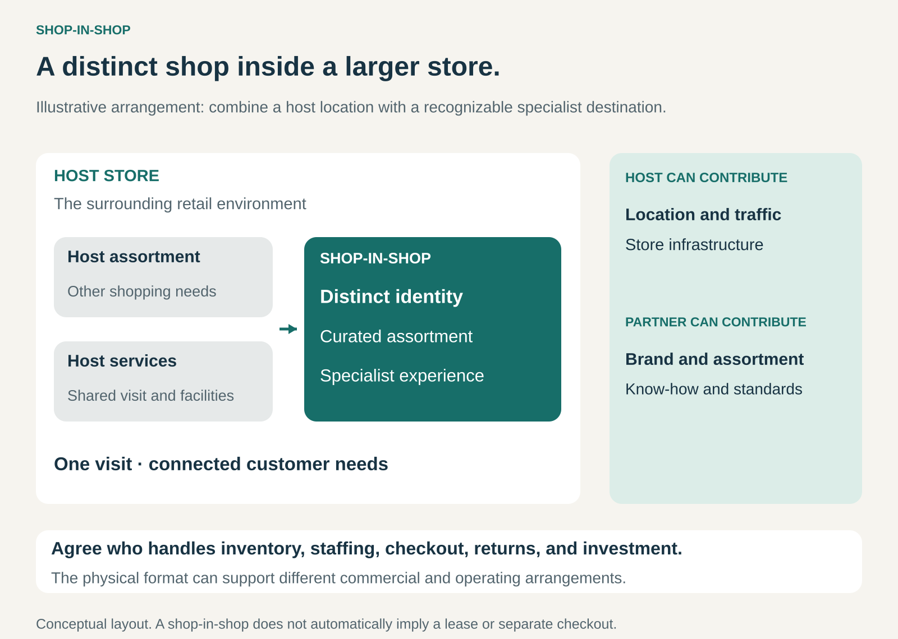

## What it is for

A specialist brand wants a physical presence where customers already shop. A larger retailer wants a stronger offer in a particular category, with recognizable branding, better presentation, or specialist advice.

Shop-in-Shop brings those interests together by creating a distinct retail destination inside a host store.

It is useful when the host’s location and customer traffic complement another brand’s assortment or expertise—and both can benefit from sharing the retail environment.

## The core idea

**Place a recognizable shop within another store, combining the host’s reach with a distinct retail experience.**

The embedded shop might have its own fixtures, signage, product selection, demonstrations, advisers, or service standards. Customers recognize it as a destination within the larger store.

It can represent a manufacturer, a specialist retailer, or a service provider. It may sell products customers take away immediately or help them plan and order something delivered later.

The operating arrangement varies. The host may run the shop, the partner may operate it, or both may divide responsibilities.

Shop-in-Shop therefore describes the retail format. It does not automatically mean that the partner leases the space, owns the inventory, employs the staff, or runs a separate checkout.

The defining feature is a distinct shopping identity and experience within the host environment. Branded merchandise on an ordinary shelf provides a more limited form of presence.

## How it works

The pattern combines several decisions.

**Find a useful customer overlap.** The embedded offer should make sense within the host’s shopping missions. Kitchen planning and appliances are closely connected; beauty products can complement an apparel visit.

**Create a recognizable destination.** Layout, fixtures, assortment, and service give customers a reason to notice and enter the space. The format needs enough distinction to communicate what it offers while remaining accessible from the surrounding store.

**Allocate operating responsibilities.** The parties establish who buys stock, sets prices, employs and trains staff, maintains displays, processes payments, and handles returns.

**Connect the customer journey.** Customers need to understand where to pay, which benefits apply, and where to seek help. A distinct identity should not create uncertainty about the practical steps of purchasing.

**Agree how value is shared.** Arrangements can involve wholesale margins, rent, revenue shares, operating-profit shares, or combinations of payments and responsibilities.

The shop can borrow aspects of the host’s infrastructure while retaining a specialist identity. Which resources are shared depends on the arrangement.

## Why it works

Shop-in-Shop can reduce the effort required to establish a retail presence.

The partner gains access to an existing location and customer flow. It may also share infrastructure that would otherwise need to be established separately.

The host gains a more compelling category offer. A specialist’s reputation, assortment, and service can make part of the store more attractive or help customers complete a broader purchasing task.

Customers can combine related needs in one visit. They might explore a kitchen design and compare appliances, or purchase clothing and receive advice about beauty products.

The benefit depends on fit. Passing traffic only becomes commercially useful when those visitors have a reason to engage with the embedded shop. Likewise, a recognizable partner creates value for the host only if its contribution justifies the space and resources it occupies.

## Famous examples

### Sephora at Kohl’s: a specialist beauty destination within a department store

Sephora at Kohl’s brings a defined beauty assortment, branded presentation, testing areas, and Sephora-trained advisers into Kohl’s stores. [Kohl’s description of the format](https://corporate.kohls.com/news/kohls-announces-locations-of-250-new-sephora-at-kohls-opening-this-year)

Its financial structure demonstrates why the format should be separated from assumptions about leasing.

Kohl’s fiscal 2025 report states that Kohl’s owns and manages the inventory, funds capital expenditure, and acts as the principal on customer sales. The parties share the arrangement’s operating profit equally, incorporating the expenses of running it. [Kohl’s fiscal 2025 annual report](https://www.sec.gov/Archives/edgar/data/885639/000119312526115982/kss-20260131.htm)

Kohl’s therefore participates as an operator and retailer. The Sephora identity sits within a jointly structured commercial arrangement.

### Apple at Target: a branded experience supported by trained host staff

Target’s Apple shop-in-shop format combines dedicated space and presentation with an assortment of Apple products and accessories.

In its 2022 expansion announcement, Target described Apple-trained Target Tech Consultants and an enlarged Apple footprint within participating stores. [Target’s Apple shop-in-shop announcement](https://corporate.target.com/press/release/2022/10/target-and-apple-deepen-collaboration-with-more-sh)

The example shows how a shop can have a clear partner identity while using staff associated with the host’s retail operation.

Its purpose extends beyond allocating more shelf space. Presentation and product expertise help establish a recognizable destination within the electronics offer.

### IKEA at Best Buy: planning and ordering within a complementary retailer

IKEA and Best Buy introduced planning spaces in selected stores in Texas and Florida. Customers can explore kitchen and laundry settings, work with IKEA staff on planning, and receive appliance expertise from Best Buy staff. [Best Buy’s IKEA partnership announcement](https://corporate.bestbuy.com/2025/best-buy-ikea-partner/)

The small format centres on inspiration, planning, and ordering. It creates a physical encounter with IKEA’s offer within a visit to another retailer.

The complementary roles are particularly clear: furniture and room planning connect with appliances and technology. IKEA’s current location page describes the format as plan-and-order points within selected Best Buy locations. [IKEA in Best Buy](https://www.ikea.com/us/en/stores/ikea-in-best-buy/)

## The economics

The economics depend on who operates the shop and how the parties divide revenue, costs, and risk.

Under a hypothetical partner-operated arrangement, an embedded shop might generate $100,000 in monthly sales and incur:

- $60,000 in merchandise costs.
- $20,000 in staffing and other local operating costs.
- A $10,000 payment to the host.

That leaves $10,000 before central overhead and recovery of the initial fit-out investment.

The host’s $10,000 receipt must be assessed against its additional costs and the contribution that another use of the space could have generated.

These figures illustrate one arrangement. A host-operated format with wholesale purchasing or shared operating profit has different economics.

Fixed payments give the host more predictable receipts while placing more sales risk on the operator. Revenue sharing links payments to sales. Profit sharing also depends on which costs enter the calculation.

The comparison should include changes elsewhere in the store. Sales transferred from an existing department are different from additional customer spending.

## Useful when

- **The host attracts relevant customers.** Its visitors have plausible reasons to buy the embedded offer.
- **A specialist identity improves the category.** Branding, advice, demonstrations, or assortment add value.
- **A full standalone store is unnecessary or difficult to justify.** A smaller presence can serve the customer’s task.
- **The offers complement one another.** Customers benefit from addressing related needs in one visit.
- **Operating responsibilities can be clearly divided.** Both parties can maintain the intended experience.

## Common mistakes and limits

**Assuming the host provides free demand.** Visibility and traffic help, but customers still need a compelling reason to engage.

**Counting all embedded-shop sales as additional revenue.** Some purchases may move from another department, location, or channel.

**Ignoring the alternative use of the floor space.** A busy shop may still underperform what the host could earn from another assortment.

**Making the identity stronger than the service.** Distinctive fixtures create expectations. Poor stock availability or inadequate advice can undermine both brands.

**Leaving customer responsibilities unclear.** Checkout, discounts, loyalty benefits, returns, and warranties need understandable rules.

**Assuming every format uses the same contract.** Inventory ownership, staffing, investment, and payments vary substantially.

**Neglecting the exit.** Partners need a workable way to handle remaining inventory, fixtures, staff responsibilities, and customer commitments when the arrangement ends.

## Related patterns

[[one-stop-shop|One-Stop Shop]] brings several customer needs into one destination. Shop-in-Shop can preserve specialist identities within that broader offer.

[[omnichannel|Omnichannel]] connects the embedded shop with online discovery, ordering, collection, and service.

[[consignment|Consignment]] can determine inventory ownership and payment timing within a shop-in-shop, although other inventory arrangements are equally possible.

[[franchising|Franchising]] provides a contractual system for operating under another brand. It can combine with Shop-in-Shop but addresses a different part of the business model.
