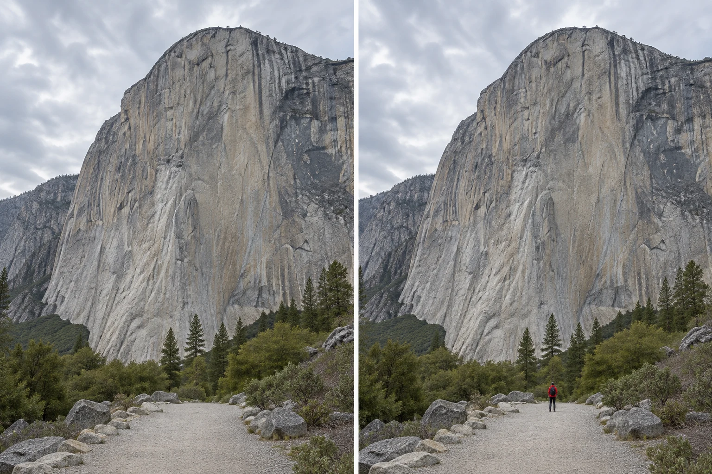

The cliff seemed enormous when you stood beneath it. In the photograph it resembles a patch
of interesting rock. The frame contains no people, trees, buildings, or other clues to size.
A crack that could be a meter wide might equally be a few centimeters across. You brought
back the surface but lost the feeling of standing beside it.

Include a familiar reference when size matters to the photograph. A person, doorway, boat,
or recognizable tree can help the viewer estimate the extent of an unfamiliar landscape or
structure. Keep that reference visible and make its spatial relationship to the larger subject
plausible. The goal is a readable comparison, not simply adding something small to the frame.

## Give the viewer a ruler they recognize

A useful mental model is an informal ruler. Viewers know approximately how large an adult,
a car, or a house door is. When that object sits beside something unfamiliar, it gives them
a starting point. They do not need to calculate a dimension. The reference makes “large”
feel more concrete than the rock texture alone.

The comparison works best when relative distance is understandable. A person on the same path
at the base of a cliff is informative. A person very close to the camera with a distant
mountain behind them is a different kind of image: relative image size mostly describes the
different distances from the camera. It does not mean the mountain is small. Position and
perspective are explained in [[photography-foundations|Photography Foundations]].

This is related to [[find-a-relationship|Find a Relationship]], but the particular relationship
here is size or distance. The reference may remain secondary. If the picture becomes primarily
a portrait with an attractive background, that is a change in intention rather than a failed
version of the same photograph.

## A person beneath a structure

Imagine photographing a large station roof. From one position, a commuter merges with a dark
pillar and contributes little information. Moving a step sideways places the person against a
light wall and reveals their whole outline. Now the arch above them becomes visibly immense.
You have changed the legibility of the reference without needing to magnify it.

There is a balance to find. Make the person too large in the frame and the roof may feel
like a setting for them. Make them too small and they become an unrecognizable speck on a
phone screen. The roof can still dominate while the figure remains identifiable as a person.
[[separate-subject-and-background|Separate Subject and Background]] helps preserve that distinction.
Check the final image at its likely viewing size rather than relying on the live view.

Never ask someone to stand near an edge, enter a restricted area, or remain in a dangerous
place to improve the photograph. Choose a safe existing reference, or accept a different image.
With strangers, avoid making their identity unnecessarily prominent when only an anonymous
size cue is needed, and respect their preferences about being photographed.

## Show distance through repetition

A row of boats can communicate the reach of a harbor. The nearest boats are recognizable;
the smaller ones toward the far bank suggest distance. Keep enough water between them that
their separation remains clear. A tight crop of the far bank may remove the comparison that
made the space understandable.

Repeated streetlights, fence posts, or windows can work similarly, especially when their
sizes are roughly consistent in the world. They suggest recession into space. But repetition
is not a guarantee of accurate dimensions: unusually large windows or decorative miniature
buildings can mislead. A photograph offers cues rather than a scale drawing. When dimensions
matter as evidence, include an actual measuring reference and describe the setup.

[[build-layers|Build Layers]] develops the related use of near and far elements to communicate
depth. Scale may be one consequence of layering, but a layered photograph can also concern
relationships or atmosphere without emphasizing size at all.

## Small objects need scale too

A close photograph of a tiny mushroom may make it appear like a full-sized umbrella. Including
a pine needle or a fingertip nearby can reveal its size. Choose a reference your audience
will recognize, and avoid placing it closer to the lens than the mushroom if that would create
a false comparison. A coin is useful only when viewers know its dimensions; a ruler is clearer
for records of specimens or objects.

The tradeoff is visual attention. A bright coin may become more conspicuous than the mushroom.
A hand may introduce a human story that is welcome in one picture and distracting in another.
If the intention is an abstract study of texture, removing scale cues can be exactly right.
Ambiguity can let a small object resemble a landscape. Size only needs explaining when it
serves the photograph's purpose.

## Make room for wonder without exaggeration

This pattern helps with landscapes, architecture, travel, close objects, and any scene whose
impression depends on extent. Phones often include a wide view, but a wide view by itself
does not communicate grandeur. Empty space without a reference may simply remain unmeasurable.
Changing camera position can alter how large a reference appears relative to its surroundings;
zooming from one fixed position mainly changes what fits in the frame.

Avoid claiming exact height from appearance, or presenting a generated person as proof that
a real place has a particular size. In an illustrative photograph the comparison teaches the
idea; in documentation the reference must actually have been there. Let the viewer see enough
of the relationship to understand your choice. The most useful scale cue often occupies little
space while changing how almost everything else in the frame is understood.
