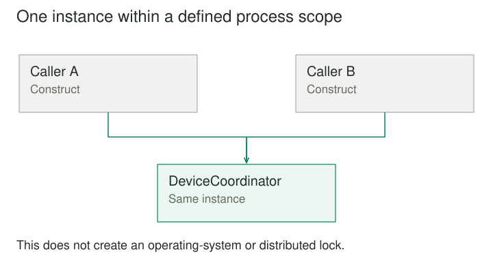

## Purpose and problem

A service should have one coordinator for a local hardware device. Somebody makes the coordinator globally accessible and prevents its class from being instantiated twice. The immediate problem seems solved. Later, tests cannot create isolated coordinators, configuration depends on whichever caller touches it first, and a second worker process opens its own instance anyway.

## Core idea

Singleton combines two ideas: controlling instance count and providing shared access. Both can be useful, but they create different consequences. The first concerns ownership and lifecycle. The second concerns how dependencies are discovered. Treating them as inseparable often turns a narrow coordination requirement into widespread global coupling.



## How it works

In the canonical form, a class controls its own instantiation and exposes an access operation that returns its unique instance. Depending on the language, implementation might use restricted constructors, static state, or another mechanism that enforces the rule.

The phrase one instance is incomplete without a scope. It might mean one per process, runtime, application context, or tenant. A process-level singleton does not establish uniqueness across multiple servers. Separate workers can each have exactly one instance and still compete for the same external resource.

The underlying system may instead need an operating-system lock, a dedicated owner process, or coordination provided by the external service. Singleton is an object-creation pattern; it is not distributed leadership or a global locking algorithm.

## Worked example

### A device owner with an honest boundary

Imagine a desktop application controlling a scanner. The scanner API permits one active session in the process. A ScannerCoordinator owns that session, serializes requests, and closes the connection during shutdown. Enforcing one coordinator can prevent accidental duplicate ownership.

However, most components do not need to obtain it through a global accessor. The application can create the coordinator once at startup and pass its interface to the scanning screens and background job manager. That supplies one shared instance without making the class itself globally discoverable.

If class-level enforcement is genuinely needed, the same explicit injection can still be used for callers. The uniqueness policy and dependency-access policy do not have to spread together. Tests can depend on a scanner interface and supply a fake that does not claim ownership of real hardware.

Initialization must also be deliberate. If the singleton opens the scanner on first access, the first screen that uses it unexpectedly becomes responsible for connection latency and failure. Startup initialization may give the application a clearer place to report errors and control configuration.

### A small implementation

This deliberately narrow Singleton controls construction of one coordinator object per Python class in one process. It does not acquire a hardware lock or establish uniqueness across processes. The lock guards creation only.

```python
from threading import Lock


class DeviceCoordinator:
    _instance = None
    _creation_lock = Lock()

    def __new__(cls):
        with cls._creation_lock:
            if cls._instance is None:
                cls._instance = super().__new__(cls)
            return cls._instance

    def identify(self):
        return "local device coordinator"


first = DeviceCoordinator()
second = DeviceCoordinator()
print(first is second)
# True
```

Two construction calls return the same object in this process. There is no mutable initialization step to rerun here. If operations mutate device state, they need their own coordination policy; the construction lock does not protect them. When callers merely need one shared service, constructing it once and passing it explicitly often gives a clearer lifetime.

### The configuration object that became a trap

A web application puts configuration in a global Configuration singleton. Handlers call Configuration.instance wherever they need a setting. At first this avoids passing parameters. Over time, tests change global values, requests need tenant-specific options, and background jobs observe configuration from a previous test.

The original requirement was not that only one configuration object could exist. It was that production components should receive a consistent configuration for a particular application context. An immutable configuration value created at startup and injected into those components expresses that requirement more accurately.

Multiple application instances can then coexist in one process during testing. Each receives its own configuration. Tenant-specific settings can be separate values rather than mutations of a universal object. This is a case where removing Singleton solves a mismatch between the chosen scope and the actual domain.

## When to use it

- A resource genuinely requires one coordinated owner within a process.
- A class must enforce a single-instance lifecycle rather than merely happen to be shared.

Consider a simpler design when the only motivation is convenient global access, or when multiple test or tenant contexts need independent instances, or when the actual uniqueness requirement spans processes.

## Tradeoffs and common mistakes

Even a correctly implemented single-instance accessor does not make the object thread-safe. Two callers may still mutate its internal data concurrently. Instance construction and ongoing operation are separate synchronization concerns.

Lazy initialization can introduce races, reentrancy, and partially initialized state unless the language or implementation handles them correctly. Eager initialization can avoid some problems but still needs a lifecycle policy for failures and shutdown. An apparently simple access method can conceal substantial responsibility.

Hidden dependencies are another cost. A class that takes only a document argument but secretly reads a global service is harder to reason about and test. Its public signature no longer tells the reader what it needs. Shared mutable singletons can also make failures depend on execution order.

## Related patterns

Singleton can fit a resource owner whose uniqueness is a real invariant within a known scope. It can also be imposed by an existing framework or platform boundary. The critical question is whether preventing another instance protects correctness, or merely makes access convenient.

Dependency injection often gives an application a single shared service while preserving explicit dependencies and permitting isolated tests. That design does not require canonical Singleton machinery. If a global stateless utility function is all that is needed, an object with a controlled instance count may add no useful meaning.

[[facade|Facade]] can present a small interface to a coordinated subsystem without controlling the facade's instance count. [[abstract-factory|Abstract Factory]] can create services for a particular application context. [[proxy|Proxy]] can mediate access to a resource while leaving ownership elsewhere.

## Sources

Singleton is one of the 23 patterns in Gamma, Helm, Johnson, and Vlissides, [*Design Patterns: Elements of Reusable Object-Oriented Software*](https://www.informit.com/store/design-patterns-elements-of-reusable-object-oriented-9780201633610). The examples, code, and illustrations here are original educational explanations.
