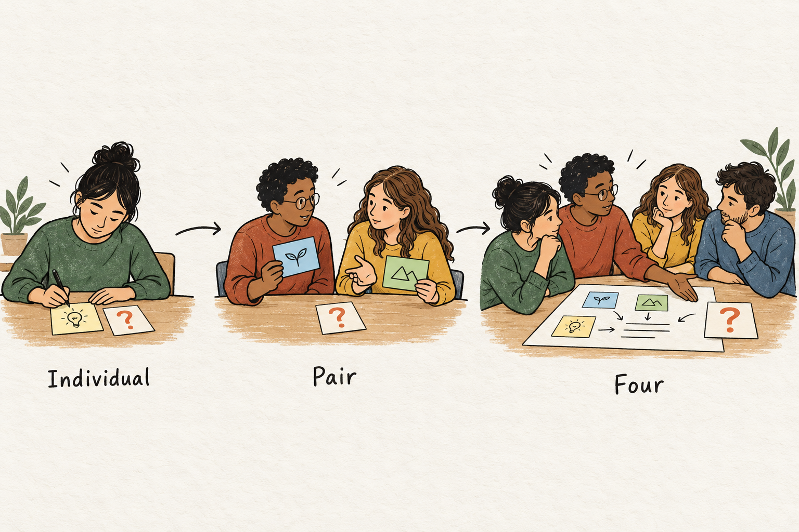

## Let ideas grow without smoothing away disagreement

A group spokesperson announces, “We all agreed that this was the best explanation.”

One learner looks surprised. She had raised an objection, but the conversation moved on before anyone examined it. Another learner preferred a different explanation but stopped arguing when the others seemed ready to finish.

The group has produced a clear response. Some of its thinking has disappeared.

Snowball Groups give ideas a staged journey from individual reflection into progressively larger conversations. Learners first work alone, then in pairs, then in groups of four, sometimes continuing into larger groups before a whole-class discussion. Each stage should develop the thinking carried forward—including disagreements that remain important.

## Grow the group and develop the task

Also called *pyramiding*, snowballing uses an expanding group structure to organize discussion.

Individuals begin by developing a response to a shared question. Pairs compare their responses and examine the reasons behind them. Two pairs then join, bringing ideas that have already received some scrutiny. The larger group develops a response for the class.

The task should evolve as the group grows. Individuals might generate explanations; pairs compare supporting evidence; groups of four evaluate the strongest alternatives and identify an unresolved question.

[The University of Waterloo’s guidance](https://uwaterloo.ca/centre-for-teaching-excellence/catalogs/tip-sheets/group-work-classroom-types-small-groups) recommends increasingly complex tasks across these stages and warns that nuances can disappear as discussions expand.

Doubling the group is the visible structure. Developing the intellectual task gives that structure its purpose.

## Why the stages matter

Beginning alone gives each learner an opportunity to establish a position before encountering someone else’s. The pair conversation creates space to explain that position and hear a response. Joining another pair introduces additional ideas without immediately requiring everyone to negotiate a whole-class discussion.

These are plausible reasons for using the method. They describe opportunities created by the structure; they do not guarantee equal participation or better reasoning.

Published accounts include teaching guidance and practitioner reports. For example, an [IIED account of the Snowball technique](https://www.iied.org/g02963) describes its use in conference working groups. Such accounts help explain implementation, but they should not be treated as controlled evidence that snowballing reliably improves learning.

The practical test remains what learners do with the ideas they encounter.

## A classroom example: interpreting an ambiguous ending

Imagine a literature class reading a fictional short story. Its central character, Elena, receives an invitation to leave her hometown. In the final scene, she folds the invitation into a drawer and returns to repairing her father’s unfinished boat.

The teacher asks:

*“Does the ending suggest that Elena has freely chosen to stay? Develop an interpretation using two details from the story.”*

Learners have a few minutes to write independently.

Sofia argues that Elena has made a deliberate commitment. Her attention to the boat suggests that she has chosen work she values. Malik thinks family obligation has restricted her freedom. He points to an earlier passage in which Elena promises to complete the boat.

When they pair up, their task is to compare interpretations and identify the strongest evidence for each. They agree that Elena’s action is deliberate. They disagree about whether deliberateness establishes freedom.

Their pair note preserves that distinction: “She acts intentionally, but we differ on how much choice she feels she has.”

They join another pair. Those learners interpreted the drawer differently: putting the invitation away could postpone the decision rather than settle it.

The group now has a more demanding task: develop its strongest interpretation, examine one serious alternative, and identify what remains uncertain.

At first, Sofia proposes that they settle on commitment because two members favor it. The task redirects them toward evidence. What explains the invitation being preserved rather than destroyed? Does returning to the boat resolve Elena’s uncertainty or temporarily avoid it?

Their final response reads:

“Elena’s return to the boat suggests commitment, but preserving the invitation leaves her future open. We disagree about whether her family promise expresses her own values or limits her freedom.”

The teacher brings this distinction into the whole-class discussion. Learners can now examine what they mean by choice, rather than merely count interpretations.

## Give disagreement somewhere to go

Disagreement is easily lost when the only requested output is a single answer. A useful adaptation is to ask groups to carry forward three things: their current conclusion, the strongest remaining objection, and the question or evidence that could change their minds.

This preserves the reasoning behind a minority position. “Someone disagreed” offers little to examine. “This interpretation does not explain why Elena keeps the invitation” gives the next group something specific to consider.

Learners should also distinguish kinds of disagreement. They may differ over facts, interpretations, priorities, or definitions. Those differences require different responses. A factual error needs checking; an interpretive disagreement needs attention to evidence and explanatory strength.

Preserving disagreement does not require retaining every initial objection. Some will be resolved. The aim is to prevent unresolved concerns from disappearing simply because the group needs a spokesperson.

## Choose tasks with room to develop

Snowballing suits questions that benefit from comparison, qualification, or synthesis: evaluating explanations, prioritizing proposals, interpreting evidence, or developing criteria.

Learners need enough shared knowledge to begin. If the topic is unfamiliar, provide a short explanation, source, or worked example first.

A straightforward factual question rarely needs several rounds. An extremely broad question can produce repeated opinions without progress. A focused question with meaningful alternatives gives each stage something to work on.

Stop expanding when another merger would mainly repeat the conversation. Groups of four followed by a class synthesis are often sufficient; reaching eight is an option, not a requirement.

## Watch what gets lost in the handover

Common mistakes include skipping individual thinking, repeating the same instruction at every stage, and asking groups to agree too early.

The handover between groups also deserves attention. If one person summarizes everything, the account may omit a partner’s qualification. Shared notes and a brief opportunity to correct the summary can help.

For online teaching, a shared document can preserve ideas as breakout groups merge. Where moving between groups is difficult, learners can exchange written responses while keeping the same progression of tasks.

Assess learning individually afterward when necessary. A polished group statement cannot show whether every member understands its reasoning.

## Connect snowballing to other methods

**[[think-pair-share|Think–Pair–Share]]** uses a similar beginning but usually moves from pairs into whole-group discussion. **[[jigsaw-learning|Jigsaw Learning]]** distributes complementary material before learners teach one another. **[[structured-academic-controversy|Structured Academic Controversy]]** explicitly asks learners to examine competing positions.

**[[think-alone-before-thinking-together|1–2–4–All]]**, developed within Liberating Structures, is a closely related format that moves from individual reflection through pairs and quartets to selected whole-group contributions. Its [published guidance](https://www.liberatingstructures.com/1-2-4-all) emphasizes developing and differentiating ideas during the exchanges.

In a useful snowball discussion, a learner can still recognize the concern they began with—even if the conversation has changed their conclusion.
