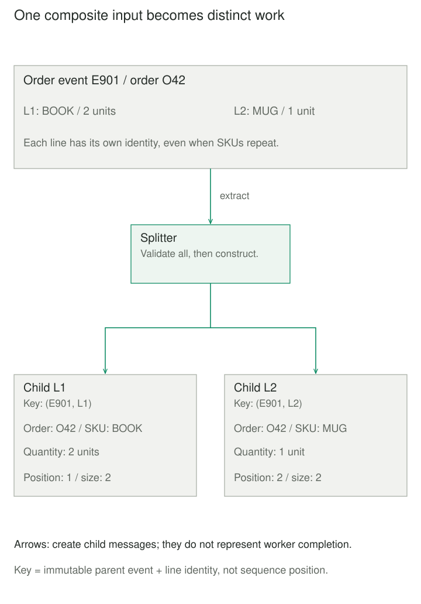

## Purpose and problem

A shop receives an order containing a book and a mug. Fulfillment accepts one order line per request, and different workers may handle the two products. Passing the entire order to every worker makes each repeat the extraction logic. Treating the order as one indivisible job prevents independent line processing.

The sender should retain a coherent order contract while downstream work has a smaller unit of responsibility. Splitting introduces another difficulty: after a failure, the system must distinguish the same line being retried from a different line that happens to contain the same product.

## Core idea

A **Splitter** extracts meaningful parts from a composite message and gives each part its own message envelope. The unit might be one order line or a deliberately chosen subset. It changes the granularity of work; it does not merely broadcast copies of the original payload.

The mental model is **one parent, several independently processable children**. Preserve enough parent context to interpret each child, without copying unrelated or sensitive fields. Splitter is the Enterprise Integration Patterns name; Message Splitter is a common descriptive form. A Resequencer instead orders messages that already exist.



## How it works

### Define parts, identity, and completion

The split rule owns part boundaries. Two lines with the same SKU can represent different instructions, so SKU alone is an unsafe child identity. In this article's example, the pair `(parent event ID, line ID)` identifies a child. Event IDs must uniquely identify immutable inputs within the integration; a revised order needs a new event ID. Across producers, include a producer namespace or use an equivalently unique identifier.

Sequence metadata can carry a group identifier, position, and total count or end marker. Position does not force workers to finish in that order. An Aggregator, if needed, separately tracks related results and defines completeness. It must count distinct children, handle duplicates and missing results, and have a termination policy. An empty input needs explicit completion handling because no child can announce its existence.

### Separate construction from delivery

A bounded splitter can validate the entire input before returning children. A streaming splitter reduces retained memory but may discover a malformed late element after earlier children have escaped; it may not initially know the total count. These are contract choices, not interchangeable optimizations. Apache Camel exposes splitting modes and failure policies explicitly.

The caller owns publication and input acknowledgment. If one child reaches the broker and the next send fails, retrying the parent can republish the first. Durable recovery needs a defined handoff, such as recording child publications transactionally before acknowledging the input. Consumers still need a way to suppress repeated effects. In RabbitMQ, publisher confirms concern broker acceptance, while consumer acknowledgments concern deliveries; neither proves all child business operations succeeded.


## Worked example

### Fulfillment instructions with stable line identities

Save these two files together and run `python3 demo.py` with Python 3.10 or later. The input is an already decoded order event: exact fields, ASCII identifiers of 1–64 characters, at most 100 lines, and positive integer quantities of at most 1000 physical units per line. Parsing and byte-size limits belong upstream. The caller must prevent concurrent mutation of the input during splitting.

`splitter.py` returns an immutable tuple of frozen children. It validates every line before construction, copies only approved context, and leaves the input unchanged. Empty orders return no children; that is not a completion notification.

```python
from dataclasses import dataclass
import re


class SplitError(ValueError):
    pass


def identifier(value):
    if not isinstance(value, str) or not re.fullmatch(r"[A-Za-z0-9_-]{1,64}", value):
        raise SplitError("Invalid identifier")
    return value


@dataclass(frozen=True)
class Part:
    parent_id: str
    order_id: str
    line_id: str
    sku: str
    units: int
    position: int
    size: int

    @property
    def key(self):
        return (self.parent_id, self.line_id)


def split_order(event):
    if not isinstance(event, dict) or set(event) != {"event_id", "order_id", "lines"}:
        raise SplitError("Invalid event fields")
    parent = identifier(event["event_id"])
    order = identifier(event["order_id"])
    lines = event["lines"]
    if not isinstance(lines, list) or len(lines) > 100:
        raise SplitError("Expected at most 100 lines")
    checked, seen = [], set()
    for line in lines:
        if not isinstance(line, dict) or set(line) != {"line_id", "sku", "units"}:
            raise SplitError("Invalid line fields")
        line_id, sku = identifier(line["line_id"]), identifier(line["sku"])
        units = line["units"]
        if type(units) is not int or not 1 <= units <= 1000:
            raise SplitError("Units must be an integer from 1 to 1000")
        if line_id in seen:
            raise SplitError("Duplicate line ID")
        seen.add(line_id)
        checked.append((line_id, sku, units))
    return tuple(
        Part(parent, order, line_id, sku, units, position, len(checked))
        for position, (line_id, sku, units) in enumerate(checked, 1)
    )
```

`demo.py` shows the resulting identities, quantities, and one-based positions, then exercises an empty order and an invalid second line:

```python
from splitter import split_order, SplitError


event = dict(event_id="E901", order_id="O42", lines=[
    dict(line_id="L1", sku="BOOK", units=2),
    dict(line_id="L2", sku="MUG", units=1),
])
for part in split_order(event):
    print(part.key, part.sku, part.units, f"{part.position}/{part.size}")
print("empty:", len(split_order(event | {"lines": []})))
bad = event | {"lines": [event["lines"][0], dict(line_id="L2", sku="MUG", units=0)]}
try:
    split_order(bad)
except SplitError as error:
    print("rejected:", error)
```

The first lines print `('E901', 'L1') BOOK 2 1/2` and `('E901', 'L2') MUG 1 2/2`. Then come `empty: 0` and `rejected: Units must be an integer from 1 to 1000`. The invalid second line returns no partial tuple. Replaying the immutable event reproduces child keys, but this code neither publishes messages nor remembers processed keys.

## When to use it

Use Splitter when a composite business message contains parts with independent destinations, retries, or processing costs. A document containing independently classified pages is another fit, provided page boundaries and shared document context are explicit.

If one consumer can handle a small order coherently, a local loop may suffice. Avoid splitting an invariant that must be enforced atomically across all lines unless another mechanism preserves that invariant.

## Tradeoffs and common mistakes

More messages mean more envelopes, tracing, storage, and scheduling. Bound queued and in-flight children; a large parent can overwhelm workers even when splitting itself is cheap. Streaming also requires explicit iterator/file ownership and closure on cancellation or failure.

Never equate count with completion: two deliveries of L1 do not replace a missing L2. Stable keys support deduplication but do not implement it. Reusing an event ID for changed data violates this example's identity contract. Copying an order-wide shipping charge onto every line can cause double charging; copy only fields with a declared child-level meaning.

Parallel execution can reorder completion and expose shared-resource contention. Authorization must still apply to each action, and child payloads should carry only the context their consumers are allowed to see.

## Related patterns

- [[content-based-router|Content-Based Router]] chooses where a message goes. It can route the children after Splitter has determined what the units of work are.
- [[correlation-identifier|Correlation Identifier]] associates related messages; it supplies grouping context without performing extraction or proving completion.
- [[data-publish-subscribe-distribution|Publish-Subscribe]] distributes a publication to independent interests. Splitter distributes distinct parts of one composite input.
- [[data-reshape-at-boundaries|Reshape at Boundaries]] addresses structural data transformations. Splitter additionally creates separate processing identities and delivery responsibilities.

## Sources

- [Hohpe and Woolf: Splitter](https://www.enterpriseintegrationpatterns.com/patterns/messaging/Sequencer.html) establishes composite-to-part messaging. Its historical URL does not rename the pattern Sequencer.
- [Hohpe and Woolf: Message Sequence](https://www.enterpriseintegrationpatterns.com/patterns/messaging/MessageSequence.html) describes sequence identification fields; [Aggregator](https://www.enterpriseintegrationpatterns.com/patterns/messaging/Aggregator.html) separates correlation, completeness, and combination.
- [Apache Camel: Split](https://camel.apache.org/components/4.22.x/eips/split-eip.html) documents materialized versus streaming splitting and explicit execution/failure options. This Python example does not implement Camel.
- [RabbitMQ: Consumer Acknowledgements and Publisher Confirms](https://www.rabbitmq.com/docs/confirms) explains the separate confirmation boundaries.

The bounded Python contract, identifiers, validation policy, outputs, and illustrations are original teaching material. Order-line decomposition follows the established pattern's motivating context.
