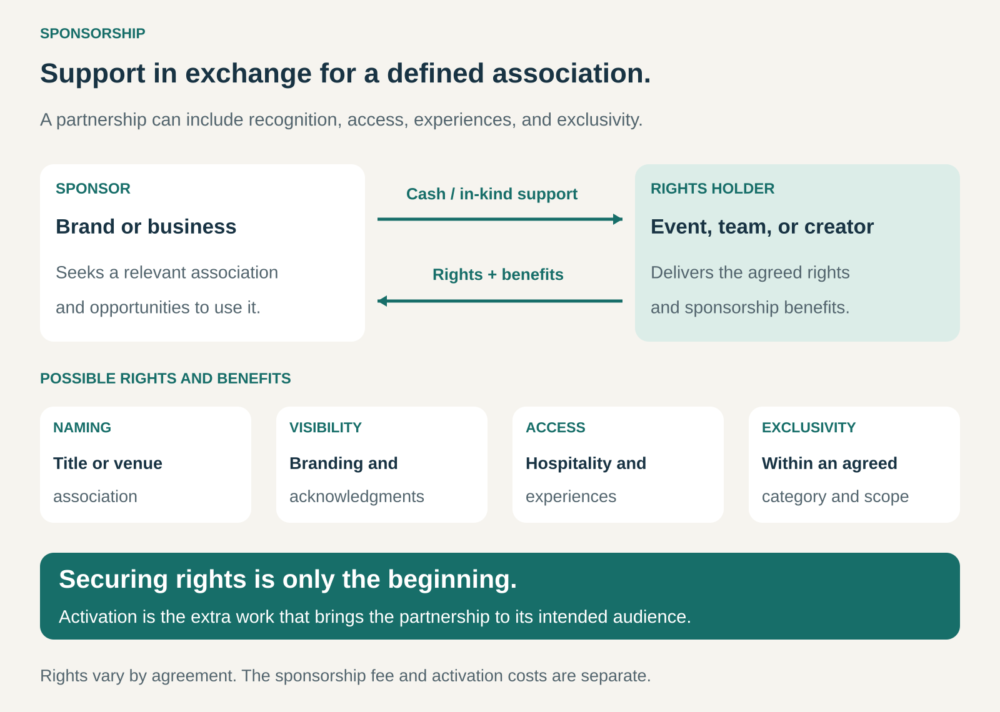

## What it is for

An event has a committed audience but needs funding. A sports club has a recognizable identity that brands want to associate with. A creator produces work that a company would like to support—and be seen supporting.

Sponsorship turns that relationship into a commercial offering.

A sponsor provides money, products, or services in exchange for agreed recognition, association rights, access, or other benefits.

It is useful when an organization, activity, or personality has an identity and audience that another business values. Sponsorship can provide additional revenue while helping the sponsor build awareness, relationships, or a particular reputation.

## The core idea

Offer a defined partnership around something people care about.

The sponsor might receive permission to use an event’s identity in its marketing, naming rights, category exclusivity, hospitality, product demonstrations, or acknowledgment across a series of activities.

The organization receiving support must define and deliver those benefits.

Sponsorship often includes advertising, but its value can extend beyond individual placements. A brand may want to become associated with a team, community, or experience over time.

Audience members may still buy tickets, subscriptions, or products. Sponsorship can complement those payments rather than replace them.

## How it works

The organization identifies what it can offer and which sponsors would find that valuable.

It then develops a package with a clear scope: the activity covered, duration, audience, permitted use of names and imagery, promotional benefits, and delivery responsibilities.

Possible benefits include:

- **Naming and association:** an event title, venue name, or official partner designation.
- **Visibility:** branding, acknowledgments, mentions, or campaign placements.
- **Access and experiences:** hospitality, demonstrations, meetings, or activities for customers and employees.
- **Exclusivity:** agreed protection from competing sponsors within a defined category.

Once the agreement is signed, both parties have work to do.

The organization delivers the promised benefits. The sponsor uses the partnership through campaigns, experiences, distribution, or other activities. This additional work is commonly called **activation**.

A partnership can therefore succeed contractually—every promised logo appears—while achieving little commercially if nobody makes effective use of it.

## Why it works

**It connects a brand with an established identity.** A sponsor may want people to associate it with a sport, creative community, professional field, or cause.

**It provides a context for contact.** People attending a conference or following a team already share an interest. A relevant sponsor can meet them within that context.

**It creates opportunities beyond conventional advertisements.** Demonstrations, hospitality, employee participation, and useful services can make the relationship tangible.

**It can create continuity.** A partnership spanning a season or series offers repeated opportunities for recognition and interaction.

These are opportunities rather than guaranteed results. The sponsor’s fit, conduct, and activation influence whether the audience welcomes the relationship.

## Famous examples

### Emirates and Arsenal: a package of prominent associations

The Emirates–Arsenal relationship has combined shirt branding, stadium naming rights, and marketing opportunities. Emirates’ account of its 2018 renewal also described access to aircraft for preseason tours and rights to develop campaigns around the partnership. [Emirates’ sponsorship announcement](https://www.emirates.com/media-centre/emirates-and-arsenal-renew-sponsorship-deal)

This illustrates sponsorship as a collection of benefits. The stadium name creates repeated recognition, shirt branding travels with the team, and marketing rights allow the sponsor to build its own activities around the association.

The commercial offering encompasses more than one advertisement. Its value depends on how the different rights work together and how the sponsor uses them.

### The Olympic Partner Programme: category rights and operational support

The International Olympic Committee’s TOP programme grants selected global partners category-exclusive marketing rights associated with the Olympic Games.

Partners provide funding, products, and technical services that support the Olympic Movement and the staging of the Games. [IOC: The Olympic Partner Programme](https://www.olympics.com/ioc/partners)

This shows two sides of the exchange. The organizer receives financial and operational support; sponsors receive a defined commercial association and rights within their categories.

It also illustrates why exclusivity requires careful design. A category must be clear enough that both the organizer and sponsor understand which competing relationships are restricted.

### Mailchimp and Serial: association with a distinctive show

Mailchimp’s sponsorship of _Serial_ became a recognizable example of podcast sponsorship.

In a retrospective interview, Mailchimp’s marketing leader described how its existing relationship with _This American Life_ led to the opportunity. The company sought exclusivity across the season and obtained substantial, though incomplete, exclusivity. He also described the value the company saw in relationships between podcast hosts and their audiences. [Interview: How Mailchimp approached podcast sponsorship](https://www.contagious.com/en/article/news-and-views/how-mailchimp-cracked-podcast-advertising-62c0796e8b0242efb75d9f3f452739e1)

The arrangement included advertising, demonstrating the overlap between these patterns. The sponsorship relationship provided a sustained association with a particular show rather than an interchangeable placement alone.

The interview describes the sponsor’s interpretation of its experience; it does not establish that other podcast partnerships will produce the same effect.

## The economics

The organizer and sponsor face different calculations.

For the **organization receiving support**, the sponsorship fee must be considered alongside sales effort, account management, production, hospitality, reporting, and the cost of delivering promised benefits.

For the **sponsor**, the rights fee is only part of the investment. Campaign production, travel, staffing, events, samples, and additional media can all increase the total cost.

Consider a hypothetical partnership with a $20,000 fee. If the organizer spends $5,000 fulfilling sponsor benefits, $15,000 remains toward the underlying activity and other expenses.

If the sponsor spends another $10,000 activating the partnership, its total investment is $30,000. The two parties therefore evaluate different amounts.

In-kind support needs separate treatment. Equipment or catering can reduce an expense, but it does not supply cash for unrelated bills. Its practical value depends on whether the organization actually needs it.

Exclusivity also has a cost: granting one sponsor protected rights may prevent other partnerships.

## Useful when

Sponsorship is particularly useful when:

- An activity has a clear identity and an identifiable audience.
- Potential sponsors have a relevant reason to associate with it.
- The organization controls rights and benefits it can reliably deliver.
- A partnership can improve the experience or support valuable work.
- Both parties have the capacity to manage and activate the agreement.

A large audience is not essential. A focused professional event or local community activity can offer a strong match for an appropriate sponsor.

## Common mistakes and limits

**Selling logo space without a clear purpose.** Visibility can be useful, but the sponsor needs to understand what the relationship helps it achieve.

**Choosing partners solely by their budgets.** A poor fit can weaken audience trust and make the relationship difficult to use convincingly.

**Promising rights the organization does not control.** Venue agreements, governing bodies, broadcasters, and existing partners may constrain what can be offered.

**Confusing support with editorial control.** The boundaries need to be explicit. TEDx, for example, prohibits sponsors from controlling its stage and program. [TEDx sponsorship guidance](https://www.ted.com/tedx/organizer-guide/plan-budget-and-fundraise)

**Undervaluing delivery work.** Custom content, hospitality, approvals, and reporting can consume substantial time.

**Counting exposure as proof of success.** Brand awareness, customer relationships, qualified contacts, and employee participation require different measures. A logo’s appearance does not establish a commercial return.

**Ignoring disruption and renewal risk.** Cancellation, reduced attendance, reputational problems, or changing sponsor priorities can affect the partnership. Clear responsibilities and realistic funding assumptions matter.

## Related patterns

[[advertising-supported|Advertising Supported]] — Advertising placements can form part of a sponsorship package. Sponsorship can add association rights, exclusivity, and experiences around a particular activity.

[[third-party-funded-access|Third-Party-Funded Access / Hidden Revenue]] — Sponsorship can help finance access for an audience, although users may also pay.

[[barter|Barter]] — In-kind sponsorship exchanges useful goods or services for partnership benefits. Cash and in-kind contributions can coexist.

[[experience-selling|Experience Selling]] — Sponsors can activate their rights through experiences that give audiences, customers, or employees a meaningful encounter with the brand.
