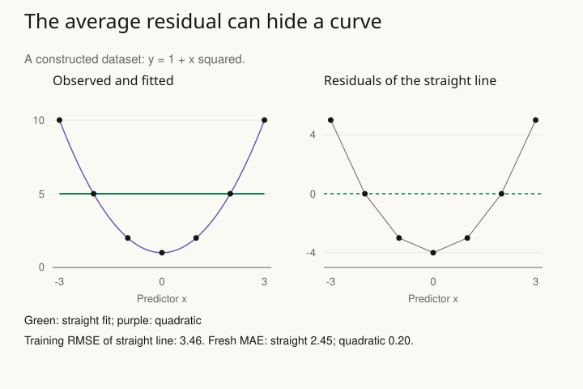

A model finishes fitting, returns plausible coefficients, and produces prediction errors whose average is almost zero. These errors are called residuals: observed outcome minus fitted outcome. The analyst is ready to report it. Yet a plot shows that predictions are consistently too low at both ends of the observed range and too high in the middle. A successful calculation has fitted the wrong shape.

Ask what the model would make observable, then compare that implication with the data. Residual plots, replicated datasets, subgroup checks, and evaluation on fresh observations expose different kinds of mismatch. Choose checks that matter for the intended conclusion; one favorable summary cannot establish overall adequacy.

## Worked example: the mean residual hides a curve

Consider seven fictional observations. The values were deliberately constructed from y = 1 + x² to make a missing relationship easy to see. They are a teaching dataset, rather than evidence that a real process has no noise.

| x | Observed y | Fitted straight line | Residual: observed minus fitted |
| --- | --- | --- | --- |
| −3 | 10 | 5 | +5 |
| −2 | 5 | 5 | 0 |
| −1 | 2 | 5 | −3 |
| 0 | 1 | 5 | −4 |
| 1 | 2 | 5 | −3 |
| 2 | 5 | 5 | 0 |
| 3 | 10 | 5 | +5 |

An ordinary least-squares straight line with an intercept has slope zero and fitted value five everywhere. Its residuals sum to zero.

For example, at x = −3 the outcome is 10 and the prediction is 5, so the residual is +5: the model predicts too low. At x = 0 the outcome is 1, giving a residual of −4: it predicts too high. Opposite signs can cancel in the average while a clear pattern remains.

All seven residuals have squared sum 84, so the training root-mean-squared error is √(84 / 7), approximately 3.46 units. This RMSE divides by the number of predictions; it is not the degrees-of-freedom-adjusted residual standard deviation.

The residual plot supplies the useful diagnosis: the missing structure is curvature. A quadratic model containing 1 and x² reproduces these particular training observations exactly. That suggests a candidate representation, but selecting it after viewing the pattern has used information. Its zero training error is especially unsurprising because the example was generated without noise from that very equation.

Try four additional fictional observations reserved for evaluation: x values −2.5, −0.5, 1.5, and 2.5, with outcomes 7.4, 1.5, 3.1, and 7.0. The straight line's mean absolute error is 2.45. The quadratic predicts 7.25, 1.25, 3.25, and 7.25, giving mean absolute error 0.20. This small demonstration favors the quadratic for those observations. It does not establish how either model behaves outside the represented range or after a change in the process.

## Check features beyond the fitted average

A second example concerns counts: 0, 0, 0, 0, 0, 0, 4, 4, 6, and 6. Their mean is two, but six of ten observations are zero. A Poisson model fitted by its mean uses a rate of two and predicts a zero probability of exp(−2), about 13.5%. The observed zero proportion is 60%.

This is a concrete discrepancy worth investigating. The 13.5% is a plug-in model expectation, not a formal significance test or a posterior predictive probability integrated over parameter uncertainty. Ten observations are few. Repeated simulation under the fitted or posterior model can show how unusual relevant discrepancies are under that model, while preserving the distinction between an exploratory check and a calibrated test.

Do not jump from a mismatch to one predetermined replacement. Extra count variation could reflect heterogeneity, dependence, measurement, or a different observation process. A model with another parameter may reproduce a feature without explaining why it occurs. [[stats-match-outcome]] helps select plausible representations, and [[stats-regularize]] addresses unsupported flexibility when revisions become elaborate.

## Use each check for the question it can answer

Residuals compare individual outcomes with fitted predictions. Their patterns can reveal missing shape, changing variability, dependence, or influential cases. Appropriate residual definitions and diagnostics depend on the outcome model; binary observations do not behave like continuous Normal errors.

Predictive checks compare observed features with replicated data generated under a model. In a Bayesian analysis, posterior predictive simulation propagates parameter uncertainty through that replication. Before fitting, prior predictive simulation checks whether the prior and likelihood together imply plausible data. Neither check certifies that a model is true or that an association is causal.

Held-out validation asks how the complete fitted procedure performs on information it did not use. [[stats-validate-forward]] makes the information boundary explicit. Inspecting the test set, modifying the model, and quoting the same test score as untouched evidence spends the independence that the check depended on. Record those revisions and reserve fresh assessment when the intended claim requires it.

## Advanced notes: make the next check consequential

Choose discrepancies connected to the target: tails for a capacity decision, group-specific calibration for a subgroup forecast, or time dependence for monitoring. Looking only at statistics a model is built to fit can make a poor model look reassuring. Conversely, a visible mismatch may be immaterial to a narrow target while important for another use.

Use this pattern before trusting an attractive fit or after surprising failures. State the relevant implication, show the discrepancy, investigate a plausible mechanism, and evaluate the revised procedure. Computational reliability, empirical adequacy, generalization, and causal identification remain separate arguments even when they support the same decision.

## Sources and further reading

The constructed examples and evaluation values are fictional. These sources explain the checking methods.

- [NIST: graphical model validation and residual analysis](https://itl.nist.gov/div898/handbook/pmd/section4/pmd44.htm)
- [Stan: prior and posterior predictive checks](https://mc-stan.org/docs/stan-users-guide/posterior-predictive-checks.html)
