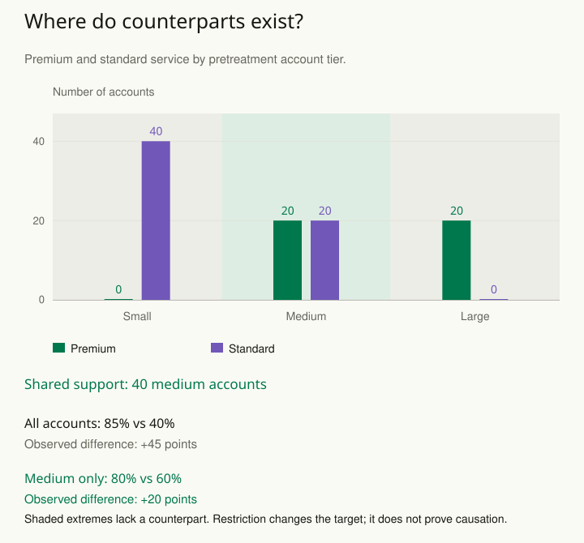

A company offers premium support only to its largest accounts. An analyst tries to estimate what premium support would do for small accounts by comparing recipients with nonrecipients and controlling for account size. Yet no small account received premium support. The desired contrast is missing from the observations.

The response is to inspect overlap: do comparable units have a meaningful chance of receiving each treatment under the proposed design and assumptions? When the comparison is absent, a fitted model may be extrapolating rather than summarizing observed counterparts.

Extrapolation means predicting for a combination the data do not show, such as premium service for a small account when no small account received it. A prediction is still mathematically possible, but its support comes from modeling assumptions rather than an observed counterpart.

## Inspect support for the actual target

Compare relevant pretreatment characteristics and estimated treatment probabilities across groups. Look for regions containing only treated or only untreated observations, sparse cells, and extreme weights. A single overall balance score can conceal important local gaps.

Suppose the premium program includes both medium and large accounts, while untreated accounts include small and medium accounts. A comparison among medium accounts may be more directly supported than an effect for all accounts. Restricting the analysis can be defensible, but it changes the population and therefore the estimand.

In another setting, a treatment is contraindicated for a subgroup. A structural lack of treatment in that subgroup cannot be repaired by collecting more untreated cases. The intervention and target population may need reformulation, or another design and set of assumptions may be required.

## Do not let weights hide the problem

Inverse-probability weighting can become unstable when estimated probabilities approach zero or one. Trimming or stabilizing weights can improve behavior but may alter the target or introduce a bias-variance tradeoff. Report the rule, its rationale, and sensitivity rather than selecting a threshold solely to obtain a preferred estimate.

Matching can similarly discard unmatched cases. State who remains and avoid presenting the matched estimate as if it automatically applied to the full original population. Balance on measured variables does not prove the absence of unmeasured confounding.

## Worked example: the supported comparison covers forty accounts

Suppose a fictional support policy gives no small account premium service, gives every large account premium service, and allows either service level among medium accounts. Use account tier measured before service assignment. The following counts describe retention over the same stated follow-up period, with complete outcomes.

| Account tier | Retained / accounts |
| --- | --- |
| Small, standard | 12 / 40 |
| Medium, standard | 12 / 20 |
| Medium, premium | 16 / 20 |
| Large, premium | 18 / 20 |

Across all premium accounts, retention is **(16 + 18) / (20 + 20) = 85%**. Across all standard accounts, it is **(12 + 12) / (40 + 20) = 40%**. The crude difference is **45 percentage points**. However, the groups contain very different account sizes. There is no observed premium outcome for small accounts and no observed standard outcome for large accounts.

Within medium accounts, the observed difference is **16 / 20 − 12 / 20 = 80% − 60% = 20 percentage points**. This comparison uses **40 of the original 100 accounts**. It retains half the premium accounts and one third of the standard accounts. Its target is medium accounts under this policy, rather than all accounts or all premium-service recipients.

The twenty-point contrast is not automatically causal. Medium accounts may still differ in urgency, prior engagement, or other causes of retention that influence premium assignment. Measured comparability, a defensible assignment argument, and appropriate uncertainty remain necessary. A chart of one coarse tier cannot establish overlap on every relevant combination of covariates.

For another way to see the boundary, use the observed treatment fractions within these policy-defined tiers: **0, 0.5, and 1**. An inverse-probability formula would require dividing by zero to represent treated small accounts or untreated large accounts. There are no such records to reweight. The fractions are an exact description of this fictional policy and sample, not a substitute for estimating a real treatment-assignment mechanism.

A model can still produce predictions for those missing combinations. Mark those predictions as extrapolations and state the assumptions supporting them. Truncating large weights can improve numerical behavior in some settings, but it cannot create the absent treatment options in this policy. If the real decision concerns small accounts, consider a design that gives them credible exposure to both options rather than silently generalizing the medium-account contrast.

[[stats-define-target]] makes the narrower population explicit. [[stats-challenge-causal-effect]] helps test the remaining causal argument after an overlap check.

## Advanced notes: positivity and finite samples

Structural positivity violations arise when a treatment option is impossible for some covariate profiles. Practical or finite-sample problems arise when it is possible but scarcely observed. The distinction matters: a model can borrow information across sparse regions under assumptions, but cannot conjure an observed comparison where the design excludes it.

Overlap is specific to the causal target and adjustment strategy. A regression-discontinuity design may intentionally use a local comparison near a threshold instead of requiring broad treatment overlap across the whole population. Its identification argument is different and should be evaluated on its own terms.

An attractive predictive fit is not proof of causal support. A model can predict factual outcomes well while estimating unobserved counterfactuals through strong assumptions. Mark where the conclusion depends on extrapolation and consider bounds or a narrower target.

Use this pattern before matching, weighting, or covariate adjustment. Ask who has a credible counterpart, what comparisons the observations actually support, and whether the stated population matches the population for which evidence exists.

## Sources and further reading

These independently written explanations and fictional examples draw on established statistical methods. The linked sources provide technical development and additional qualifications.

- [Hernán and Robins — Causal Inference: What If](https://content.sph.harvard.edu/wwwhsph/sites/1268/2024/04/hernanrobins_WhatIf_26apr24.pdf)

- [Stuart: Matching methods for causal inference](https://pmc.ncbi.nlm.nih.gov/articles/PMC2943670/)

