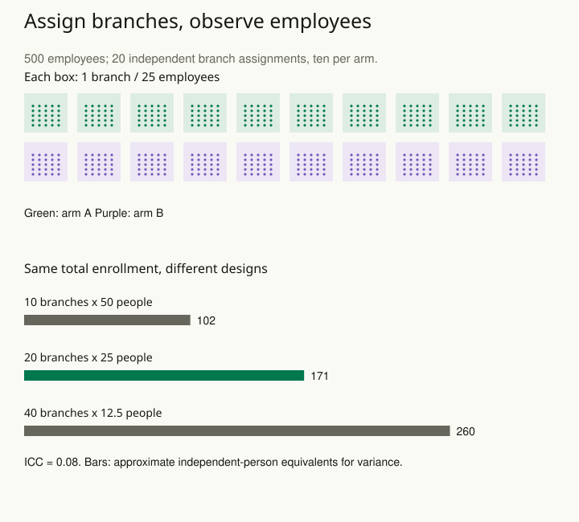

A company gives one branch a new training program and compares its staff with hundreds of staff in another branch. The dataset has many employees but only two independently assigned branches. Differences in managers, local demand, or working conditions can look like a precise training effect if every employee is counted as a separate experimental replicate.

Decide which units can independently receive the intervention before deciding how many observations to collect. Distinguish the unit of assignment, the unit of observation, and the population targeted by the effect. When treatment spreads within a classroom, branch, household, or network, individual assignment may not produce the contrast the study is meant to examine.

## Map the intervention and the routes of spillover

An individual software feature can sometimes be assigned to accounts, but shared accounts or communication between users may spread its effects. A staff training program may change how a whole branch operates even when only some staff attend. A classroom teaching method usually changes a common learning environment.

Describe how one unit’s assignment could affect another unit’s outcome. Cluster assignment can reduce some contamination, but a boundary chosen for convenience may not contain the relevant interaction. If branches share staff, assigning branches does not eliminate interference. Depending on the goal, the study may need a different boundary or an explicit design for direct and spillover effects.

Once the boundary is credible, randomize enough independent units within a suitable design. Blocking or matching on important baseline characteristics can improve balance. Preserve that restriction in the analysis. Randomization provides a comparison through the assignment mechanism; it does not make every measured row an independent draw.

## Worked example: five hundred people are not five hundred assignments

Suppose a fictional experiment randomizes **20 branches**, ten per arm, with **25 employees per branch**. There are 500 measured employees.

For this planning example, assume equal branch sizes and the same individual outcome variance throughout. Treat different branches as independent, and assume any two employees within a branch have outcome correlation **ρ = 0.08**.

In the formula below, m is employees per branch, and ρ, read “rho,” is the intracluster correlation (ICC). It describes how strongly employees’ outcomes in the same branch tend to move together; the simple model gives each within-branch pair the same correlation. A design effect compares the variance of the estimate with the variance under independent individuals. Larger variance means less precision. For this simple mean contrast, the planning approximation is:

**DE = 1 + (m − 1)ρ = 1 + 24 × 0.08 = 2.92.**

The corresponding standard-error inflation is **√2.92 ≈ 1.71**. Dividing 500 by 2.92 gives about **171 independent-person equivalents** as a rough variance comparison. The experiment still has **20 randomized branches**, not 171 assignments. Degrees of freedom, arm balance, analysis, and the number of clusters require their own attention.

Now compare allocations with the same total enrollment of 500. Ten branches of fifty employees have **DE = 4.92** and about **102** independent-person equivalents. Forty branches averaging 12.5 employees have **DE ≈ 1.92** and about **260** equivalents under an equal-size planning approximation. The average 12.5 can represent a design planning value; actual unequal cluster sizes need a more appropriate calculation.

The contrast explains why recruiting more people from the same few branches can yield less information than recruiting more independent branches. It does not establish that the forty-branch design is feasible, balanced, or sufficiently powered. Budget, assignment restrictions, cluster-size variation, and the plausible range of correlation belong in prospective planning and simulation.

## Keep the analysis aligned with assignment

Summarizing each branch and comparing branch summaries is one possible analysis, with weighting chosen for the target effect. Multilevel models, suitable cluster-aware variance estimates, and randomization-based analyses offer other approaches. Small numbers of clusters require methods and corrections appropriate to that setting; an asymptotic cluster-robust option is not automatically reliable.

For a second example, suppose one treatment branch and one control branch each provide a thousand observations. Within-branch repetition helps describe those branches, but it cannot reveal how treatment effects vary across independently assigned branches or separate an observed treatment contrast from this particular pair of branch conditions with dependable conventional inference. A large row count does not solve the two-cluster problem.

Report how many units were assigned, how many were observed, and where exclusions occurred. Track whole-branch withdrawal separately from missing employee outcomes. State whether the primary analysis compares assignment groups regardless of uptake or targets another effect requiring additional assumptions. Outcomes after treatment-dependent selection can compromise the original randomized comparison.

## Advanced notes: weighting and interference change the question

An equally weighted average branch effect and an average employee effect can differ when branch sizes and effects vary. Choose the target before choosing weights, and consider whether cluster size is informative. Stratification, pair matching, unequal assignment probabilities, and repeated measurement change the appropriate analysis and precision calculation.

The design-effect formula is a deliberately simple planning device. It assumes a common correlation and an estimator for which that approximation is suitable. A single estimated intracluster correlation is uncertain, especially with few branches. Evaluate several plausible values and include attrition at both levels. Model-based precision can also differ substantially when useful baseline outcomes are included.

When spillovers remain across assigned units, a conventional effect may mix direct exposure, peers’ exposure, and broader implementation effects. Record the exposure you intend to contrast, then choose a design that can identify it. Cluster randomization is a tool for constructing an experiment, not a general guarantee against every form of contamination.

Use this pattern before recruitment. A short diagram showing assignment boundaries, observation rows, potential spillovers, and the intended target often exposes a design error earlier than a sophisticated analysis would.

Related patterns: [[stats-randomize-blocks]], [[stats-plan-precision]], [[stats-resample-units]], and [[stats-test-simulation]].

## Sources and further reading

The branch example and calculations are original fictional teaching cases. These methodological sources develop cluster-assignment reporting and inference.

- [Campbell and colleagues: CONSORT extension to cluster randomised trials](https://www.bmj.com/content/328/7441/702)
- [Campbell and colleagues: CONSORT 2012 cluster-trial extension](https://www.bmj.com/content/bmj/345/bmj.e5661.full.pdf)
- [Cameron and Miller: A Practitioner’s Guide to Cluster-Robust Inference](https://www.econ.ucdavis.edu/faculty/cameron/research/Cameron_Miller_JHR_2015_February.pdf)
