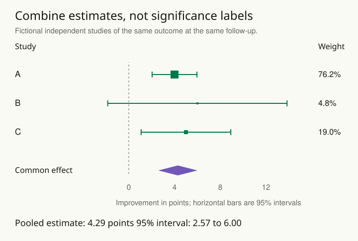

Three studies report benefits and two do not. Counting the positive studies treats a large precise study and a tiny noisy study as equivalent votes. It also ignores whether the estimated effects actually disagree or merely have different uncertainty.

The response is to define a common review question, assess comparability and bias, and synthesize effect estimates with an appropriate model when pooling is meaningful. A meta-analysis is a statistical component of that work, not a substitute for deciding which evidence belongs together.

## Worked example: three estimates on one scale

The name meta-analysis means a statistical combination of study results. A common-effect model assumes the studies estimate one shared underlying effect. The studies’ estimates can differ because their samples differ; their standard errors describe the sampling uncertainty in those estimates. A smaller standard error indicates a more precise estimate under that study’s analysis.

Suppose three fictional independent studies evaluate the same training intervention against the same comparison and measure improvement on the same assessment after one month. For this deliberately simple illustration, assume a common true effect, approximately Normal independent effect estimates, and usable standard errors. Those assumptions must be argued for before pooling real evidence.

| Study | Estimated improvement, points | Standard error | Approximate 95% interval |
| ----- | ----------------------------- | -------------- | ------------------------ |
| A     | 4                             | 1              | 2.04 to 5.96             |
| B     | 6                             | 4              | −1.84 to 13.84           |
| C     | 5                             | 2              | 1.08 to 8.92             |

To read the forest plot, find each study’s square (its estimate) and horizontal bar (its interval). The vertical zero line marks no improvement. A larger square means more weight in the combination, not a larger effect. The pooled diamond shows the combined estimate and its interval.

B's interval crosses zero, while A's and C's do not. That does not make B evidence of no effect or a contradiction of A and C. Its point estimate is actually larger, but much less precise. Counting two 'positive' studies and one 'negative' study would hide both the estimated magnitudes and the uncertainty.

For inverse-variance weighting, calculate 1 / SE² for each study: 1 for A, 1/16 for B, and 1/4 for C. Their sum is 1.3125, so the normalized weights are approximately 76.2%, 4.8%, and 19.0%. A receives sixteen times B's weight because its standard error is four times smaller. The pooled estimate is (1 × 4 + 0.0625 × 6 + 0.25 × 5) / 1.3125 = **4.29 points**.

Under the common-effect assumptions, the pooled standard error is √(1 / 1.3125), approximately 0.87 points. The approximate 95% interval is 4.286 ± 1.960 × 0.873, or **2.57 to 6.00 points**. The diamond in the figure shows that interval. It becomes narrower through additional independent information, not because studies were assigned votes.

Now reconsider the inputs. If C measured a different outcome or a much longer follow-up, the numerical formula would still produce an answer, but it might combine different targets. If the same people appeared in A and C, these weights would ignore dependence. If true effects vary across settings, a common-effect interpretation is inadequate; a suitable model should preserve that heterogeneity and distinguish uncertainty about an average from variation in effects. With only three studies, those differences are difficult to estimate precisely. The worked calculation is a baseline for understanding the forest plot, not a recommendation to pool every set of available numbers.

## Decide what can be combined

Compare populations, interventions, outcomes, follow-up times, and study designs. Two estimates with the same numerical units can still answer different questions. Conversely, compatible quantities measured on different scales may sometimes be transformed into an interpretable common effect measure.

Suppose two studies estimate an improvement near five units, but one interval is wide enough to include zero and the other is not. They may be consistent despite opposite significance labels. A weighted synthesis can use their precision, provided the estimates and uncertainty calculations are suitable for combination.

A different pair of studies might examine short-term task performance and long-term retention. Calling both “learning” does not make their effects interchangeable. Separate syntheses or a narrative account may be more honest than one pooled number.

## Preserve real differences

A common-effect model and a random-effects model make different assumptions about the effects being summarized. A random-effects analysis represents between-study variation under a distributional model. Its interval for the average effect does not describe the full variation in effects across settings.

Report heterogeneity and, when justified, a prediction interval for the relevant distribution of study effects. With few studies, estimates of heterogeneity can be weak. An automatic model switch based on a heterogeneity significance test is not a sufficient strategy.

## Advanced notes: pooling cannot cancel systematic bias

If studies share the same measurement problem or selection mechanism, combining them can yield a precise estimate of a biased quantity. Assess within-study bias and consider whether differences in results reflect methodology as well as genuine effect variation.

Missing studies and selectively unreported outcomes can distort the available evidence. Search relevant sources, compare protocols with reports where possible, and examine sensitivity to missing evidence. Funnel-plot asymmetry has several possible explanations and is not proof of publication bias.

Avoid double-counting overlapping participants or treating correlated estimates as independent studies. Multi-outcome or multilevel synthesis may be needed when the evidence structure is more complicated than one independent estimate per study.

A useful synthesis shows the individual estimates, uncertainties, study characteristics, and pooled result together. Examine whether one influential study or one defensible analysis choice changes the conclusion. If comparable evidence is too sparse or inconsistent, state what remains unresolved.

Use this pattern when a decision depends on several studies, replications, or evaluations. The deliverable is a reasoned account of the body of evidence, including its differences and absences, rather than a single authoritative average detached from how it was assembled.

## Sources and further reading

These independently written explanations and fictional examples draw on established statistical methods. The linked sources provide technical development and additional qualifications.

- [Cochrane Handbook](https://www.cochrane.org/authors/handbooks-and-manuals/handbook/current/chapter-10)
- [Cochrane Handbook](https://www.cochrane.org/authors/handbooks-and-manuals/handbook/current/chapter-13)
