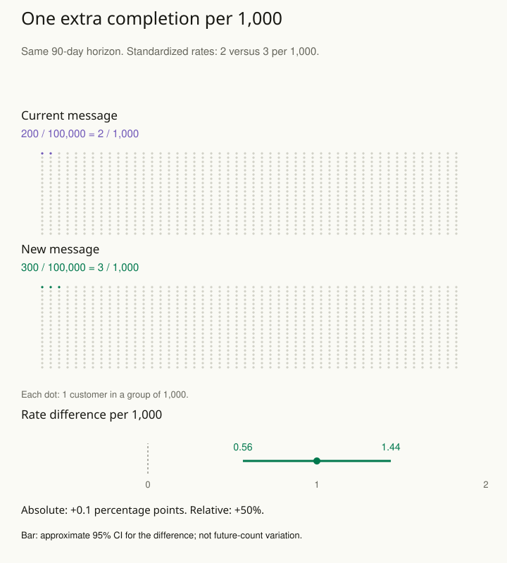

A headline announces a 50% improvement. The underlying rate increased from two events per thousand opportunities to three. The relative increase is indeed 50%, but readers need the absolute difference and baseline to understand what changed.

The response is to present complementary quantities with clear denominators, units, populations, and time horizons. Show the effect in a form that connects to the audience's question, and state what uncertainty or variation accompanies it.

## Give the denominator a visible place

For the fictional event rate, report “an increase from 2 to 3 per 1,000 opportunities, or 1 additional event per 1,000, corresponding to a 50% relative increase.” Whether this is beneficial, harmful, or important depends on what the event is and its consequences.

A change from 20% to 25% is five percentage points and a 25% relative increase. These are different descriptions of the same values. Avoid using “percent” loosely when the distinction could change the reader's understanding.

A second example is comparing waiting times. An average improvement of one minute may coexist with little change for most users and substantial improvement for a small subgroup. Describe the distribution or subgroup structure when it is relevant, rather than letting the average imply a uniform benefit.

## Label uncertainty precisely

Explain whether an interval concerns an estimated mean, a group difference, or a future individual outcome. A narrow confidence interval for the average does not mean that most individuals lie within that interval. Show individual variation separately when it matters to expectations or commitments.

State which population the result covers and which comparison produced it. An adjusted association should not become a causal claim through wording. An experiment estimating the effect of offering a program should not be described automatically as the effect of completing it.

Prefer charts that show the estimate, reference value, uncertainty, and relevant scale. Include sample sizes or effective information where useful, and explain exclusions or missingness that materially affect interpretation. The audience should be able to identify the main limitation without reconstructing the analysis.

## Worked example: fifty percent and one extra per thousand

Suppose two fictional independent customer groups each contain **100,000 people**, with complete follow-up for **90 days**. The outcome is whether a customer completes a referral during that period; each customer contributes one binary outcome. The current-message group has **200 completions** and the new-message group has **300**. Treat the groups as independent binomial samples for the following uncertainty calculation.

| Message | Completed / customers |
| --- | --- |
| Current | 200 / 100,000 = 0.2% |
| New | 300 / 100,000 = 0.3% |

On a common denominator, those rates are **2 and 3 per 1,000 customers**. The absolute difference is **0.003 − 0.002 = 0.001**, or **1 additional completion per 1,000**. In percentage units that is **0.1 percentage points**. The risk ratio is **0.003 / 0.002 = 1.5**, so the relative increase is **50%**.

One and a half times the original rate means an extra half of the original rate, hence a 50% increase. Percentage points instead subtract the percentages directly: 0.3% − 0.2% = 0.1 percentage points. Keeping the starting rate visible prevents those two descriptions of the same observed difference from being confused.

Now quantify uncertainty in the absolute difference. Using the two observed proportions, the unpooled standard error is **√[0.003 × 0.997 / 100,000 + 0.002 × 0.998 / 100,000] ≈ 0.0002233**. A large-sample Normal 95% confidence interval is **0.001 ± 1.959964 × 0.0002233**, approximately **0.000562 to 0.001438**. Multiplying by 1,000 gives **0.56 to 1.44 additional completions per 1,000**.

This particular Normal approximation is supported by substantial event and nonevent counts in both groups. It should not be copied to a study with only two and three observed events: the same point estimates with much smaller samples have much weaker information and need a suitable interval method. The dot display standardizes the rates; it does not reduce the actual sample sizes to one thousand.

A concise report could say: “Within 90 days, completion was 0.3% with the new message and 0.2% with the current message: an observed increase of 1 per 1,000 customers, with an approximate 95% confidence interval of 0.56–1.44 per 1,000. The relative increase was 50%.” State separately how customers entered the groups. A causal claim requires an appropriate design and assumptions, rather than a change in the wording of this report.

The interval describes uncertainty about a difference in underlying rates under the stated sampling model. It does not say that every future group of a thousand customers will have between 0.56 and 1.44 extra completions. Actual future counts have their own variation, and a single binary outcome cannot be 0.56 of a completion. Nor does the interval include every possible source of measurement error, selection, dependence, or model mismatch.

Use [[stats-report-uncertainty]] to choose the interval for the quantity being estimated. [[stats-choose-consequences]] connects the absolute gain to costs and benefits; a small rate difference can still matter at scale, but its value depends on what the outcome means.

## Advanced notes: avoid precision without meaning

A long decimal expansion can suggest certainty the measurement and model do not support. Choose precision that preserves consequential differences while keeping uncertainty visible. Rounding should not turn an interval barely crossing zero into a categorical claim that it does not.

Different effect scales answer different questions. Odds ratios, risk ratios, rate ratios, and absolute differences should not be substituted casually. Translate a model into predicted quantities for a stated baseline or target population where that aids interpretation, while making the modeling assumptions explicit.

A final report should distinguish observations, inference, and action. “The estimated difference is X under these assumptions” and “we recommend action Y because of these consequences” are connected statements with different supporting arguments.

Use this pattern when a correct calculation is likely to be misunderstood through scale, denominator, or wording. A useful short explanation says what changed, by how much, for whom, over what period, and what the evidence still leaves uncertain.

## Sources and further reading

These independently written explanations and fictional examples draw on established statistical methods. The linked sources provide technical development and additional qualifications.

- [American Statistical Association](https://www.amstat.org/docs/default-source/amstat-documents/p-valuestatement.pdf)
- [NIST Engineering Statistics Handbook](https://www.itl.nist.gov/div898/handbook/prc/section2/prc26.htm)

- [statsmodels: Confidence intervals for the difference of two independent binomial proportions](https://www.statsmodels.org/stable/generated/statsmodels.stats.proportion.confint_proportions_2indep.html)

