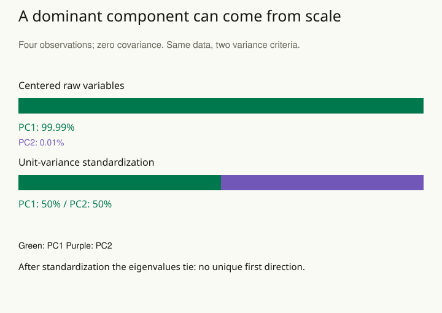

A survey contains thirty correlated questions. A team wants a manageable description and immediately gives the first few statistical components psychological names. Another team clusters customers and treats every resulting group as a natural category. Both moves may give convenient structure more meaning than the analysis supports.

Begin by distinguishing the purpose. Dimension reduction compresses measurements. A latent-variable model represents shared variation through unobserved quantities under assumptions. Clustering organizes cases according to a chosen similarity structure. These are related tools for different problems, not interchangeable ways to discover hidden truth.

## Match the representation to the question

Principal component analysis, or PCA, draws new perpendicular axes through the center of the measurements. A case’s positions along those axes are its component scores. The first axis points along the direction with the greatest variance, or spread, on the chosen measurement scales. If many sensor readings move together, a few components may provide a useful compressed representation. The direction with most variance is not automatically the direction most relevant to an outcome or scientific explanation.

Factor analysis instead posits a model in which latent factors explain covariance among measured variables, together with measurement-specific variation. For a questionnaire, the factor model can express a hypothesis about shared dimensions. Naming a factor requires substantive interpretation and validation beyond inspecting its largest loadings.

Clustering customers asks which cases are similar under selected features, scales, distances, and an algorithm. Different defensible choices may produce different groupings. A useful segmentation can support a task without establishing that the population consists of discrete natural kinds.

## Inspect the choices that create the structure

Variables measured on large numerical scales can dominate some distance and variance calculations unless the scale choice is deliberate. Standardizing every variable also makes a substantive choice: it can amplify noisy low-variance measures. Choose scales for the problem and assess sensitivity.

Check how the representation changes when observations are resampled, features are altered reasonably, or another suitable method is used. Examine whether the proposed structure appears in independent data. A two-dimensional display can distort distances and make continuous variation look clustered, so do not treat a visualization alone as confirmation.

## Worked example: a component created by the unit scale

Take four fictional observations of two features: **(−100, −1), (−100, 1), (100, −1), (100, 1)**. A feature is one measured variable. Both feature means are zero and their sample covariance is zero: the larger values of one feature do not line up with larger or smaller values of the other in this four-point example. The first feature’s sample variance is **40,000 / 3 = 13,333.33**; the second’s is **4 / 3 = 1.33**. There is no shared linear variation in this constructed example.

A PCA on the centered, unstandardized variables selects the first feature’s axis as its first component. The fraction of total variance captured is **10,000 / 10,001 ≈ 99.99%**, using the exact variances. This sounds like a remarkably successful reduction, but the percentage mainly reflects the numerical scale. Multiplying the second feature by 100 would change that conclusion without adding a single observation.

If each feature is divided by its sample standard deviation, both resulting variances are one and the covariance remains zero. In matrix notation, the standardized covariance matrix is the identity matrix. Its eigenvalues, the variances along the PCA directions, are **1 and 1**. Each therefore accounts for 1 / (1 + 1) = **50%** of the total variance. There is no uniquely preferred first direction: rotating a pair of perpendicular unit-length axes gives the same variance split. A software-selected axis should not acquire a substantive name just because it appears first.

Neither analysis is automatically the right one. If the original magnitudes represent meaningful physical variation in comparable units, retaining them may be sensible. If the variables use arbitrary or incomparable units, standardization can make a different comparison useful. If one variable is mostly noise, giving it equal variance can amplify noise. Choose and explain the scale using the purpose and measurement evidence, then examine alternative defensible choices.

For a second example, a clustering display shows three islands after a team selects features and tunes the algorithm on those same observations. Before calling the islands customer types, check whether group assignments persist when reasonable scales, features, or resampled cases change. Then test whether the segmentation supports its intended task on new data. A stable partition may be operationally useful while still imposing boundaries on a continuous population.

The four-point PCA example is an exact arithmetic demonstration, not a model-selection rule. Real data need checks for measurement quality, outliers, missingness, and uncertainty in the representation. If a reduced representation becomes input to prediction, estimate scaling and dimension reduction inside each training partition to keep validation independent.

Related patterns: [[stats-measurement-validity]], [[stats-validate-forward]], and [[stats-resample-units]].

## Advanced notes: discovery and validation differ

Choosing the number of factors or groups after inspecting many alternatives is part of exploration. Assess the entire selection procedure when evaluating performance, and avoid validating a representation only on the same data used to invent it.

Components and factors can be ambiguous in sign or rotation; these mathematical freedoms do not necessarily indicate scientific contradictions. Interpret invariant implications and clearly state the conventions used for presentation. A factor score is an estimated quantity under a model, not a direct observation of a latent trait.

Mixture models provide another representation, with assumptions about how observations arise from component distributions. Their fitted components need not correspond to the groups stakeholders hoped to find. Check identifiability, uncertainty, and predictive adequacy.

Use this pattern when many variables obscure a simpler description or unlabeled cases may have useful organization. State the intended use, mathematical choices, uncertainty, and independent checks before giving the resulting structure a persuasive name.

## Sources and further reading

These independently written explanations and fictional examples draw on established statistical methods. The linked sources provide technical development and additional qualifications.

- [NIST Engineering Statistics Handbook](https://www.itl.nist.gov/div898/handbook/pmc/section5/pmc55.htm)
- [UCLA: interpreting factor-analysis output](https://stats.oarc.ucla.edu/sas/output/factor-analysis/)
- [scikit-learn: Clustering](https://scikit-learn.org/stable/modules/clustering)
- [scikit-learn: Importance of Feature Scaling](https://scikit-learn.org/stable/auto_examples/preprocessing/plot_scaling_importance.html)

