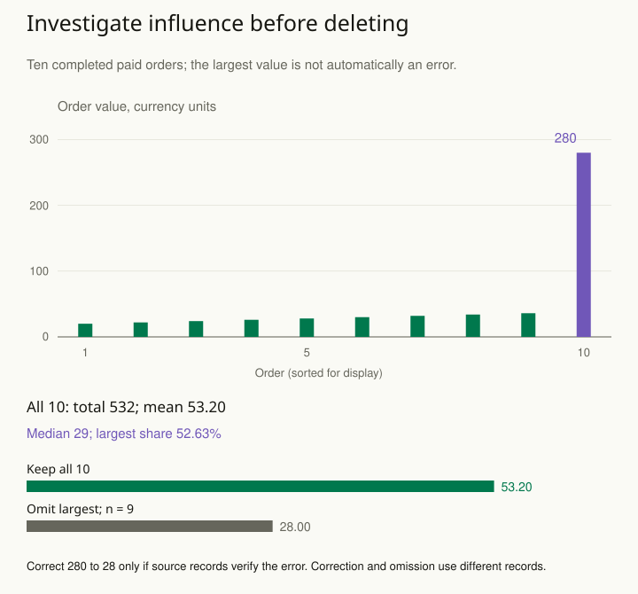

An online store's average order value doubles after one unusually large transaction. The analyst deletes the transaction as an outlier and the average returns to normal. But was it a duplicated record, a corporate purchase, fraud, or a legitimate event the business must plan for? A distance from the average does not answer that question.

An unusual observation is a signal to investigate. Trace its origin, check units and transformations, and determine whether it belongs to the population named in the question. Correct verified errors with an audit trail. Treat genuine extremes according to the analysis target and a defensible model.

## Separate three questions

First, is the value recorded correctly? A temperature entered in Fahrenheit among Celsius readings needs correction, not a robust statistical technique. A duplicated invoice should be resolved using the underlying transaction record.

Second, does it belong to the target population? A wholesale order might be irrelevant to a clearly defined retail-customer analysis. Excluding it is then a population decision, which should be justified independently of whether it makes the result attractive.

Third, how much does it influence the conclusion? A legitimate observation can reveal that a mean, fitted coefficient, or uncertainty estimate is fragile. Compare results with and without it as a diagnostic, while explaining which analysis answers the stated question.

## Choose a summary that preserves the purpose

For typical purchase size, a median and distribution plot may be useful. For expected revenue, large orders genuinely contribute to the mean; replacing the mean with a median changes the target. If unusually large prediction errors occur more often than a Normal model allows, a model with heavier tails may be useful. A robust method limits how much a few unusual values influence some results; it still needs to answer the chosen question. Each choice needs a purpose beyond making the plot look tidy.

Imagine estimating response times. Most requests finish quickly, but a small minority take several seconds. Those slow requests may be precisely what users notice. Reporting only a robust center would conceal a service problem. Include relevant tail summaries and investigate whether the extremes arise from a distinct mechanism.

## Worked example: one order supplies more than half the revenue

Suppose the target is the mean value of **all ten completed paid orders** in a fictional day. Their values are **20, 22, 24, 26, 28, 30, 32, 34, 36, and 280 currency units**. The ten orders total **532**, so the mean is **53.20**. The two central sorted values are 28 and 30, making the median **29**.

The mean divides the total by the number of orders: 532 / 10. The median finds the middle of the ordered list; with ten values, average positions five and six: (28 + 30) / 2. The mean and median differ here because they summarize different features of the same orders.

The final order contributes **280 / 532 ≈ 52.63%** of the total revenue. It strongly affects the mean, but that influence does not show that the order is wrong. If invoices and payment records confirm it and it belongs to the stated population, it is real information about that day’s revenue.

Omitting the last order leaves **252 units across nine orders**, a mean of **28**. The mean falls by **25.20**, or about **47.37%** of the full-data mean. Report that as an influence diagnostic: “The mean is 53.20 with all ten orders and 28.00 without the largest.” It does not justify substituting the nine-order result for the original ten-order target.

| Analysis | Orders; total; mean |
| --- | --- |
| All recorded orders | 10; 532; 53.20 |
| Omit the largest | 9; 252; 28.00 |
| Correct a verified 280 → 28 error | 10; 280; 28.00 |

The last row is a different hypothetical branch. Suppose the source invoice establishes that the actual value was 28 and an extra zero entered the analysis table. Correcting that verified recording error gives **252 + 28 = 280** across ten orders and mean **28**. The corrected and omitted means happen to coincide here, but their denominators and totals differ. An identical summary number does not make the two workflows equivalent.

Keep the original value, the corrected value, and the evidence for the correction in an audit trail. If the record is unresolved, state that uncertainty and show defensible scenarios. Do not declare 28 the truth merely because it makes the order look ordinary. Equally, if the 280 order was valid but outside a separately defined retail-only population, the exclusion needs that population definition, not an outlier label.

The full-data median answers a useful typical-order question. It cannot replace the mean when estimating total revenue as the number of orders times expected order value. In this day’s data, multiplying ten by the median gives **290**, not the observed total of **532**. That is a target mismatch rather than a calculation error in the median.

The bar chart uses a common vertical scale so the large contribution is visible. In a broader study, examine whether large orders recur, arise in a distinct customer segment, or signal a changed transaction process. Ten orders cannot establish a reliable tail model or long-run average. Use [[stats-define-target]] to choose the summary’s purpose and [[stats-show-distribution]] to preserve the shape that the average alone conceals.

## Advanced notes: robustness is conditional

Different methods are robust to different departures. A median resists a small fraction of extreme values in a location estimate but does not repair sample selection. A heavy-tailed model can reduce the influence of large residuals while still relying on assumptions about independence and the mean structure. A robust standard error does not automatically make the fitted relationship correct.

Avoid defining a deletion rule after seeing which observations weaken a desired conclusion. If exclusion thresholds are needed, justify them using measurement knowledge or a prespecified protocol. Report the number and reasons for exclusions, and examine reasonable alternatives.

An extreme value may also indicate a mixture: two customer populations, a changed machine setting, or an unrecorded batch effect. In that case the response may be to model the structure rather than downweight an inconvenient point.

Use this pattern when a single observation drives a decision or an automatic cleaning script labels unusual values as errors. The desired outcome is a clearer account of the data-generating process, with a conclusion whose dependence on genuine extremes is visible.

## Sources and further reading

These independently written explanations and fictional examples draw on established statistical methods. The linked sources provide technical development and additional qualifications.

- [NIST Engineering Statistics Handbook](https://www.itl.nist.gov/div898/handbook/prc/section1/prc16.htm)
- [NIST: Detection of Outliers](https://www.itl.nist.gov/div898/handbook/eda/section3/eda35h.htm)
