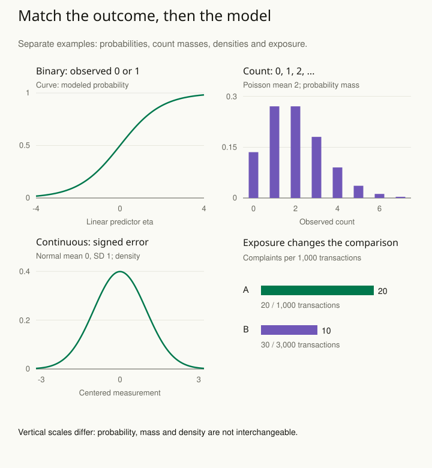

A model predicts a negative number of daily support calls. Another predicts a cancellation probability above one. These are visible signs that a convenient mathematical form may not respect the outcome it is describing.

Start with what an observation can be: a continuous measurement, a binary event, a count, an ordered category, a proportion with a denominator, or a time to an event. The possible values are called the outcome’s support. Choose a model that allows appropriate values and whose other assumptions fit the question. Evaluate the resulting predictions rather than selecting a model by name alone.

## Preserve the observation process

For binary cancellation outcomes, logistic regression models a probability between zero and one. For counts, a Poisson model can be a useful starting point under suitable conditions. Counts collected over different exposure periods need that exposure represented, often through an offset in a log-rate model.

Suppose store A records 20 complaints over 1,000 transactions and store B records 30 over 3,000. The raw count is larger at B, but the complaint rates are 2% and 1%. Whether a binomial, Poisson, or another model is appropriate depends on how opportunities and events are generated, including whether multiple complaints can arise from one transaction.

A second example is an ordered satisfaction response. Categories such as poor, fair, and excellent have order but need not be equally spaced. Treating them as exact equally spaced measurements introduces an assumption that should be assessed against the question. An ordinal model may provide a better representation.

## Check variability as well as the mean

A Poisson model links variance to the mean. Real counts may vary more because of unobserved heterogeneity, clustering, or another mechanism. Consider a negative-binomial or structured model when appropriate, and investigate why the extra variation occurs. Adding a dispersion parameter does not automatically repair a wrong mean function or ignored dependence.

Similarly, many zeros do not automatically imply a special zero-generating process. A low expected count naturally produces zeros. Compare plausible mechanisms and inspect whether simulated data reproduce the features relevant to the analysis.

## Worked example: more complaints, lower complaint rate

Return to the fictional stores. A records **20 complaints over 1,000 transactions**; B records **30 over 3,000**. The raw count ratio is **30 / 20 = 1.5**. After accounting for exposure, A has **20 complaints per 1,000 transactions**, while B has **10 per 1,000**. The rate ratio B/A is **0.01 / 0.02 = 0.5**, reversing the impression given by raw counts.

| Store | Complaints / transactions |
| --- | --- |
| A | 20 / 1,000; rate 0.02 |
| B | 30 / 3,000; rate 0.01 |

If complaints can occur repeatedly within a transaction, a count model with transaction exposure may be relevant. Start with the simpler rule **expected complaints = transactions × complaint rate**. This is why three times as many transactions can produce a higher count despite a lower rate. A Poisson log-rate model writes the same multiplication as an addition of logarithms: **log(expected complaints) = log(transactions) + α + β × I(store B)**. The exposure term has a fixed coefficient of one.

In that equation, log is the natural logarithm, α (alpha) sets A’s rate, and β (beta) describes B’s rate relative to A. I(store B) is an indicator: 0 for A and 1 for B. The fixed log(transactions) term is the offset; it accounts for how many opportunities each store has. With **α = log(0.02)** and **β = log(0.5) ≈ −0.6931**, the expected counts are **1,000 × 0.02 = 20** at A and **3,000 × 0.02 × 0.5 = 30** at B.

These values reproduce the two aggregate counts; that is not evidence that Poisson variability or independence is adequate. There are too few aggregate cells here to assess those assumptions meaningfully. If each transaction can contribute at most one complaint indicator, the number of complaining transactions is bounded by the number of transactions, and a binomial formulation may better express the observation process. Repeated customers, varying transaction types, and shared store conditions can require additional structure.

## Three supports, three different meanings

For a binary outcome, an observation is **0 or 1**, while its average under the model for a stated set of inputs is a probability. A logistic model converts an input score η (eta) into a probability p using **p = 1 / (1 + exp(−η))**. Here exp means raising the mathematical constant e to the indicated power. You can read the resulting probabilities without calculating the exponential yourself. At linear predictor values **−2, 0, and 2**, probabilities are approximately **0.1192, 0.5, and 0.8808**. The middle value does not predict half an observed cancellation; it expresses the model’s probability of one cancellation indicator being 1.

For a Poisson count with mean **2**, observations are **0, 1, 2, …**. The probability of zero is **exp(−2) ≈ 0.1353**. Zeros are therefore expected without a separate zero-producing mechanism. The mean and variance both equal two under this model; real counts may violate that equality. Fractional expected counts are allowed even though observed counts are integers.

For a continuous centered measurement, such as a signed dimensional error, a Normal model with mean **0** and standard deviation **1** assigns a density over real values. Its density at zero is about **0.3989**. That height is not a 39.89% probability of observing exactly zero. Probabilities refer to intervals; for example, this model puts about **68.27%** between −1 and 1. Whether its tails and unbounded support are sensible depends on the measurement and intended use.

The panels deliberately distinguish a probability curve, a probability-mass function, and a density. Their vertical scales have different meanings and should not be compared as though they all measured the same thing. After choosing a plausible support, examine the mean relationship, dispersion, dependence, and exposure process using [[stats-check-model]] and [[stats-test-simulation]].

## Advanced notes: coefficients need translation

A logistic coefficient is on the log-odds scale. A log-rate coefficient represents a multiplicative association with the rate under the model. Neither is automatically an absolute change in probability or a causal effect. Translate predictions into quantities the reader needs and state the covariate values or population over which they are summarized.

The link function and outcome distribution are only part of a model. Nonlinearity, interactions, sampling, measurement, and dependence can still matter. A model with the correct support can fit poorly or answer the wrong question.

There are settings where a linear model of a binary outcome can estimate a useful contrast. The issue is not banning a technique because of its label; it is understanding the estimand, predictions, uncertainty procedure, and limitations. Use a simpler representation when it is defensible and a richer one when it resolves a concrete problem.

## Sources and further reading

These independently written explanations and fictional examples draw on established statistical methods. The linked sources provide technical development and additional qualifications.

- [Penn State STAT 504: categorical data models](https://online.stat.psu.edu/stat504/Lesson09)
- [Penn State: categorical data analysis course](https://online.stat.psu.edu/statprogram/stat504)
- [R documentation: Generalized linear models and offsets](https://stat.ethz.ch/R-manual/R-devel/library/stats/html/glm.html)
- [Stan reference: Normal distribution and density](https://mc-stan.org/docs/functions-reference/unbounded_continuous_distributions.html#normal-distribution)
