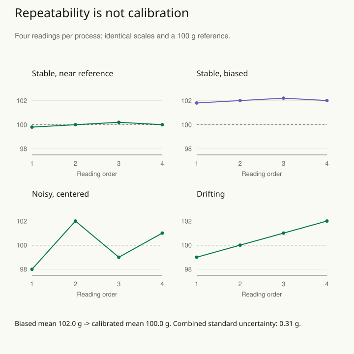

Two sensors report almost identical readings, so a team concludes that two production settings are equivalent. Later, calibration reveals that one sensor consistently reads high. The apparent similarity came from the instruments, not necessarily the process.

Recorded values are observations of a measurement process. They are not automatically exact versions of the quantities a statistical model is meant to describe. The useful response is to characterize important measurement errors and carry them into estimation and interpretation.

## Worked example: a repeatable scale with a shared bias

A fictional scale measures a reference object known here to weigh 100 grams. Four successive readings are 101.8, 102.0, 102.2, and 102.0 grams. Their average is 102.0: a very repeatable result can still be offset from the reference. The illustration compares that case with readings near the reference, wider scatter, and drift over time.

Suppose an independent calibration supports subtracting two grams and reports a standard uncertainty of 0.30 grams for that correction, including the relevant reference uncertainty. Do not estimate this correction solely by assuming that the unknown sample object ought to weigh 100 grams; the external reference or calibration supplies the needed information.

Standard deviation describes how much the individual readings scatter. For these four readings, sum their squared distances from the mean of 102 to get 0.08. Divide by 4 − 1 to estimate the sample variance, then take the square root to return to grams: **√(0.08 / 3) ≈ 0.163 grams**.

Uncertainty about the average is different from scatter among readings. Under a stable, independent repeatability model, divide the standard deviation by √4 to get the estimated standard uncertainty of the mean: **0.163 / √4 ≈ 0.082 grams**. Subtracting the two-gram calibration correction gives a corrected mean of **100.0 grams**.

| Component for the corrected mean | Standard uncertainty |
| --- | --- |
| Repeatability of the four-reading mean | 0.082 g |
| Independent calibration correction | 0.300 g |
| Combined by root sum of squares | 0.311 g |

For this simple uncertainty budget, assume the repeatability and calibration errors do not move together and that both apply to these measurement conditions. “Standard uncertainty” expresses each component on a standard-deviation scale, so the components can be combined consistently. The combined standard uncertainty is √(0.082² + 0.300²), approximately **0.31 grams**. An expanded uncertainty using a coverage factor of two is about **0.62 grams**. That factor does not automatically establish an exact 95% confidence interval: coverage depends on the component distributions, degrees of freedom, and uncertainty evaluation.

If 400 repeats had the same repeatability standard deviation, that contribution to the mean would fall to approximately 0.008 grams. The calibration contribution would remain 0.30 grams, giving a combined uncertainty still about 0.30 grams. A shared correction uncertainty does not become 400 independent corrections just because 400 readings were taken.

The calculation also has limits. Drift violates the stable repeatability picture, and a calibration valid at one weight or temperature may not transfer to another. Correlated components require covariance terms; adding squared uncertainties as if independent would then be wrong. The plot and budget together identify what information an additional repeat, a new calibration, or a revised procedure could actually supply.

## Distinguish the sources of error

An instrument can be repeatable yet systematically offset. Repeating the same reading helps characterize short-term variability but does not reveal a shared calibration error. Rounding hides information within intervals. A questionnaire can consistently measure a proxy that differs from the intended concept. These mechanisms require different responses.

Suppose a scale is checked against known reference weights and reads approximately two grams high across the relevant range. A calibration adjustment may be justified, accompanied by uncertainty about the correction. If the bias changes with weight or temperature, a single constant correction may be inadequate. Record the conditions under which calibration information applies.

In another setting, researchers relate activity levels to outcomes using a noisy wearable device. Treating measured activity as exact can distort the estimated relationship. An explicit measurement model distinguishes latent activity from its noisy readings, using validation data, repeated measurements, or credible prior information to constrain the error process.

## Make a useful uncertainty budget

List the contributions that could materially affect the final quantity: repeatability, calibration, sampling, rounding, processing, and differences between operators or batches. Quantify them where the evidence allows and explain substantial unquantified components. Combining uncertainties requires attention to their relationships; shared errors do not disappear just because many observations are averaged.

Before adding a complicated model, ask whether the uncertainty is consequential for the decision. A measurement error of a millimeter may be immaterial for a rough storage estimate and decisive for a precision component. A sensitivity analysis can show whether plausible error changes the conclusion.

## Advanced notes: a model needs information

Introducing an unknown true value and an unknown measurement variance does not by itself make them estimable. Replicate readings, reference measurements, validation studies, or substantive restrictions may be needed to distinguish measurement error from genuine variation. State where that information comes from.

The direction of distortion also depends on the error mechanism. The familiar attenuation of a simple regression slope applies under particular classical-error assumptions; it is not a universal rule for every noisy measure. Misclassification, systematic errors, and correlated measurement errors can behave differently.

A final check concerns meaning. Calibrating a sensor does not validate a questionnaire's interpretation, and a highly reliable score need not measure the intended construct. Explain both the measurement procedure and its relationship to the question.

This pattern is useful when small differences drive a claim, readings come from multiple instruments, explanatory variables are noisy, or processing produces more decimal places than the original measurements support. Report precision honestly and keep measurement uncertainty visible rather than burying it in a residual term.

## Sources and further reading

These independently written explanations and fictional examples draw on established statistical methods. The linked sources provide technical development and additional qualifications.

- [Stan methods guide and case studies](https://mc-stan.org/docs/stan-users-guide/measurement-error.html)
- [NIST Engineering Statistics Handbook](https://www.itl.nist.gov/div898/handbook/mpc/mpc.htm)
- [NIST: propagation of uncertainty and covariance](https://www.itl.nist.gov/div898/handbook/mpc/section5/mpc55.htm)

