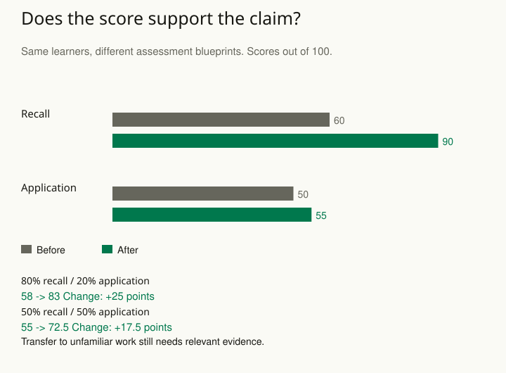

A training team celebrates a twenty-five-point improvement on its final assessment. Most questions ask participants to recognize definitions from the slides. The team announces that participants can now solve unfamiliar problems at work. The score may have been calculated perfectly, yet the conclusion reaches beyond what was measured.

Start with the claim the measurement must support. Then examine the chain connecting the intended concept, the tasks or observations, the scoring rule, and the decision. A reliable instrument can measure the wrong thing consistently. A useful proxy for one purpose can be weak evidence for another.

## Write the interpretation before selecting the instrument

“Learning” is too broad to determine a measurement plan. Recognizing terminology, explaining an idea, applying it to a familiar exercise, and transferring it to an unfamiliar situation make different demands. Specify whose performance matters, under which conditions, and how the score will be used. A low-cost practice quiz and a decision about independent work require different evidence.

Look for two kinds of mismatch. The assessment may omit important parts of the intended ability, such as handling an unfamiliar exception. It may also depend on something outside that ability, such as reading speed, interface familiarity, or prior access to the exact questions. These problems can coexist. Improving repeatability alone does not remove either one.

An operational definition makes an idea observable; it does not settle whether the observations justify every interpretation. Keep the label close to the evidence. “Performance on ten course questions” is immediately supported. “Readiness for independent problem solving” needs an additional argument and relevant checks.

## Worked example: an improvement changes with the blueprint

Consider a fictional assessment with eight equally weighted recall questions and two equally weighted application questions.

Recall questions ask for remembered information; application questions ask learners to use it. With ten equally weighted questions, eight recall questions give recall eight tenths, or 80%, of the total score. An assessment blueprint is the plan for which kinds of tasks contribute to that score. Treat the percentages below as cohort averages on each part. All participants supply both assessments; no sampling uncertainty or causal effect is being estimated in this arithmetic example.

| Part | Before → after |
| --- | --- |
| Recall | 60% → 90% |
| Application | 50% → 55% |

The original score weights recall at 80% and application at 20%. Before training it is **0.8 × 60 + 0.2 × 50 = 58**. After training it is **0.8 × 90 + 0.2 × 55 = 83**. That is the reported **25-point improvement**. The calculation is correct, but its size partly reflects which tasks dominate the assessment.

If the intended reporting blueprint gives recall and application equal weight, the corresponding summaries are 55 before and 72.5 after, an improvement of **17.5 points**. The application result itself improves by only **5 points**. Neither weighting is universally right, and the alternative weighting does not establish transfer. The choice should follow the intended interpretation and be documented before inspecting which summary looks most favorable.

The practical next step is to sample tasks that resemble the claimed use: unfamiliar problems, realistic constraints, and a scoring rubric that rewards defensible reasoning. Have relevant experts inspect what those tasks cover and what they miss. Try them with learners to check whether the intended reasoning actually produces the scores.

## Gather evidence that could challenge the interpretation

A measurement argument becomes stronger when it can fail. Compare the score with an independently assessed relevant performance, examine explanations of unexpected results, and check whether changes persist on new tasks. A correlation with a second quiz may partly reflect shared question wording. Repeated exposure may improve familiarity with the assessment without improving the target ability.

For a second example, a support team uses tickets closed per hour as its quality measure. A new workflow raises that number while reopened tickets also rise. Closure speed remains a useful operational observation, but the broader quality claim needs evidence about durable resolution, customer experience, and which cases staff receive. Combining these into a score introduces weights and tradeoffs that should be visible.

When comparing groups or periods, check whether the observation process is comparable. A translated item, a changed interface, or altered task difficulty can change a score even when the target ability stays constant. An aggregate comparison can conceal a measurement problem concentrated in one group. Examine item behavior and response processes, then decide whether comparison or recalibration is justified.

## Advanced notes: validity belongs to an interpretation and use

Reliability concerns consistency under specified sources of variation. Validity concerns the evidence supporting an interpretation for a proposed use. They answer related questions, and weak reliability can limit useful interpretation, but a high reliability coefficient is not a universal certificate. Nor does one impressive association validate every use of a score.

Latent-variable models can organize evidence about shared variation. They do not establish that a factor has the meaning suggested by its name. Check content, response processes, external relationships, and competing explanations. A model can fit a narrow set of items while that set underrepresents the intended concept.

Keep a short measurement record: the intended claim; the population and conditions; the observations and scoring; the evidence supporting the interpretation; and the important unresolved alternatives. Revisit it when the instrument, population, incentives, or use changes. If the evidence supports a narrower claim, report that narrower claim and collect the missing evidence before expanding it.

Related patterns: [[stats-define-target]], [[stats-measurement-error]], and [[stats-hidden-structure]].

## Sources and further reading

The calculations and examples are original fictional teaching cases. These primary sources develop the measurement principles in greater depth.

- [AERA, APA, and NCME: Standards for Educational and Psychological Testing, chapter 1](https://www.testingstandards.net/uploads/7/6/6/4/76643089/standards_2014edition.pdf)
- [Messick: Validity of Test Interpretation and Use](https://www.ets.org/research/policy_research_reports/publications/report/1990/ihmy.html)
