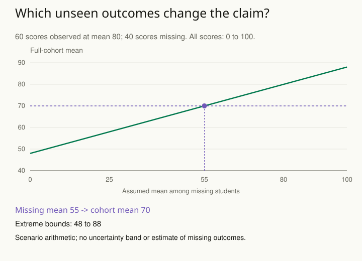

A course survey looks positive, but many students never complete the final questionnaire. If the missing students mostly dropped out because the course was difficult, the observed responses tell an incomplete story. Deleting missing rows has made an assumption about whose experience can stand for whom.

The pattern is to investigate the process producing missing values before choosing a technique. Distinguish a field that was never collected, an instrument failure, a skipped question, a lost follow-up, and a result withheld from publication. They may all appear as blanks while requiring different analysis and different claims.

## Ask what would make the missing values predictable

Suppose a sensor misses readings only during a scheduled maintenance period unrelated to the quantity being measured. That differs from a sensor that stops recording precisely when the quantity exceeds its range. In the latter case, treating the missing readings as ordinary absent observations discards information about extreme values.

For the course survey, compare available characteristics of respondents and nonrespondents, inspect timing, and use follow-up information when possible. These checks can reveal inconsistencies with simple assumptions, but observed data generally cannot prove that unobserved outcomes follow the required missingness mechanism.

## Choose a response with an explicit target

Complete-case analysis can be justified under some conditions, but it is not a universal default. Weighting can adjust for response probabilities under suitable models and assumptions. Multiple imputation can represent uncertainty about plausible replacements. Likelihood-based methods can use partially observed records under an explicit model.

Replacing every missing score with the observed average and then treating those replacements as genuine observations usually loses important uncertainty and distorts relationships. The issue is not merely choosing a sophisticated filling algorithm: the assumptions connecting observed and missing values must be credible.

A useful report says what was missing, how much was missing, which analysis handled it, and what assumptions support that analysis. It also distinguishes the original target population from any narrower population actually analyzed.

## Worked example: find the assumption that changes the conclusion

Return to the fictional course survey. There are 100 enrolled students, 60 observed final scores, and 40 unavailable scores. The observed mean is 80 on a bounded 0–100 scale. The target is the final-score mean for all 100 enrolled students, not merely for those who responded. Suppose 70 is a prespecified descriptive benchmark, not a causal comparison or significance threshold.

Let **m** denote the assumed mean score among the 40 missing students.

For example, assuming m = 65 does not assign every missing student a score of 65. It specifies only their group average; their individual scores could differ. We vary that unknown average to see how much the conclusion depends on it.

The mean for all enrolled students would be **(60 × 80 + 40 × m) / 100 = 48 + 0.4m**. The observed students contribute 60 × 80 = 4,800 score points; the missing students would contribute 40 × m. Divide their combined total by all 100 students. This expression separates the observed contribution from the part that depends on an assumption.

| Missing-group mean m | Full-cohort mean |
| --- | --- |
| 80 | 80 |
| 65 | 74 |
| 55 | 70 |
| 40 | 64 |

The mean reaches the benchmark when **48 + 0.4m = 70**, so **m = 55**. A missing-group mean below 55 takes the full-cohort mean below the benchmark. The respondent mean of 80 alone cannot tell us which row is credible. Reasons for dropout, earlier scores, and targeted follow-up can inform the plausible scenarios.

Because scores lie between 0 and 100, extreme bounds for this finite cohort are **48 to 88**. These bounds use only the observed total and the outcome range. They may be too broad to decide what to do, but they reveal how much the data leave unresolved. A plausible sensitivity range should be justified separately; choosing 65 because it preserves a favorable conclusion would not justify it.

This calculation holds the observed mean fixed and varies one unknown group mean. It does not add sampling uncertainty or imputation uncertainty, and it is not multiple imputation. In a fuller analysis, imputed datasets can represent uncertainty under a stated model; departures from that model can then be examined with meaningful adjustments. Report both the model and the sensitivity assumptions.

Missing completely at random means the missingness mechanism does not depend on the relevant observed or unobserved values. Missing at random allows dependence on observed information after conditioning appropriately, while excluding residual dependence on the missing values under the specified model. Neither phrase means that missing values were chosen casually. Distinguishing these assumptions can guide an analysis, but a comparison of respondents with nonrespondents cannot generally prove the required claim about unseen outcomes.

Related patterns: [[stats-sample-target]], [[stats-measurement-validity]], and [[stats-test-simulation]].

## Advanced notes: examine departures from the main assumption

Suppose the main analysis assumes that, conditional on recorded baseline information, nonrespondents would have comparable outcomes to respondents. Run additional scenarios in which missing outcomes are systematically worse or better by substantively plausible amounts. Ask when the conclusion changes and whether that change requires an implausible or a modest departure.

These scenarios are not estimates of what the missing values truly were. They show how the conclusion depends on information the study does not supply. Include uncertainty in the scenario analysis where feasible rather than presenting guessed replacements as established facts.

Prevention often offers more than repair. Collect the variables needed to understand dropout, preserve reasons for missingness, and design follow-up that reaches likely nonrespondents. For an ongoing system, distinguish actual zeros from unavailable measurements at data-entry time.

This pattern is useful whenever an analysis silently shrinks after exclusions or a clean-looking table hides a selective observation process. The objective is a justified conclusion with visible assumptions, not a spreadsheet with every cell filled.

## Sources and further reading

These independently written explanations and fictional examples draw on established statistical methods. The linked sources provide technical development and additional qualifications.

- [Cochrane Handbook](https://www.cochrane.org/authors/handbooks-and-manuals/handbook/current/chapter-10)

