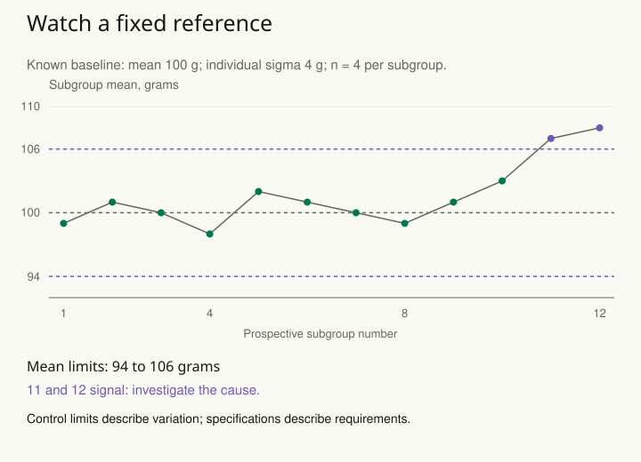

A production dashboard turns red whenever this week’s average exceeds last week’s. The team repeatedly adjusts a machine in response. Sometimes the next week improves; sometimes it gets worse. Ordinary variation is being treated as evidence that the process changed, while gradual changes can disappear inside a constantly moving comparison.

Establish a baseline that describes a sufficiently stable process, select a statistic and a signal rule, and then monitor new observations against that reference. Investigate signals as prompts for diagnosis. A control chart makes the comparison and its assumptions visible; it does not automatically identify a cause or establish that output is acceptable.

## Choose what the chart is watching

A chart of individual readings, subgroup means, proportions, and event counts has different variability. Choose a statistic suited to the outcome and collection process. Define what makes a subgroup meaningful: for example, four items produced under similar short-term conditions. Preserve time order and record relevant process changes.

Use historical information to investigate stability before fixing prospective limits. Changes in measurement, product mix, operating conditions, or dependence can make one pooled baseline misleading. Do not remove inconvenient baseline points simply because narrower limits look more sensitive. Establish an explanation for any exclusion and preserve a record of the decision.

## Worked example: four readings per subgroup

Consider a fictional filling process. A separate, adequate historical assessment is assumed to establish an in-control mean of **100 grams** and an individual-reading standard deviation of **4 grams**. For this example, readings are independent Normal observations with unchanged variability, and consecutive subgroups are independent. Treat both baseline parameters as known so that the arithmetic isolates the monitoring rule.

Each new subgroup contains four readings.

A subgroup is one batch of readings taken together for monitoring; the chart plots their average. Sigma is another name for standard deviation, the model’s measure of spread. A three-sigma limit is three standard deviations of the plotted statistic from its baseline mean, not necessarily three standard deviations of an individual reading.

For four independent readings, the subgroup mean has standard deviation **4 / √4 = 2 grams**. A three-sigma chart for these means therefore has center 100 and limits **100 ± 3 × 2**, or **94 and 106 grams**. Limits for subgroup means are narrower than limits for individual readings because the plotted statistic is an average.

The next twelve subgroup means are 99, 101, 100, 98, 102, 101, 100, 99, 101, 103, 107, and 108. Under the prespecified rule “signal when a subgroup mean falls outside the limits,” subgroups **11 and 12 signal**. Values 102 and 103 do not signal under this rule. The first ten prospective points are monitoring observations, not the historical data used to estimate the baseline.

An investigation might find a change in calibration, raw material, staffing, or machine settings. Check both location and variability: a stable mean can conceal increased spread. Preserve the original sequence and the investigation outcome. If a lasting, understood process change justifies a new baseline, document when it begins and estimate it from suitable new information.

## A signal has a false-alarm rate

Under the stated known-parameter Normal assumptions, an in-control subgroup mean falls outside three-sigma limits with probability about **0.27%**. This is a per-point probability. Across twenty independent monitored subgroups, the probability of at least one such signal is **1 − (1 − 0.0026998)²⁰ ≈ 5.26%**. A low chance at one look is not the chance across an ongoing dashboard.

Additional run or trend rules can improve sensitivity to some changes while altering false alarms. Specify the rule set in advance and evaluate its operating behavior. Trying several rules after seeing a suspicious run makes a favorable interpretation easier to obtain. Averages, cumulative-sum charts, and exponentially weighted charts have different detection properties and require their own design choices.

For a second example, a service team tracks the proportion of jobs needing rework. A week with twenty jobs has different proportion variability from a week with two hundred. A suitable proportion chart accounts for the denominator and its assumptions; fixed limits copied from a constant-volume example can mislead. Sparse counts may need exact or model-based treatment.

## Advanced notes: stability, capability, and causation differ

Control limits describe expected variation for a specified baseline and monitoring statistic. Specification limits describe externally required performance. A stable process can consistently miss a customer requirement. Conversely, a process can meet requirements while exhibiting a detectable change. Keep the chart’s limits and the business tolerance visibly distinct.

Estimated baseline parameters add uncertainty that the known-parameter example omits. Autocorrelation, non-Normal tails, changing subgroup sizes, and seasonal patterns can alter nominal signal rates. Use a suitable chart or model, then assess it with realistic simulated sequences. The number of historical subgroups and their conditions matter; twelve convenient observations do not automatically establish a stable reference.

A signal alone does not show that an intervention caused a change. Changes may coincide with measurement drift, case mix, or an unrelated event. If the objective is a causal claim, design a credible comparison. If the objective is forecasting, evaluate predictive performance under future conditions rather than substituting control limits for a full forecast distribution.

Use this pattern when a running process provokes frequent reactions but lacks a clear reference. Write down the baseline period and conditions, statistic, subgroup definition, limits, rule set, investigation response, and conditions for rebaselining. That record turns repeated inspection into a procedure whose behavior can be examined.

Related patterns: [[stats-validate-forward]], [[stats-forecast-intervals]], [[stats-account-for-search]], and [[stats-measurement-error]].

## Sources and further reading

The sequence and calculations are original fictional examples. NIST develops the charting principles and assumptions.

- [NIST: What are control charts?](https://www.itl.nist.gov/div898/handbook/pmc/section3/pmc31.htm)
- [NIST: Variables control charts](https://www.itl.nist.gov/div898/handbook/pmc/section3/pmc32.htm)
- [NIST: Process monitoring and control](https://www.itl.nist.gov/div898/handbook/pmc/pmc.htm)
