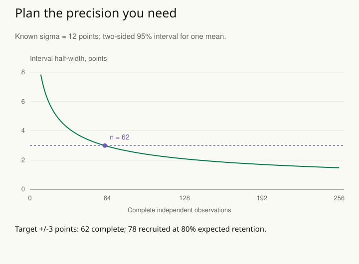

A team has enough budget to recruit fifty people. It asks whether fifty is a good sample size. That question has no single answer: estimating a rough average, comparing two treatments, studying a rare failure, and describing ten separate subgroups require different amounts and kinds of information.

Start with the quantity to estimate and the precision that would make it useful. Then connect the design to plausible outcome variation, dependence, missingness, and recruitment. A sample-size calculation is a conditional planning argument. Its assumptions should be inspectable before the study begins.

## Worked example: estimate an average within three points

Suppose a fictional study estimates the mean score for a defined population on an assessment. For a transparent first calculation, assume independent observations from a Normal (bell-shaped) population with **known standard deviation 12 points**. This standard deviation measures spread among individual scores; the interval below concerns uncertainty about their population average. The aim is a two-sided 95% confidence interval with half-width at most three points.

Half-width means the distance from the estimated mean to either endpoint. If the sample mean were 70, a half-width of three would give 67 to 73. It concerns uncertainty about the population average, not a promise that individual scores lie within three points of 70. The symbol n below counts complete observations. This is an estimation target, rather than a claim about the probability of rejecting a null hypothesis.

Under those assumptions, the half-width is 1.960 × 12 / √n. Rearranging gives n ≥ (1.960 × 12 / 3)², approximately 61.46. Round upward: **62 complete observations** meet the stated target. Rounding down would promise slightly more precision than the design supplies.

| Complete observations | Planned 95% half-width |
| --- | --- |
| 16 | 5.88 points |
| 64 | 2.94 points |
| 256 | 1.47 points |

The table shows the resource tradeoff. Quadrupling n halves this interval's half-width under the fixed assumptions. Collecting four times as many observations does not make the original measurement four times more accurate, fix selective participation, or reduce a shared calibration error.

If only 80% of recruits are expected to provide usable outcomes, divide 62 by 0.8 and round up to **78 recruits**. This targets an expected number of complete observations; random dropout can leave the achieved sample smaller. It does not guarantee 62 outcomes, and it does not repair bias if missing outcomes differ systematically. A recruitment buffer or explicit probability of attaining the target may be appropriate when falling short has important consequences.

## A comparison requires its own calculation

Now change the question to the difference between two independent group means. With the same known standard deviation in both groups and equal completed group sizes, the standard error is 12 × √(2 / n), where n is the number per group. A three-point half-width therefore needs approximately 122.93 observations per group, rounded to **123 per group**, or 246 complete observations in total.

At the same 80% expected retention, recruitment becomes 154 per group, or 308 in total. Reusing the earlier answer of 62 would quietly replace a two-group comparison with a one-mean calculation. Paired designs, unequal group sizes, binary outcomes, and cluster assignment require their own appropriate variance calculations.

Precision planning also differs from power planning. Power concerns how often a specified testing procedure rejects under a particular alternative effect and design. The desired effect, significance level, test, and stopping rule matter. Neither a confidence-width target nor a conventional power percentage can choose the smallest practically important effect on the team's behalf.

## Stress-test the assumptions before committing resources

The standard deviation is rarely known exactly. If it is actually 18 rather than 12, the one-mean calculation needs about 138.29 complete observations, rounded to 139. If the desired half-width is 1.5 rather than three, the original standard deviation implies 246 complete observations. A single convenient variance estimate can hide a large planning uncertainty.

When the standard deviation must be estimated, the exact known-sigma formula no longer provides the promised interval calculation. Use an appropriate procedure, such as planning with a t-based interval or simulation, and examine uncertainty in the variance assumption. Report a range of plausible resource requirements when the available pilot evidence is weak.

Dependence is another information constraint. Hundreds of records from a few teams need not provide the same precision as hundreds of independent teams or people. Randomization within blocks can improve some comparisons, while dropout and unequal weighting can reduce effective information. [[stats-randomize-blocks]], [[stats-paired-comparisons]], and [[stats-sample-target]] explain why the design matters alongside the row count.

## Advanced notes: define what success would establish

For a complicated design, simulate the complete planned process: assignment, observations, exclusions, estimation, uncertainty, and the resulting decision. Examine achieved interval widths or coverage across credible scenarios. [[stats-test-simulation]] explains how to separate Monte Carlo error from the uncertainty being studied.

Prespecify what will be estimated, which observations belong, and whether interim looks can change the stopping rule. Collecting more data whenever the current result is inconvenient changes the procedure that the original calculation describes. If practical equivalence is the target, [[stats-practical-equivalence]] supplies the relevant question; it needs sufficient information to rule out meaningful differences.

Use this pattern when study scope is being negotiated or an existing dataset is being offered as adequate by its size alone. A useful plan states the target, desired precision, outcome variability, dependence, expected usable observations, and assumptions that would make the result less informative than planned.

## Sources and further reading

The calculations are original fictional planning examples with explicit known-sigma assumptions.

- [NIST: sample sizes for estimating a mean](https://www.itl.nist.gov/div898/handbook/prc/section2/prc222.htm)
- [NIST: confidence intervals and known versus estimated standard deviation](https://www.itl.nist.gov/div898/handbook/prc/section1/prc14.htm)
