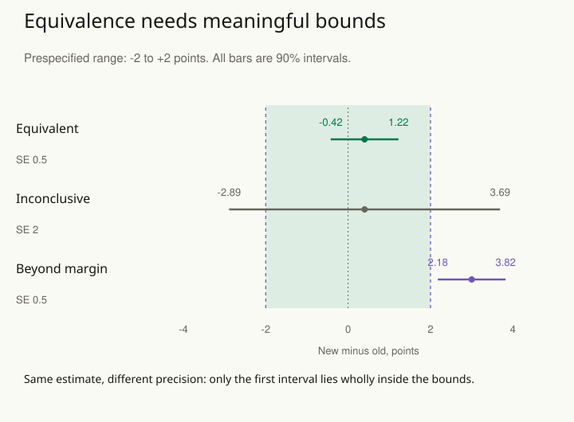

A cheaper process produces an estimated score difference of 0.4 points. Its comparison with the old process is not statistically significant. The team wants to call the processes equivalent and adopt the cheaper one. The same label could arise from a precise estimate near zero or a study too noisy to distinguish large benefits from large harms.

Practical equivalence asks whether the data rule out differences large enough to matter. Define those differences before examining the result, select an appropriate procedure, and retain an inconclusive outcome when information is insufficient. Equivalence is relative to a target, scale, margin, and set of assumptions; it is not a statement that two processes are identical.

## Worked example: a two-point margin

For a fictional assessment, stakeholders decide in advance that mean changes strictly between −2 and +2 points are small enough for a specified use. Both directions matter.

Here a margin is the largest difference considered small enough for the stated purpose. The question is whether the evidence is precise enough to stay inside both margins, not whether the estimated difference is exactly zero. The target is the new-minus-old population mean difference for the same defined assessment and follow-up. The margin comes from consequences and measurement meaning, rather than whichever interval the study eventually returns.

Use two one-sided tests, commonly called TOST, each at significance level 0.05. One tests whether the difference exceeds the lower margin; the other tests whether it is below the upper margin. Both must support being inside the margins before this procedure declares equivalence. Under the usual matching formulation, this is equivalent to requiring the corresponding two-sided **90% confidence interval** to lie wholly within the equivalence bounds. A 95% interval is often used for a different two-sided question about zero; the confidence level must match the testing procedure.

For simple arithmetic, assume an unbiased Normally distributed effect estimate with a known standard error. If the estimate is 0.4 and the standard error is 0.5 points, the 90% interval is 0.4 ± 1.645 × 0.5, approximately **−0.42 to +1.22**. Both ends lie inside −2 to +2, so this procedure supports practical equivalence under the stated assumptions.

| Result | Estimate (known SE) | 90% interval |
| --- | --- | --- |
| Equivalent | 0.4 (0.5) | −0.42 to +1.22 |
| Inconclusive | 0.4 (2.0) | −2.89 to +3.69 |
| Beyond the margin | 3.0 (0.5) | +2.18 to +3.82 |

The second study has the same point estimate, but its interval extends beyond both margins. It supports neither practical equivalence nor a clear consequential difference. Calling it equivalent because its ordinary zero-difference test is nonsignificant would replace insufficient information with a favorable conclusion.

The third interval lies entirely above +2. It supports a positive difference exceeding the upper practical margin under the illustrative model. Whether that change is beneficial or harmful depends on what the score measures. An interval overlapping a margin would leave the corresponding practical question unresolved, even if a separate test established a positive difference from zero.

For the first case, the ordinary 95% interval is approximately −0.58 to +1.38 and includes zero. It is therefore possible to lack evidence against an exact zero difference while having enough precision to support equivalence within the specified bounds. With other results, a small difference can be distinguishable from zero and still lie within a practically negligible range. These procedures ask different questions.

## Justify the margin before the result

Use the outcome's units, measurement capability, stakeholder consequences, and intended population to argue for the bounds. Symmetry is a choice, not a requirement. A delay may be tolerable in one direction while a quality loss of the same numerical size is unacceptable in the other. Report the justification so another reader can assess the practical claim.

A second application is replacing one measuring instrument with another. Equivalence of their average readings does not establish agreement for individual specimens. Large positive and negative discrepancies could cancel. If individual interchangeability matters, inspect an appropriate agreement analysis and acceptable individual differences; [[stats-measurement-error]] and [[stats-paired-comparisons]] preserve that distinction.

## Design for an informative answer

A broad interval cannot establish a narrow equivalence claim. Plan sample size and precision against the actual bounds and a plausible effect, using a procedure appropriate to the design. [[stats-plan-precision]] explains why row counts, dependence, dropout, and outcome variability must enter that argument. Power for an equivalence procedure is not automatically the power of an ordinary difference test.

Real studies usually estimate standard errors. Use the corresponding t-based, model-based, or otherwise suitable interval and tests, rather than substituting the known-SE Normal multipliers from this teaching example. Account for paired observations, clustering, multiplicity, selection, and any consequential departures from the analysis assumptions.

## Advanced notes: preserve what the conclusion covers

A one-sided noninferiority question asks whether a loss exceeds one specified margin. Two-sided equivalence rules out meaningful differences in both directions. Select the question that matches the decision and avoid changing between them after inspecting the result.

Equivalence on one mean outcome does not establish equality of distributions, subgroup effects, measurement processes, or causal mechanisms. Nor does an equivalent average remove safety, cost, or implementation concerns that were never measured. A final conclusion should state the bounds, target population, interval, procedure, and unresolved limitations. Use [[stats-report-uncertainty]] to communicate the evidence and [[stats-choose-consequences]] to explain the resulting action.

## Sources and further reading

All scenarios and numerical results are original fictional examples.

- [Lakens: Equivalence Tests—A Practical Primer](https://pmc.ncbi.nlm.nih.gov/articles/PMC5502906/)
- [NIST: confidence intervals](https://www.itl.nist.gov/div898/handbook/prc/section1/prc14.htm)
