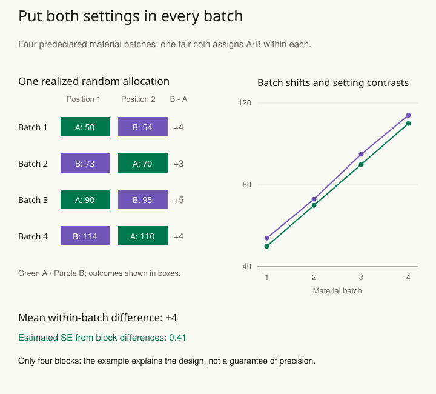

A team tests two manufacturing settings over several days. Setting A runs on Monday's material and setting B on Friday's material. The output differs, but material quality and day conditions differ too. The experiment has bundled the setting with other plausible explanations.

Random assignment breaks systematic links between treatment assignment and baseline characteristics through a known chance mechanism. Blocking adds a useful constraint: form groups based on important pretreatment characteristics, then randomize treatments within those groups.

A block is a group of units that are similar in a relevant way before treatment. In this example, compare A and B on the same material batch, then combine those within-batch comparisons. The batch is the block; A and B are the settings being tested. This can improve precision while preserving a defensible treatment comparison.

## Design the comparison before running it

For the manufacturing example, use material batches as blocks and assign both settings within each batch, in randomized order where appropriate. The treatment contrast then uses comparisons made under more similar conditions. Keep a record of assignment and execution, including deviations.

A customer experiment might block by subscription tier. Within each tier, randomly assign customers to the existing or new message. A chance imbalance in tier composition becomes less likely to obscure the treatment contrast. The analysis should reflect the design and the population weighting relevant to the target effect.

Choose a modest number of useful blocking characteristics. Creating so many combinations that blocks contain almost nobody can make implementation difficult. Characteristics should be measured before treatment and selected for their relevance to outcomes or experimental logistics, rather than chosen after seeing which partition produces an attractive result.

## Keep assignment separate from participation

An assigned treatment and a received treatment can differ. Some customers never open the assigned email; some machines fail to execute the planned setting. Comparing only compliant recipients can destroy the protection offered by random assignment. An intention-to-treat analysis estimates the effect of assignment; estimating another effect requires additional assumptions and a clearly defined target.

Similarly, randomizing people may be inappropriate when a treatment spreads within teams. The randomization unit may need to be a classroom, store, or site. The analysis must respect that grouping rather than pretending every person received an independent assignment.

## Worked example: two settings in each of four batches

Suppose four material batches differ substantially in baseline quality. Each batch supplies two comparable experimental units. Before measuring outcomes, declare batch as the block and use an independent fair coin within each batch to assign A and B to its two positions. Assume the units can receive settings independently and that there is no carryover or spillover between them.

One possible realized allocation is **A/B, B/A, A/B, B/A** across the four batches. This alternating-looking sequence is the recorded outcome of four coin tosses, not an instruction to alternate deterministically. There are **2⁴ = 16** possible allocations under this design, each with probability **1/16**. Each allocation gives both treatments to every batch.

The fictional observed quality scores are:

| Batch | A → B; difference B − A |
| --- | --- |
| 1 | 50 → 54; +4 |
| 2 | 70 → 73; +3 |
| 3 | 90 → 95; +5 |
| 4 | 110 → 114; +4 |

Compare the settings within each batch, then average the four differences: **(4 + 3 + 5 + 4) / 4 = 4 score points**. This is an equally weighted block comparison. The overall A mean is 80 and the overall B mean is 84, so the unadjusted difference happens to be four as well in this balanced design. Blocking changes how the comparison is constructed and how its uncertainty is assessed; it need not change the point estimate.

The spread of those four differences is small relative to the spread across batches. Their sample variance is **[(4 − 4)² + (3 − 4)² + (5 − 4)² + (4 − 4)²] / 3 = 2/3**. Treating the block differences as independent observations gives an estimated standard error for their mean of **√[(2/3) / 4] ≈ 0.41 points**.

The standard error describes how the estimated average difference would vary across repeated studies under this working model. It is not the spread of all eight quality scores. That distinction is why the within-batch differences, rather than the large differences between batches, drive this calculation.

A naive independent-group calculation uses the much larger variation among the four A scores and among the four B scores. It yields **√[(666.67 + 680.67) / 4] ≈ 18.35 points**. That calculation ignores the deliberate within-batch comparison. It is not a second equally appropriate uncertainty estimate for the blocked design. The dramatic difference here is engineered to make the mechanism visible, not a promised precision gain in every experiment.

If we instead kept only A from batch 1 and B from batch 4, the difference would be **114 − 50 = 64 points**. That comparison bundles the setting with the batch conditions. It does not isolate the setting effect and cannot be repaired by calling the two observations randomized after the fact.

Four blocks are enough to inspect this arithmetic, but provide weak information about how block differences vary more generally. The 0.41 standard error is not itself a 95% interval or a guarantee of a stable effect. Small-sample inference depends on the design and assumptions; a larger study should plan the number of independent blocks prospectively.

Use [[stats-choose-assignment-unit]] to identify what can be randomized independently. [[stats-paired-comparisons]] explains the paired uncertainty calculation, while [[stats-plan-precision]] helps decide how many informative comparisons are needed before collecting outcomes.

## Advanced notes: randomization is not guaranteed balance

Chance assignment does not promise identical groups in a particular experiment. Its value comes from the design-based probability structure and the avoidance of systematic allocation based on prognosis. Baseline differences should be interpreted in that context, with prespecified adjustments where appropriate.

Blocking cannot correct an unreliable outcome measure, selective attrition, or interference that the design ignores. Nor does random assignment make a recruited sample representative of a wider population. These are separate design questions.

The pattern works best before data collection, when investigators can control assignment and preserve records. If the experiment has already been confounded by scheduling, calling it randomized afterward does not repair it. State the limitation and consider whether any remaining variation supports a narrower comparison.

A useful design statement identifies the assignment unit, treatment options, blocks, randomization procedure, outcome, follow-up period, and analysis target. Those details turn “we compared A and B” into a study whose evidence can be assessed.

## Sources and further reading

These independently written explanations and fictional examples draw on established statistical methods. The linked sources provide technical development and additional qualifications.

- [NIST Engineering Statistics Handbook](https://www.itl.nist.gov/div898/handbook/pri/section3/pri332.htm)

