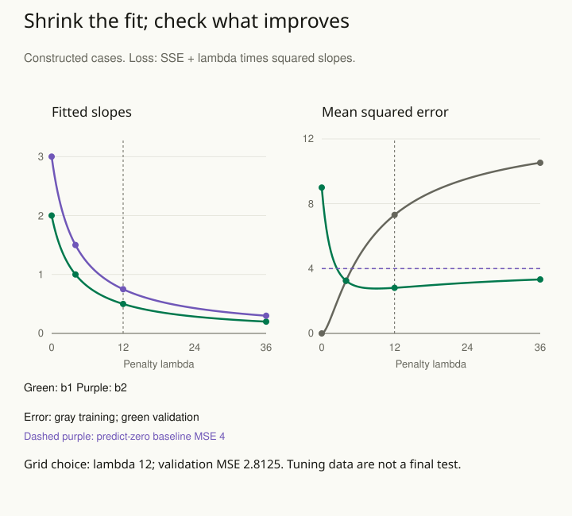

A model fits last month's data almost perfectly, but its predictions deteriorate on new observations. Removing one case reverses several coefficients. There are many ways to explain the observed sample, and the fitting procedure has used flexibility to follow noise.

Regularization limits how freely a model can fit the observed data. A penalty, for example, makes large coefficients costly; coefficients are the numbers multiplying the model’s inputs. A prior or a restriction on the model can also supply a constraint. These constraints trade some flexibility for stability. The strength and form of that constraint should be justified by the task and checked using information that was not already spent tuning the model.

## Stabilize a weakly determined relationship

Suppose two predictors measure nearly the same behavior. Their separate coefficients may be poorly determined even when their combined predictive contribution is useful. A ridge penalty or suitable prior can shrink unstable coefficient combinations. This does not discover which correlated predictor is the true cause; it changes the estimation problem by adding structure.

In a second example, a small binary-outcome dataset happens to separate perfectly: everyone above a predictor threshold succeeds and everyone below fails. The usual unpenalized logistic maximum-likelihood estimate can diverge. A suitable penalized or Bayesian approach can produce finite estimates while expressing uncertainty and the additional assumptions.

Regularization also appears in partial pooling, smooth curves, and restrictions on interactions. The reusable idea is that poorly supported detail should not be allowed unlimited influence merely because a numerical fitting routine can represent it.

## Choose the constraint for a reason

Scale matters. A penalty applied to coefficients measured in incompatible units can impose unintended preferences. Standardization or domain-specific scales can make the constraint interpretable. Priors should be examined through the predictions they imply, not only through whether a parameter value seems broad.

Choose tuning procedures that respect the intended use. If predicting future observations, preserve time order. If predicting a new site, hold out sites. Feature selection, scaling, and tuning belong inside the training portion of each validation split. Otherwise information from evaluation data can leak into the apparent performance.

## Worked example: shrink a fitted pattern that does not recur

Use four fictional training cases with two centered predictors. Their pairs are **(−1, −1), (−1, 1), (1, −1), and (1, 1)**. Training outcomes are **−5, 1, −1, and 5**. Ordinary least squares fits them exactly with **prediction = 2x₁ + 3x₂** and an intercept of zero.

Now define four separate, constructed validation cases with the same predictor combinations and outcomes **−2, −2, 2, and 2**. In those cases the relationship is **2x₁**; the training pattern involving x₂ does not recur. This deliberately transparent example lets us calculate the tradeoff rather than infer a population truth from a tiny dataset.

Use ridge regression, which balances prediction errors against the size of its slopes. Its objective here is **sum of squared training errors + λ × (b₁² + b₂²)**. The slopes b₁ and b₂ multiply x₁ and x₂; λ, read “lambda,” controls how strongly large slopes are penalized. Leave the intercept, the constant term, unpenalized.

For these centered, equally scaled inputs, the two predictor columns are orthogonal: their products sum to zero. This special structure makes both slopes shrink by the factor **4 / (4 + λ)**. At λ = 4, the factor is 4 / 8 = one half, so slopes 2 and 3 become 1 and 1.5. The matrix shorthand **XᵀX = 4I** records this example’s special structure. The table can be followed using the shrinkage factor alone.

| Penalty λ | Slopes b₁, b₂ |
| --- | --- |
| 0 | 2, 3 |
| 4 | 1, 1.5 |
| 12 | 0.5, 0.75 |
| 36 | 0.2, 0.3 |

At **λ = 4**, the model gives up its perfect training fit. Predictions become **−2.5, 0.5, −0.5, and 2.5**. Training mean squared error is **3.25**.

Mean squared error, or MSE, squares each prediction error and averages those squares. Lower MSE means smaller errors by this measure. It is measured in squared outcome units, so it is not an average error of 3.25 outcome points.

Validation errors relative to −2, −2, 2, 2 are **−0.5, 2.5, −2.5, and 0.5**, whose mean square is also **3.25**. The unpenalized model had training MSE **0** but validation MSE **9**.

For the prespecified grid **0, 4, 12, and 36**, validation MSE is **9, 3.25, 2.8125, and 3.33**. The grid selects **λ = 12**. The smooth curve also shows values between grid choices: its minimum occurs at **λ = 9**, with validation MSE **36 / 13 ≈ 2.7692**. Thus twelve is the best of the four prespecified choices, not the minimum over every possible penalty. Even stronger shrinkage is not automatically better: driving both slopes to zero would predict zero for everyone and produce validation MSE **4**. The graph includes that simple baseline so that improvement has a concrete reference.

Notice that ridge shrinks both slopes, including the useful x₁ slope. Its benefit here comes from reducing the unstable x₂ contribution enough to outweigh the introduced bias. It has not discovered that x₂ is irrelevant by setting its coefficient to zero. Real correlated predictors generally do not share one simple shrinkage factor, and changing predictor scales changes the penalty’s meaning.

The validation cases are part of choosing the penalty. Once they select λ, their minimum error is not an untouched estimate of the selected procedure’s future performance. Use additional independent evaluation or a suitable nested validation design if that estimate is needed. Fit scaling, feature selection, and tuning within each training partition, as described in [[stats-validate-forward]].

The numerical λ also depends on the loss convention. Software that divides squared error by sample size uses a differently scaled penalty parameter. Record the objective, predictor transformation, unpenalized terms, tuning grid, and evaluation boundary. [[stats-check-model]] then checks whether the constrained model still misses important structure; numerical stability alone is insufficient.

## Advanced notes: stability is not identification

A regularized estimate can be numerically stable because the prior or penalty determines a direction that the likelihood cannot distinguish. That can be useful, but it should not be mistaken for new information supplied by the data. Inspect sensitivity to consequential constraints and distinguish predictive performance from interpretation of individual coefficients.

Shrinkage can hide a real large effect if applied too strongly. Sparse-selection methods may choose one among several correlated predictors without establishing that the others are irrelevant. Present uncertainty about the procedure and avoid treating a selected feature list as a definitive scientific explanation.

Compare the model with a simple baseline. Complexity earns its place through improved performance or a more credible account of the process, not through a longer specification. If predictions remain unstable, more data or a narrower question may be more valuable than another tuning search.

Use this pattern when estimates swing, a model has many adjustable parts relative to information, or a fit appears too perfect. Ask what is being constrained, why that constraint is plausible, and how the conclusion changes when it is relaxed.

## Sources and further reading

These independently written explanations and fictional examples draw on established statistical methods. The linked sources provide technical development and additional qualifications.

- [Stan methods guide and case studies](https://mc-stan.org/docs/stan-users-guide/regression.html)
- [scikit-learn: Ridge regression objective](https://scikit-learn.org/stable/modules/generated/sklearn.linear_model.Ridge.html)
- [Penn State: Regression shrinkage methods](https://online.stat.psu.edu/stat508/Lesson06.html)
