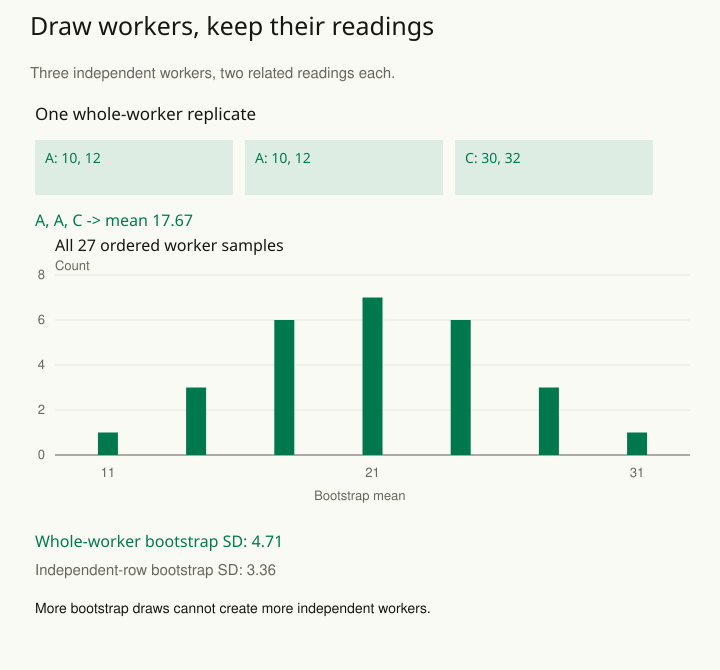

A team records two measurements from every worker and bootstraps the spreadsheet by drawing individual rows. Some simulated samples include a worker’s first measurement without the second. Others combine observations as though all rows came from different people. The resulting uncertainty describes a different sampling process from the one that produced the data.

A bootstrap repeatedly constructs new datasets from the observed data and recomputes an estimate. Its usefulness depends on what is resampled and why. Preserve the structure that creates dependence: pairs, people, classrooms, sites, or consecutive stretches of time. Resampling is an approximation to a stated process, not a way to make the sampling design disappear.

## Identify what could have been sampled again

For independent people with several jointly measured variables, resample people and retain all their variables together. For before-and-after measurements, retain the pairing. If independent sites contain related observations, a cluster bootstrap may resample entire sites. For a stratified design, preserve the relevant strata and allocation rather than mixing everything into one pool.

The unit follows the inferential question and the design. A time series usually cannot be treated as independent dates; suitable block or model-based methods preserve relevant temporal dependence. Complex surveys can require design-specific replicate weights. Hierarchical sampling may need multiple levels represented. “Use a bootstrap” is therefore the beginning of a method specification.

## Worked example: six rows, three independent units

Suppose three independently sampled workers each supply two readings. The target is the population mean across workers, giving each worker equal weight. All workers have the same number of readings, so the ordinary row mean happens to equal this worker-weighted mean.

| Worker | Two readings; worker mean |
| --- | --- |
| A | 10, 12; mean 11 |
| B | 20, 22; mean 21 |
| C | 30, 32; mean 31 |

The estimate is **(11 + 21 + 31) / 3 = 21**. A whole-worker bootstrap draws three worker labels independently with replacement, carrying both readings whenever a worker is selected.

“With replacement” means put the label back after each draw, so the same worker can be selected again. Drawing A twice means including two copies of A’s complete pair of readings. It does not mean observing a new fourth worker. One possible sample is **A, A, C**. Its six readings are 10, 12, 10, 12, 30, 32, and its estimate is **17.67**. Give each sampled copy its own cluster identity when fitting models that use those identities.

There are only **3³ = 27 ordered worker-label samples**. Enumerate them all in this teaching case. Their bootstrap means range from 11 to 31, with mean 21 and standard deviation **4.71**. This is the exact conditional standard deviation of this finite bootstrap distribution, using its probability weights; it is not an unbiased population standard-error formula.

If instead six individual rows are drawn independently with replacement, the conditional variance of a draw is 67.67 and the variance of the six-row mean is 67.67 / 6. Its bootstrap standard deviation is **3.36**. The smaller number comes from treating within-worker information as independently resampled evidence. It does not become more appropriate by running more replications.

This deliberately tiny dataset exposes the mechanism. It is not a recommendation to report a bootstrap interval from three clusters. The observed workers cannot represent the full diversity of possible workers, and tail behavior is poorly determined. Hundreds of thousands of bootstrap draws would reduce computational noise while leaving that information shortage intact.

## Repeat the full analysis inside each sample

Recompute the statistic the report actually uses. If the analysis includes normalization, fitting, or a selection step, decide which parts must be repeated to represent its uncertainty. Holding a data-selected model fixed can answer a narrower question than uncertainty for the full procedure. Failed fits and undefined statistics need explicit handling; silently dropping them changes the summarized distribution.

For a second example, estimate average before-and-after improvement from paired scores. Resample complete people, calculate each sampled person’s change, and average those changes. Separately drawing the before and after columns destroys the covariance that makes the comparison informative. A permutation test is different again: it uses rearrangements justified by a null hypothesis or assignment mechanism. Bootstrap resampling and permutation are not interchangeable labels for repeated shuffling.

## Advanced notes: preserve the estimand as well as dependence

Unequal cluster sizes make weighting consequential. The average of site means targets an equally weighted site summary; the average of all individual outcomes weights larger sites more heavily. Specify whether people or sites define the target, and keep the estimator and resampling design aligned. Informative cluster size can require more care than choosing one convenient formula.

A bootstrap standard error is only one ingredient in an interval. Percentile, basic, and other constructions have different behavior. Boundary estimates, extreme quantiles, rare events, weak identification, and very few independent units can defeat ordinary approximations. Inspect the distribution and use known-answer simulations that resemble the intended design before relying on coverage claims.

Record the resampling unit, preserved structure, estimator, number of replications, random seed, interval method, and treatment of failures. Check whether increased replications stabilize the reported summary, while keeping separate the question of whether the underlying data and resampling assumptions are adequate. The useful result is uncertainty for a recognizable sampling process.

Related patterns: [[stats-paired-comparisons]], [[stats-separate-within-between]], [[stats-test-simulation]], and [[stats-choose-assignment-unit]].

## Sources and further reading

The finite example is original and exactly enumerable. These references explain resampling interfaces and dependence-aware extensions.

- [R boot documentation: bootstrap resampling, multivariate observations, and strata](https://stat.ethz.ch/R-manual/R-devel/library/boot/html/boot.html)
- [R boot documentation: block and model-based time-series resampling](https://stat.ethz.ch/R-manual/R-devel/library/boot/html/tsboot.html)
- [Cameron and Miller: A Practitioner’s Guide to Cluster-Robust Inference](https://www.econ.ucdavis.edu/faculty/cameron/research/Cameron_Miller_JHR_2015_February.pdf)
