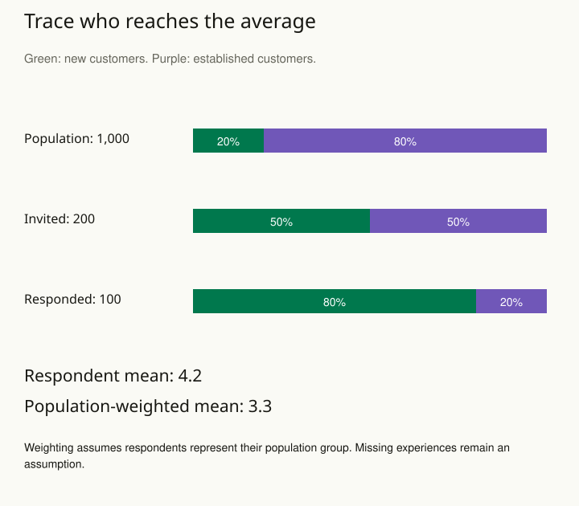

An organization asks website visitors to rate its service. Thousands respond, and the average rating has a narrow uncertainty interval. Yet people who left the service months ago never see the questionnaire. Increasing the number of current visitors cannot reveal the experiences of those absent former customers.

The problem is a mismatch between the target population and the process producing observations. Start by describing who could enter the dataset, who actually entered, and who supplied the final outcome. Sampling precision concerns variation from the sampling process. Representativeness concerns whether that process supports claims about the intended population.

## Worked example: whose ratings dominate the average?

A fictional service wants the average rating among all 1,000 current customers. Its complete register contains 200 new and 800 established customers. The team invites 100 from each group, but 80 new customers and only 20 established customers respond. Suppose ratings average 4.5 and 3.0 within those respondent groups on the same five-point scale.

| Group | Population | Responded |
| --- | --- | --- |
| New | 200 | 80 |
| Established | 800 | 20 |

The ordinary respondent mean is (80 × 4.5 + 20 × 3.0) / 100 = **4.2**. That calculation gives the new-customer experience four fifths of the weight, although new customers are only one fifth of the target population. For the average current customer's rating, give the groups their shares of the population: new customers get 20% of the weight and established customers 80%. The calculation is 0.2 × 4.5 + 0.8 × 3.0 = **3.3**. This is called standardization: compare or combine results using a stated population mix.

Another way to see the same calculation is to let each new respondent represent 200 / 80 = 2.5 new customers, and each established respondent represent 800 / 20 = 40 established customers. The weighted rating total is 80 × 2.5 × 4.5 + 20 × 40 × 3.0 = 3,300. Divide by the represented population of 1,000 to obtain 3.3. This adjustment is called poststratification: calculate results within groups, then combine them using known population totals. These illustrative weights are amounts of representation, not known probabilities that an individual responds.

The adjustment is defensible only if respondent means can stand for the population means within each group, under the sampling and response assumptions. If dissatisfied established customers are especially unlikely to answer, restoring the group totals does not restore their missing experiences. A follow-up study or sensitivity analysis is needed to investigate that threat. [[stats-missingness]] helps make it explicit.

The large weights for the twenty established respondents also concentrate influence. Do not report an uncertainty calculation that treats the 1,000 represented customers as 1,000 independently observed ratings. We have 100 responses, an unequal selection and response process, and estimated group means. The design, weights, and assumptions belong in uncertainty estimation.

Finally, the target in this example is current customers. If the decision concerns everyone who has used the service, former customers need a route into the evidence as well. Weighting categories present in a dataset cannot recover an entirely uncovered population. [[stats-define-target]] settles that scope before a polished weighted average obscures it.

## Trace the route into the data

Write down the selection stages: inclusion in a contact list, invitation, participation, follow-up, and inclusion in the analysis. A systematic exclusion at any stage can matter. A large sample reduces some random variation but does not automatically repair coverage, nonresponse, or measurement problems.

For the service survey, the team could sample from its account register, including former users, and follow up with selected nonrespondents. This improves the opportunity to observe the target population. It does not guarantee honest answers or eliminate differences between respondents and nonrespondents, so those uncertainties still need examination.

A second example is estimating satisfaction across branches. Suppose small branches have the same number of respondents as large branches. Averaging all responses directly may overweight customers at small branches. Whether that is wrong depends on the target: the average customer's experience and the average branch's score are different quantities.

## Adjust with a reason

If selection probabilities are known, design weights can account for unequal chances of inclusion. When population subgroup totals are known, poststratification can combine subgroup estimates according to the target population's composition. For example, estimate ratings by account type and combine them using the actual account-type proportions.

Such adjustments require suitable information and assumptions. Balancing age does not remove bias due to an unmeasured reason for nonresponse. No weight can supply direct evidence about a group that the sample never covers. Extremely large weights can also make estimates unstable, so examine their distribution and reflect the sampling design in uncertainty calculations.

The response should match the weakness. Improve recruitment when possible; use defensible adjustments where supported; narrow the claim when essential groups remain unrepresented. Report the target population and selection process alongside the estimate.

## Advanced notes: generalization is a separate argument

A randomized treatment assignment can support an internal causal comparison without making participants representative of everyone who might receive the treatment. Random sampling and random treatment assignment solve different problems. Generalizing an effect may require assumptions about which characteristics modify it and whether those characteristics are observed across populations.

Similarly, convenience data can sometimes support a useful model, but its applicability requires an argument beyond sample size. Check whether the result changes under plausible selection scenarios and whether independent information contradicts the observed sample.

Use this pattern before interpreting a poll, customer survey, administrative database, or volunteer study. The central question is not merely how many rows exist, but how those rows came to stand for the people or cases named in the conclusion.

## Sources and further reading

These independently written explanations and fictional examples draw on established statistical methods. The linked sources provide technical development and additional qualifications.

- [Stan methods guide and case studies](https://mc-stan.org/docs/stan-users-guide/poststratification.html)

