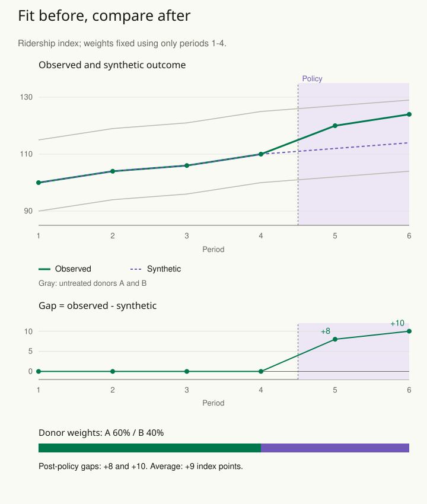

A region introduces a policy, but no single untreated region resembles it closely. One has a similar population, another a similar economic history, and a third a similar outcome trajectory. Choosing the one comparison that yields the most appealing result would make the evidence difficult to trust.

A synthetic control combines untreated units using a specified fitting procedure to approximate relevant pretreatment characteristics of the treated unit. The posttreatment gap is then interpreted through a causal argument about how that constructed comparison represents the untreated trajectory.

## Build the comparison before inspecting its apparent effect

Choose a donor pool of units that were not affected by treatment or important spillovers. Specify which pretreatment outcomes and predictors inform the fit. In a conventional synthetic-control formulation, nonnegative donor weights sum to one, making the constructed comparison a weighted combination of observed units.

Suppose a city changes its transit policy. A weighted combination of other cities may track its ridership before the change better than any single city. Examine that pretreatment fit and the substantive relevance of the donors before interpreting a later divergence.

Good earlier fit is useful evidence, but it does not establish the unobserved posttreatment trajectory. A city-specific shock occurring at the same time as the policy can still explain the gap. A donor affected by the policy can contaminate the comparison.

## Make fragility visible

Inspect donor weights and whether the result depends heavily on one unit. Repeat the analysis under defensible donor exclusions or predictor choices. State the reasons for those alternatives in advance where possible and avoid presenting only the most favorable specification.

Placebo analyses can apply the procedure to untreated units or earlier dates to investigate whether comparable gaps arise without treatment. Their interpretation depends on comparability, pretreatment fit, the design, and the chosen inferential framework. A large treated gap is not automatically a conventional randomized-experiment p value.

A second application is a product change introduced in one market. Preserve consistent measurement over time and investigate marketing campaigns, competitor changes, and other concurrent interventions. The statistical fit cannot substitute for a history of what happened.

## Worked example: fit the weights before the policy starts

A fictional city changes its transit policy after period 4. The outcome is a consistently defined ridership index. There are two untreated donor cities, A and B, assumed unaffected by the policy or spillovers. We use only pretreatment outcomes to choose nonnegative donor weights that sum to one, then freeze them for the post-policy comparison.

| Series | Periods 1–4; then 5–6 |
| --- | --- |
| Treated city | 100, 104, 106, 110; then 120, 124 |
| Donor A | 90, 94, 96, 100; then 102, 104 |
| Donor B | 115, 119, 121, 125; then 127, 129 |

A weight is the share of the comparison supplied by each donor city. For example, weights 0.60 and 0.40 mean using 60% of A’s index and 40% of B’s at every period. The weights add to one; we are averaging cities, not adding their index totals.

Let **w** be A’s weight and **1 − w** be B’s. In period 1, matching the treated city requires **90w + 115(1 − w) = 100**. Solving gives **w = 0.60**, so B’s weight is **0.40**. The same weights reproduce the treated city in all four pretreatment periods: **100, 104, 106, and 110**. They also minimize the equally weighted pretreatment squared-error objective in this deliberately simple two-donor example.

After the policy, keep those weights fixed. The synthetic index is **0.60 × 102 + 0.40 × 127 = 112** in period 5, and **0.60 × 104 + 0.40 × 129 = 114** in period 6. Observed minus synthetic is therefore **120 − 112 = 8** and **124 − 114 = 10 index points**. The average post-policy gap is **9 index points**.

The pretreatment root mean squared error is zero by construction. Donor A alone would miss every pretreatment outcome by ten points; donor B alone would miss by fifteen. Combining them improves this earlier fit, but only four pretreatment periods and two donors are available here. The simplicity makes the calculation inspectable; it does not establish a reliable empirical counterfactual.

A concrete fragility check is to remove A and refit using the remaining donor. B then receives weight one, the pre-policy RMSE becomes **15**, and post-policy gaps become **−7 and −5**, averaging **−6**. Removing B instead gives A weight one, pre-policy RMSE **10**, and post-policy gaps **18 and 20**, averaging **19**. Those are poorly fitting alternatives, not equally credible effect estimates or the endpoints of a confidence interval. They show how much this example relies on the donor combination.

A concurrent campaign unique to the treated city could also create a gap. More individual ticket records would not supply additional untreated cities or resolve that explanation. In a real study, inspect a richer pretreatment history, donor suitability, measurement continuity, anticipation, concurrent events, and meaningful placebo comparisons. Report whether alternative fits remain comparable before interpreting their post-policy results.

Use [[stats-challenge-causal-effect]] to choose checks directed at these vulnerabilities. [[stats-validate-forward]] reinforces the information boundary: post-policy outcomes must not be used to select the donor weights intended to predict an untreated trajectory.

## Advanced notes: limited support and extrapolation

If the treated unit lies outside the range represented by the donor pool, a conventional convex combination may fit poorly. Some extensions permit different forms of adjustment or extrapolation, introducing additional modeling assumptions. Explain what new assumptions support that extension rather than treating improved fit as proof of validity.

The target often concerns one treated aggregate unit in one context. Generalizing the result to other regions or times requires another argument. Uncertainty should reflect the design and available comparison information, not the number of individual records hidden within an aggregate series.

Use this pattern when a treated region, organization, or market lacks a single credible counterpart but has a useful pool of untreated comparisons. Report the donor selection, weights, earlier fit, alternative specifications, contextual threats, and the causal assumptions together.

## Sources and further reading

These independently written explanations and fictional examples draw on established statistical methods. The linked sources provide technical development and additional qualifications.

- [Facure — Causal Inference for the Brave and True](https://matheusfacure.github.io/python-causality-handbook/15-Synthetic-Control.html)
- [Abadie: Using Synthetic Controls](https://economics.mit.edu/sites/default/files/publications/jel.20191450.pdf)
