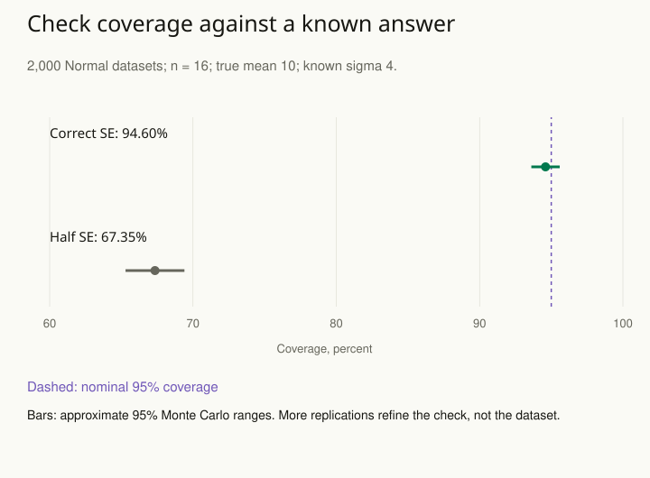

An analysis produces a precise-looking result, but no one has checked whether the implementation can recover a known effect. A sign error, misunderstood parameter, or unreliable approximation can survive an attractive chart and a successful software run.

Generate data from a specified process whose relevant quantities are known, apply the full analysis, and examine what it recovers. Repeat across scenarios that challenge the assumptions.

Think of each simulated dataset as another fictional run of the same study. Because you choose the generating process, you know the true mean or effect before analyzing the data. A replication here is one such simulated study, not one observation within it. Simulation makes the procedure observable under controlled conditions, while keeping the limits of those conditions explicit.

## Test a concrete behavior

Suppose a team plans an experiment to detect a three-point improvement. Simulate assignment and outcomes under several plausible baseline rates, effect sizes, dependence structures, and dropout mechanisms. Run the planned estimator and uncertainty procedure on every simulated dataset. Summarize bias, interval coverage, precision, and decision behavior relevant to the design.

Do not simulate only the easiest case where the fitted model is exactly correct. Include plausible departures that matter to the real question. The purpose is to learn which assumptions drive performance, not to produce one favorable power estimate.

A second application is checking a new statistical implementation. Start with a simple case that has a trustworthy analytic solution, then add complexity. An implementation that fails the simple case should not earn trust merely because the realistic case has no known answer.

## Measure simulation error

Monte Carlo estimates themselves vary because the simulation uses a finite number of replications. Report their computational precision and choose enough replications for the required conclusion. Reproducible random seeds help inspect a run, but agreement after fixing a seed does not establish numerical accuracy.

Keep statistical uncertainty separate from numerical uncertainty. Posterior variation describes uncertainty under a Bayesian model. Monte Carlo error describes imperfect computation of posterior summaries. More sampling can reduce the latter without supplying new observations for the former.

## Worked example: a precise computation can expose a bad interval

Consider independent Normal (bell-shaped) outcomes with true mean **10**, known standard deviation **4**, and **16 observations** per simulated dataset. The sample mean has standard error **4 / √16 = 1**. A known-variance 95% interval is therefore the sample mean **±1.959964**. Compare it with a deliberately faulty procedure that halves the standard error and reports the same nominal confidence level: mean **±0.979982**.

Generate 2,000 independent datasets, apply both procedures to each dataset, and count how often the interval includes 10.

For a concrete single run, if a dataset has sample mean 11, the correct interval is about **9.04 to 12.96**, which contains the true mean 10. The faulty interval is about **10.02 to 11.98**, which misses it. Count that run as covered for the first procedure and not covered for the second. Coverage is the share of simulated studies whose intervals contain the known answer.

A reproducible teaching run using Python’s `random.Random`, seed **20261025**, gives:

| Procedure | Covered / replications |
| --- | --- |
| Correct standard error | 1,892 / 2,000 = 94.60% |
| Half the standard error | 1,347 / 2,000 = 67.35% |

The simulation mean estimate is **10.0145**, a bias estimate of about **0.0145** in this run. Both interval procedures use those same point estimates, so their point-estimate bias is identical. Interval coverage detects the problem that a bias check alone would miss. Here the analytic coverages are 95% and approximately 67.29%, providing an independent known-answer reference for the simulation.

For an estimated coverage **p̂** from **R** independent replications, its Monte Carlo standard error is **√[p̂(1 − p̂) / R]**. Here that is **0.51 percentage points** for the correct procedure and **1.05 percentage points** for the faulty one. Approximate Monte Carlo 95% ranges are **93.61%–95.59%** and **65.29%–69.41%**, respectively. They describe finite-simulation error in the estimated coverages, not confidence intervals for a particular sample’s mean.

If we want a Monte Carlo standard error no larger than **0.25 percentage points** near 95% coverage, plan about **0.95 × 0.05 / 0.0025² = 7,600 replications**. A conservative calculation that must work for any coverage uses p = 0.5 and requires 40,000. More simulated datasets make the performance estimate more precise. They do not add information to any of the sixteen-observation datasets.

This is a simple case where the assumptions match the correct procedure exactly. Next vary the data-generating process: heavy tails, dependence, missing outcomes, or a selected analysis. Include fitting failures in the report rather than calculating coverage only among convenient successes. Successful computation under this Normal scenario establishes neither robustness under those departures nor suitability for a particular real-world problem.

Related patterns: [[stats-plan-precision]], [[stats-check-model]], and [[stats-resample-units]].

## Advanced notes: check inference machinery and model adequacy separately

Simulation-based calibration assesses aspects of a Bayesian inference algorithm by repeatedly drawing parameters and data from the model and examining calibration of the resulting inference. It is a check on computation under the assumed model, not evidence that the model describes the real world.

Posterior predictive checking asks a different question: can replicated data from the fitted model reproduce features relevant to the observed data? A procedure can be computationally accurate for a scientifically inadequate model. Conversely, a plausible model can be implemented with unreliable sampling.

For Markov chain Monte Carlo, inspect convergence diagnostics, effective sample sizes, and algorithm-specific warnings. A large raw number of draws does not guarantee adequate exploration. Reparameterization or model revision may be more useful than simply running a problematic sampler longer.

Use this pattern when designing a study, implementing an estimator, fitting a complex model, or relying on an approximation. Record the simulated process, scenarios, known targets, evaluation criteria, and computational uncertainty. State which real-world uncertainties were not represented so a successful simulation is not mistaken for universal validation.

## Sources and further reading

These independently written explanations and fictional examples draw on established statistical methods. The linked sources provide technical development and additional qualifications.

- [Stan methods guide and case studies](https://mc-stan.org/docs/stan-users-guide/simulation-based-calibration.html)
- [Stan methods guide and case studies](https://mc-stan.org/learn-stan/diagnostics-warnings.html)

- [Morris, White, and Crowther: Using simulation studies to evaluate statistical methods](https://arxiv.org/abs/1712.03198)

