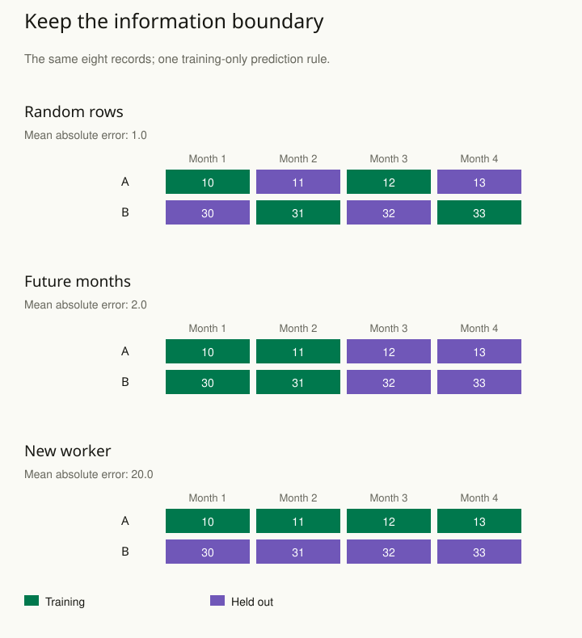

A forecasting model looks excellent when rows are randomly divided into training and test sets. In production it fails. The random split allowed patterns from later periods to help predict earlier ones, while the real task always predicts an unseen future.

Validation should imitate the information boundary at the moment of use. Identify what will be new: future time, a new participant, another site, or a changed environment. Then hold out the corresponding units and reproduce the full training procedure using only the information available on the training side.

## Worked example: the split changes the question

Take eight fictional records: two workers observed in four months. Outcomes are 10, 11, 12, and 13 for A, and 30, 31, 32, and 33 for B. A deliberately simple prediction rule uses each worker's average in the training data; for an unseen worker, it falls back to the average of all training outcomes. Every average is calculated using training observations only.

Training data build the prediction rule; held-out data check it. The table uses mean absolute error (MAE): find the size of each prediction error, ignore its sign, and average those sizes. An MAE of two means predictions miss by two outcome units on average in that evaluation set.

| Partition | Held-out observations | MAE |
| --- | --- | --- |
| Random rows | A: months 2, 4; B: months 1, 3 | 1.0 |
| Future months | A and B: months 3, 4 | 2.0 |
| New worker | B: all four months | 20.0 |

For random rows, the training means are 11 for A and 32 for B. Evaluation outcomes are 11, 13, 30, and 32, so absolute errors are 0, 2, 2, and 0, averaging one. But training includes B's month 4 while evaluating B's month 1. It also supplies information about both workers. This partition does not reproduce a task that predicts an unseen future or a new worker.

For future months, the training means are 10.5 and 30.5. Predicting the four later outcomes gives errors of 1.5, 2.5, 1.5, and 2.5, averaging two. For the unseen-worker partition, A's training mean is 11.5. Using that fallback for B produces errors of 18.5, 19.5, 20.5, and 21.5, averaging twenty. The failure exposes how strongly the rule relies on having seen a worker already.

The differences are caused by both the available information and the task being evaluated. They do not imply that the largest error is the most honest score for every deployment. Predicting another observation from a familiar worker, a later outcome, and a new worker are distinct uses. This tiny example has one partition per task; a real assessment needs enough relevant evaluation units and a protocol for uncertainty.

Apply preprocessing and model selection within the same boundary. Even a forward-time split can leak if a scaler, imputation model, or feature-selection step was fitted using all months first. [[stats-check-model]] complements this evaluation by examining what a fitted model misses, while [[stats-plan-precision]] asks whether the evaluation has enough information for its intended conclusion.

## Recreate the prediction boundary

For a time series, train on an earlier period and evaluate on a later period. A rolling-origin evaluation repeats this procedure at several historical cutoffs. Match the forecast horizon to the task: one-day-ahead accuracy does not establish twelve-month-ahead accuracy.

If the task concerns a new patient, repeated records from that same patient should not be divided casually across training and evaluation sets. If the target is a new hospital, holding out individual patients from already observed hospitals tests a different form of generalization. The evaluation unit must reflect the deployment question.

An example outside forecasting is a text classifier with near-duplicate documents. A random split can place versions of the same document on both sides. Group related documents before splitting if the intended task is classifying genuinely new material.

## Keep the whole procedure inside training

Imputation, scaling, feature selection, hyperparameter tuning, and threshold choice can all use information. Fit those steps inside each training split. Selecting the best model using the final test set gradually turns that set into training information, even if its label still says “test.”

Compare against a realistic simple baseline, such as predicting the last observed value or a historical group average. Report the metric that fits the consequences and include uncertainty or variation across relevant evaluation units. A single average score can hide severe failures in important groups.

## Advanced notes: evaluation is conditional on the environments observed

A well-designed historical evaluation does not guarantee performance after a major policy change, measurement change, or population shift. Identify differences between evaluation conditions and intended use, and monitor relevant behavior after deployment. Validation provides evidence about a defined setting, not universal certification.

Separate model selection from final assessment. Nested validation can help estimate the performance of a selection procedure when there is sufficient information, but it also has variability and computational cost. Explain the protocol so that readers know which choices were made using which data.

The purpose is not choosing the most pessimistic possible split. A split that differs from actual use can be misleading in either direction. New-site prediction, future-within-site prediction, and interpolation among existing observations are different tasks and may justify different evaluations.

Use this pattern whenever performance seems surprisingly strong, repeated units exist, or a model will be used in a setting unlike the training sample. Write the information boundary in plain language before constructing the split.

## Sources and further reading

These independently written explanations and fictional examples draw on established statistical methods. The linked sources provide technical development and additional qualifications.

- [Forecasting: Principles and Practice — forecasting tools](https://otexts.com/fpp3/toolbox.html)
- [Stan methods guide and case studies](https://mc-stan.org/docs/stan-users-guide/cross-validation.html)
