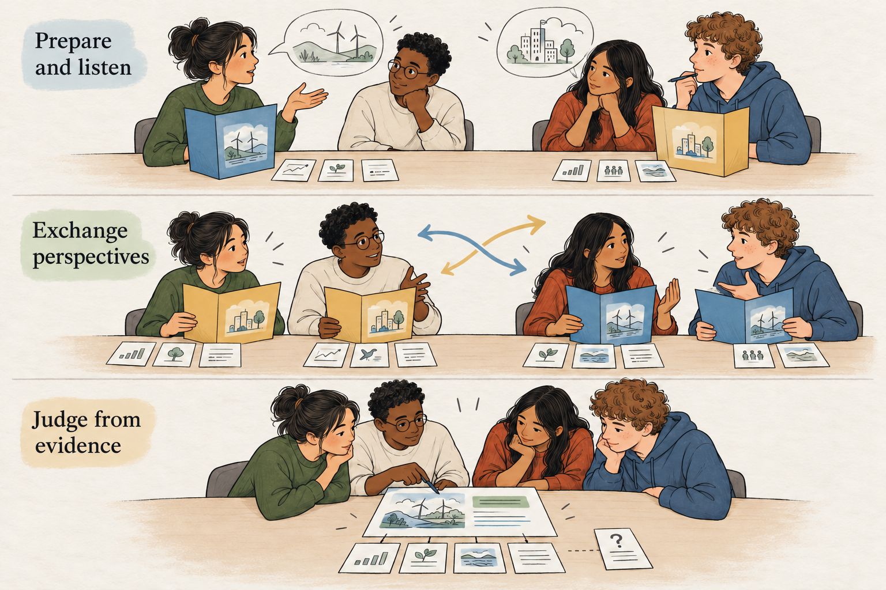

## Understand the competing case before making a judgment

The teacher presents a difficult question. Learners quickly choose positions. During discussion, they collect examples that support their views and search for weaknesses in the alternatives.

Several arguments become more polished. Few positions become more informed.

Structured Academic Controversy gives that conversation a different sequence. Learners prepare an assigned position, explain it, listen carefully to a competing case, and then exchange perspectives. Only afterward do they develop their own considered judgment.

Its central requirement is demanding: understand another position well enough to represent it accurately before deciding what the evidence warrants.

## Prepare, exchange, reverse, synthesize

A common format uses groups of four divided into two pairs. Each pair receives a contrasting position on a shared question and prepares the strongest evidence-based case it can.

The pairs present in turn. Listeners ask questions and restate the argument they have heard. In the version described by [TeachingHistory.org](https://teachinghistory.org/teaching-materials/teaching-guides/structured-academic-controversy-sac/), listeners demonstrate understanding before moving into their own presentation.

The pairs then switch positions. This requires them to work with reasoning they may initially have discounted.

Finally, learners set aside their assigned advocacy and develop a synthesis. They consider which claims remain persuasive, where evidence is insufficient, and what conclusion they can justify.

There are variations, including formats without a perspective switch. [Carleton’s teaching guidance](https://serc.carleton.edu/sp/library/sac/how.html) describes these alternatives. For learning to examine competing perspectives, explicitly exchanging positions makes that responsibility particularly visible.

## Why the sequence matters

An assigned position gives learners a concrete task without requiring them to announce a personal commitment immediately. Listening, paraphrasing, and reversal then create opportunities to encounter evidence as something other than ammunition.

These are plausible mechanisms. Learners may discover that they misunderstood an objection, applied different standards to different sources, or overlooked a tradeoff.

Research on the broader procedure of constructive controversy provides support, with qualifications. David and Roger Johnson’s 2009 synthesis reported benefits across 39 studies, including achievement and perspective taking, compared with several alternative learning arrangements. The studies covered different populations, tasks, and durations; some outcome comparisons relied on few studies. The synthesis does not establish that every classroom controversy or adaptation produces those benefits. [Johnson and Johnson, 2009](https://journals.sagepub.com/doi/abs/10.3102/0013189X08330540)

The learning depends on how learners examine the positions, not simply on having opposing assignments.

## A classroom example: the neighborhood library

Imagine a civics class working with a fictional town’s proposal to close a neighborhood library branch and use the savings to expand services at the central library.

The teacher provides a manageable evidence packet: operating costs, usage records, transport information, and statements from residents and library staff. Learners have already discussed evaluating sources and distinguishing evidence from predictions.

In one group, Eva and Karim prepare the case for closure. They emphasize the possibility of concentrating staff and resources at the larger site. Jo and Ben prepare the case for retaining the branch, focusing on access for residents who use it locally.

During the first presentation, Eva points to lower visit numbers at the branch. Jo initially hears this as a claim that its users do not matter.

The listening task slows that reaction. Jo restates the argument: “You think the same resources could support more services centrally. Are you treating visit numbers as evidence of how much benefit each location provides?”

Eva recognizes an assumption she had not articulated. Visit counts indicate use, but they do not establish the availability of alternatives for those users.

After both presentations, the pairs exchange positions.

Eva and Karim now examine the transport information closely. A route that looks straightforward on the map requires a transfer at times relevant to branch users. Meanwhile, Jo and Ben must confront the operating costs and explain what retaining the branch would mean for the proposed central services.

Once assigned advocacy ends, the group develops a recommendation. It favors retaining the branch for now because the packet gives stronger evidence of an access problem than of the benefits projected from closure. It also identifies information needed to reconsider: fuller cost estimates and evidence about unmet demand centrally.

One learner still favors closure. The final account records that disagreement and its reasoning.

The group has reached a judgment without pretending that every concern disappeared.

## Separate understanding from endorsement

Representing a position accurately does not require accepting it. Learners should be able to distinguish “This is the argument I was assigned to examine” from “This is my conclusion.”

Paraphrasing helps check understanding. A useful restatement preserves the claim, its supporting reasons, and relevant qualifications. “They only care about saving money” would distort the library argument. “They expect concentrating resources to increase available services” gives the group a claim it can investigate.

The original presenters can correct the restatement, but this should remain a check on understanding rather than a way to prevent criticism.

Reversal should also go beyond repeating the other pair’s opening statement. Learners need to explain why the evidence might support that position and identify its strongest unresolved difficulty.

## Build a judgment that answers the evidence

Synthesis can mean a qualified recommendation, a revised interpretation, or an explanation of why the available evidence cannot settle the question.

It need not mean dividing the difference. One position may be better supported. A group can reject an argument while demonstrating that it understood it.

Ask learners to explain what they concluded, which evidence mattered most, and what could change their judgment. Where consensus remains unavailable, preserve the substantive disagreement.

An individual written response afterward helps reveal whether each learner can represent the competing case and justify a conclusion independently.

## Choose the controversy carefully

Suitable questions have meaningful competing interpretations or options, accessible evidence, and a clear connection to the learning goal. Historical decisions, design choices, and policy tradeoffs can provide useful material.

Avoid manufacturing equivalent sides when the evidence does not support them. The existence of public disagreement does not make every claim equally credible.

Sources need enough balance to support genuine investigation, though equal quantities of material cannot guarantee equal evidential strength. Learners may need shared background instruction before they can evaluate either case.

Shorter source packets, annotated documents, or sentence starters can make the method more manageable. Online, pairs can prepare separately before meeting as a four-person group.

## Keep the structure cooperative

Common mistakes include rewarding persuasive performance, skipping the listening check, rushing the reversal, and treating agreement as the main achievement.

Correct factual errors as they arise. Encourage criticism of claims through evidence, while keeping personal judgments about classmates outside the task.

**[[peer-instruction|Peer Instruction]]** examines reasoning behind different answers. **[[jigsaw-learning|Jigsaw Learning]]** develops complementary contributions. **[[fishbowl-discussion|Fishbowl Discussion]]** makes listening and interaction available for reflection.

Structured Academic Controversy gives learners a particular responsibility: carry a competing argument through preparation, explanation, and reconsideration before deciding what they themselves can defend.
