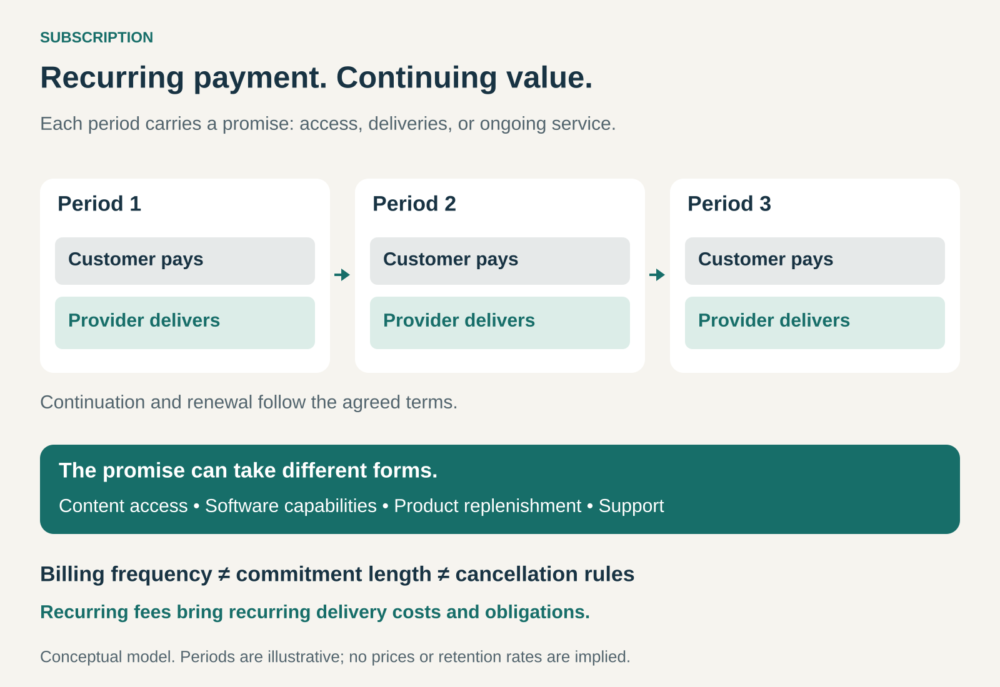

## What it is for

Use Subscription when customers have a continuing need that can be served through ongoing access, regular deliveries, or a sustained service relationship.

A household wants entertainment throughout the year. A designer needs reliable access to creative tools. Someone who shaves regularly wants replacement blades to arrive before they run out.

Instead of arranging each purchase separately, the customer enters a continuing arrangement. Payments recur, and the business keeps providing the agreed value.

The central proposition is: **keep receiving something useful in exchange for a recurring commitment.**

## The core idea

A subscription connects payment to a period of access, a delivery schedule, or an ongoing service.

The customer might pay monthly, quarterly, or annually. The offering might include a fixed allowance, several tiers, or additional charges for usage beyond what is included.

Three decisions shape the arrangement:

- **What continues:** access, deliveries, support, or another benefit.
- **How payment works:** its amount, frequency, and any usage charges.
- **How the relationship continues or ends:** commitment length, renewal, changes, pauses, and cancellation.

These decisions are related but distinct. Monthly billing can accompany an annual commitment. An annual payment can purchase a year of service. A recurring fee does not automatically mean unlimited use.

Subscription also differs from paying for a single purchase in installments: the ongoing relationship supplies continuing value rather than simply spreading an existing purchase price.

## Why it works

Repeated purchasing creates effort. Customers must remember to reorder, compare options again, or arrange access whenever a need returns.

A subscription can remove some of that effort. It can also provide a predictable allowance or make a substantial capability accessible through smaller recurring payments.

For the business, an established subscriber relationship can make demand and revenue easier to anticipate. The company has opportunities to understand customer needs, improve delivery, and retain the relationship over time.

Those benefits depend on customers staying and the service remaining economical to provide. Recurring billing creates a recurring obligation to deliver.

Continuing value can be simple: a dependable tool, available support, or supplies arriving at an appropriate interval. It need not involve constant novelty.

## Famous examples

### Netflix: continuing access to entertainment

Netflix charges members monthly for access to its streaming offering. Customers choose a plan and can change or cancel it under the service’s terms. [Netflix’s membership model](https://help.netflix.com/en/node/112419)

The customer buys access for a period rather than purchasing each film or episode separately. That makes trying another title part of the existing relationship instead of another transaction.

The business must keep the overall offering worthwhile enough for customers to continue paying. A particular show can attract someone, but continued subscription depends on the value they expect from retaining access.

When a customer cancels with time remaining in a paid billing period, Netflix generally allows viewing until that period ends. [Netflix’s cancellation guidance](https://help.netflix.com/en/node/407)

### Adobe Creative Cloud: ongoing access to working tools

Adobe Creative Cloud offers subscriptions to individual applications or collections of creative tools, including Photoshop and Illustrator. Its proposition combines access to software with continuing capabilities and updates. [Adobe Creative Cloud](https://www.adobe.com/creativecloud.html)

For a professional who regularly uses those applications, the subscription becomes part of maintaining a working capability.

Adobe also illustrates why payment frequency and commitment length need separate explanations. Its offerings include annual plans billed monthly as well as other payment arrangements; cancellation consequences depend on the plan. [Adobe’s subscription terms explained](https://helpx.adobe.com/account/individual/terms-policies-and-regulations/adobe-subscription-terms.html)

The recurring payment purchases the subscription entitlement. It does not gradually turn into permanent ownership of every future version.

### Dollar Shave Club: regular replenishment

Dollar Shave Club lets customers select products and a delivery frequency, with options to manage, pause, or cancel the subscription. [Dollar Shave Club’s model](https://us.dollarshaveclub.com/pages/how-it-works)

Here, the recurring benefit is replenishment. The products delivered become goods the customer can use and keep; the subscription organizes subsequent purchases.

That makes matching delivery to consumption important. A customer who accumulates unused blades may need fewer deliveries rather than more reasons to buy.

The company’s subscription controls include changing dates, sending an order sooner, skipping an order, and pausing deliveries. Those options help accommodate changing needs. [Dollar Shave Club’s subscription controls](https://ask.dollarshaveclub.com/en-US/manage-my-subscriptions-264213)

### The economics of staying subscribed

A subscriber’s value to the business depends on more than the fee.

Providing the service may involve content, computing, products, shipping, support, payment processing, and other continuing costs. Acquiring the customer can require substantial expenditure before those payments begin.

Consider a hypothetical subscription charging $20 per month with $8 in direct monthly service costs. It contributes $12 per paid month before acquisition and shared costs.

If acquiring that customer costs $60, five paid months are needed just to recover that acquisition expenditure under those assumptions. A customer who leaves earlier may never repay it.

Retention therefore matters alongside sign-ups. So do discounts, downgrades, failed payments, support needs, and changes in the cost of serving customers.

Annual prepayment can improve cash flow and commitment visibility. The business still has to fund delivery throughout the period already purchased.

### Designing the continuing promise

The offering needs a clear answer to what customers receive each period.

An access subscription needs useful availability. A replenishment subscription needs appropriate products and timing. A service subscription needs a defined level of support or continuing work.

Allowances and boundaries matter too. A subscription may include a certain number of users, deliveries, support hours, or units of consumption. Customers need to understand what happens beyond those limits.

The relationship also needs to accommodate change. A household’s preferences shift, a business adds employees, or someone uses supplies more slowly than expected.

Plan changes, pauses, and clear renewal information can help the arrangement remain appropriate. Their availability depends on the offer.

## Useful when

Subscription is especially useful when the underlying need recurs, delivery can continue reliably, and customers value continuity or convenience.

It fits offerings where the provider can sustain value over time and understand the costs of serving different subscribers.

It is less attractive when customers need something only occasionally, receive nearly all its value immediately, or see little benefit in maintaining the relationship between uses.

## Common mistakes and limits

**Adding recurring billing without recurring value.** Customers need a continuing reason to pay.

**Counting sign-ups while overlooking departures.** Strong acquisition can conceal a customer base that leaves too quickly to support the business.

**Making delivery more frequent than the need.** Excess supplies and unused allowances can make the subscription feel wasteful.

**Confusing monthly payment with monthly freedom.** Commitment and cancellation terms need to be clear alongside the advertised payment.

**Treating prepaid revenue as money without obligations.** Future delivery, support, and service costs still need funding.

**Relying on cancellation friction.** Keeping charges flowing does not establish that customers still value the offering. Difficult exits can damage trust and future purchasing.

## Related patterns

- [[freemium|Freemium:]] can provide a useful free tier alongside paid subscriptions.
- [[razor-and-blade|Razor and Blade:]] creates repeat demand for consumables; a subscription can organize their replenishment.
- [[bundling|Bundling:]] combines several benefits into one subscription offering.
- [[pay-per-use|Pay per Use:]] charges according to consumption. A subscription can include an allowance and add usage charges beyond it.
