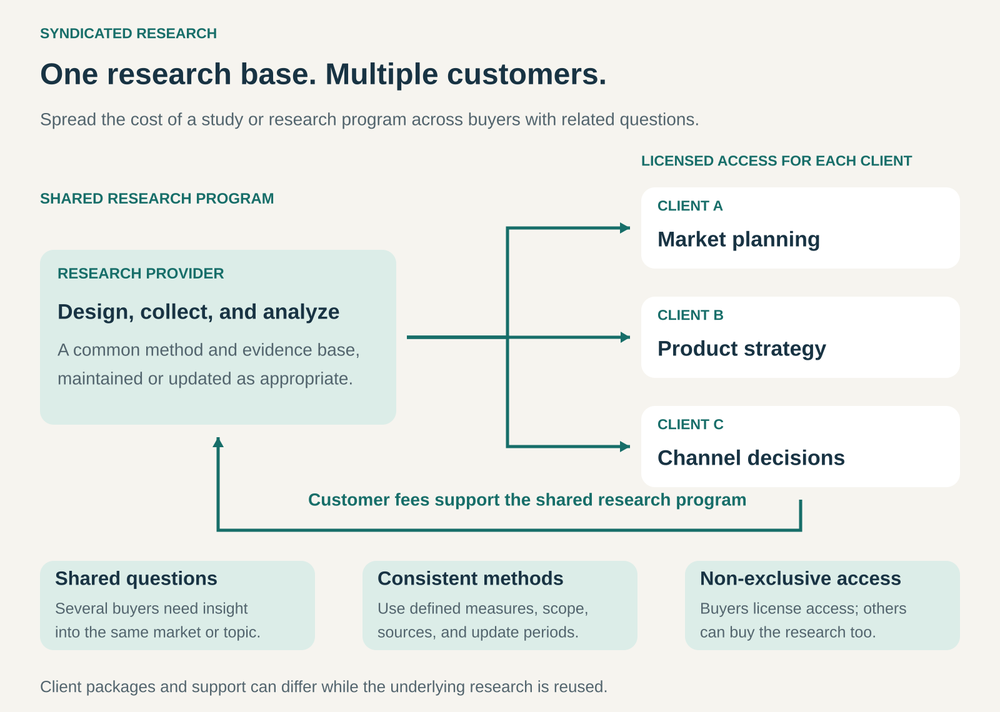

## What it is for

Syndicated Research makes substantial research commercially viable by selling access to its findings to multiple customers.

It is useful when many organizations face related questions, but conducting separate studies would duplicate expensive work. Several retailers may need to understand shopping habits. Many manufacturers may need estimates of the same market. Technology buyers may need comparable assessments of suppliers.

A research provider develops a shared evidence base and licenses access to different buyers. Customers obtain useful intelligence without individually financing the entire research effort.

## The core idea

**Develop research that serves a recurring class of questions, then license the underlying findings to multiple customers.**

The shared asset might be a market study, consumer survey, measurement program, forecast, industry analysis, or continuously maintained research library.

The provider typically establishes the research scope and methodology, drawing on customer needs without rebuilding the core study for each buyer. Customers purchase defined access rather than exclusive ownership of the findings.

NIQ, for example, describes syndicated services as standardized offerings based on predesigned studies or ongoing data collection, licensed to multiple clients. [NIQ’s description of syndicated services](https://nielseniq.com/global/en/legal/terms-of-use/online-license-terms-and-conditions-for-syndicated-strategic-analytics-insights-services/).

The commercial structure can include individual report purchases, annual subscriptions, licensed datasets, or packages combining research with expert support.

## How it works

The model connects five elements.

**A shared research need.** Several potential customers must care about substantially overlapping questions. Their decisions can differ while drawing on the same evidence.

**A reusable research design.** Defined categories, sampling methods, sources, measures, and reporting periods make findings interpretable. Consistency can also support comparisons across markets or successive research cycles.

**A credible evidence base.** The provider collects, checks, reconciles, and analyzes information. This can involve surveys, interviews, observations, administrative sources, licensed data, or combinations of methods.

**Licensed access.** Customers receive access appropriate to their agreement. Packages may differ by geography, industry, number of users, level of detail, update frequency, or support.

**Maintenance and renewal.** Some studies are completed once. Others require repeated fieldwork, revised estimates, new analysis, and continuing technical delivery. The provider must maintain enough value to justify subsequent purchases.

Customer-specific interpretation can sit on top of the shared research. That does not require commissioning the underlying study again.

## Why it works

Research often has substantial costs that do not increase proportionately with the number of buyers.

Designing a survey, recruiting respondents, assembling sources, and developing an analytical framework can be expensive. Once the resulting research exists, serving another licensed customer may cost much less than repeating the work from the beginning.

This creates an opportunity to spread costs across customers while supporting deeper coverage than many buyers could afford independently.

Shared methods can also provide a common reference. Organizations can discuss market definitions, category trends, or supplier assessments using compatible evidence.

The tradeoff is specificity. A shared study must serve a sufficiently broad audience, so it may not answer a customer’s precise question. Buyers often need to combine syndicated findings with their own information and judgment.

## Famous examples

### Euromonitor Passport — a shared foundation for market intelligence

Euromonitor’s Passport brings together market data, company and brand information, consumer research, forecasts, and analysis through a subscription platform.

Its methodology combines sources such as company information, official statistics, store research, trade discussions, and surveys. A consistent taxonomy helps organize evidence for comparisons across countries and categories. [Passport overview](https://www.euromonitor.com/solutions/passport), [Euromonitor’s research methodology](https://lp.euromonitor.com/who-we-are/research-methodology).

A manufacturer considering expansion and a retailer reviewing categories can draw on overlapping research while making different decisions. The commercial asset is the maintained research base, supported by methods and interpretation. Each customer does not need to commission a separate investigation of every market.

### NIQ Shopper Trends — recurring research into shopper behavior

NIQ describes Shopper Trends as an annual syndicated survey-based offering. It examines topics including store choice, shopping behavior, channel dynamics, and shoppers’ perceptions of retailers. Its historical research supports analysis of changes over time. [NIQ Shopper Trends](https://nielseniq.com/global/en/insights/report/2024/syndicated-studies-research-shopper-trends/).

The same research can inform several organizations interested in the retail environment. One buyer might investigate channel priorities; another might examine what shoppers value when choosing stores.

This illustrates syndication through a recurring research program. Buyers obtain a broader context than their own transactions reveal, while the provider reuses a common research framework across customers.

### Gartner — shared research combined with advisory access

Gartner distributes proprietary reports, briefings, updates, and tools through subscription arrangements that can also include advisory services. Its published research provides a shared foundation for serving many client organizations. [Gartner’s annual report](https://www.sec.gov/Archives/edgar/data/749251/000074925126000112/it-20251231.htm).

For example, its _Critical Capabilities_ reports assess products against defined use cases. Different customers can use the same assessment as an input to their own evaluation. [Example: Critical Capabilities for Recurring Billing Applications](https://www.gartner.com/en/documents/7068298).

The model combines reusable research with access to expertise. Individual conversations help clients interpret the material, while the underlying analysis remains useful to multiple subscribers. The advisory component also means the cost of serving another customer is greater than simply delivering another document.

## The economics

Consider an illustrative annual research program:

| Annual activity                               |      Amount |
| --------------------------------------------- | ----------: |
| Twenty customer licenses at $10,000           |    $200,000 |
| Research design, collection, and analysis     |   −$120,000 |
| Shared publishing, maintenance, and updates   |    −$30,000 |
| Customer acquisition, onboarding, and support |    −$20,000 |
| **Remaining contribution**                    | **$30,000** |

Under these assumptions, shared costs total $150,000 and each customer contributes $9,000 after $1,000 in customer-specific costs.

The program therefore needs **17 customers to cover those modeled costs**. With ten customers, it would generate $100,000 in revenue against $160,000 in costs, leaving a $60,000 shortfall.

These figures are hypothetical and exclude remaining corporate overhead and tax.

The provider usually carries the risk of attracting enough buyers. Advance subscriptions or shared commissioning can reduce that exposure. Recurring programs must also finance the next research cycle; an existing library does not eliminate ongoing collection and analysis costs.

## Useful when

- Several organizations need insight into the same market, audience, or topic.
- Research is expensive to produce but reusable across customers.
- A consistent methodology supports useful comparisons.
- Customers can benefit without exclusive access.
- The provider has credible sources, analytical expertise, and distribution.
- Updates or expanding coverage can sustain repeat purchases.

The pattern is particularly attractive when a specialized provider can maintain coverage that individual customers would struggle to reproduce.

## Common mistakes and limits

**Building before establishing sufficient demand.** A sophisticated study can still fail commercially if too few customers need it at the proposed price.

**Stretching a shared study beyond its scope.** Broad findings may not describe a narrow segment, local situation, or unusual customer group. Small subsamples can be especially misleading.

**Confusing consistency with accuracy.** A repeatable method helps comparison, but it can still contain systematic bias, coverage gaps, or uncertain assumptions.

**Allowing research to become stale.** Publication dates, collection periods, revisions, and methodological changes matter. Forecasts also need their assumptions and uncertainty explained.

**Promising exclusive advantage from widely available findings.** Other organizations may license the same research. Customers often differentiate themselves through interpretation, execution, and complementary information.

**Underestimating service costs.** Sales, onboarding, explanation, licensing administration, and expert support can consume substantial resources.

**Blurring commercial influence and research judgment.** Buyers need confidence that conclusions follow from evidence. Transparent methods, limitations, and relevant disclosures help sustain that confidence.

## Related patterns

- [[data-as-a-service|Data as a Service:]] delivers maintained data; Syndicated Research emphasizes reusable studies, analysis, and interpretation, although the offerings can overlap.
- [[licensing|Licensing:]] establishes permitted access and use while allowing the provider to serve multiple buyers.
- [[subscription|Subscription:]] can finance continuing coverage and provide recurring access to the research.
- [[contribute-to-benchmark|Contribute-to-Benchmark:]] builds comparisons from participants’ contributions; syndicated research does not inherently require buyers to contribute their own data.
