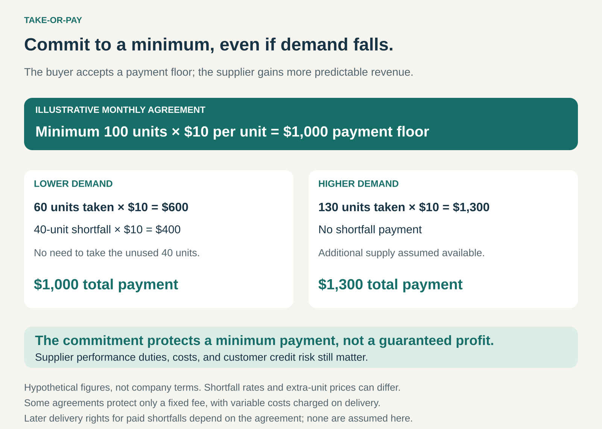

## What it is for

A supplier is ready to invest in a production plant, dedicated equipment, or long-term supply. But the investment only makes sense if customers provide enough revenue to support it—even when their demand fluctuates.

Take-or-Pay creates that minimum commitment.

The customer agrees to take an agreed quantity of goods or services, or make a specified payment if it takes less. The supplier gains a more dependable revenue base; the customer accepts part of the risk that its future needs may fall.

The proposition is: **we commit to supplying you; you commit to a minimum payment.**

## The core idea

Separate the payment obligation from actual consumption below an agreed threshold.

Under pure Pay per Use, lower consumption usually means a proportionally lower bill. Under Take-or-Pay, the customer’s payment cannot fall below the contractual minimum merely because it needs less.

The commitment might cover a minimum quantity, a minimum spend, or a fixed component of the price.

That last distinction matters. Some agreements preserve a capacity or processing fee when deliveries are cancelled, while avoiding variable charges associated with producing and delivering the unused output.

Take-or-Pay also does not necessarily mean a fixed price. Prices can include indexation, inflation adjustments, or input-cost pass-throughs.

The pattern concerns **who bears the financial consequences of lower demand**.

## How it works

Consider a hypothetical agreement for at least **100 units per month at $10 each**.

If the customer takes 100 units, it pays $1,000.

If it takes only 60, it pays $600 for those units plus a $400 shortfall payment. Its total remains $1,000.

If it takes 130 units, and additional supply is available at the same rate, it pays $1,300.

This example uses a simple pricing rule. Real contracts can apply different rates to delivered quantities, shortfalls, and additional purchases.

A workable arrangement defines:

- **The minimum:** quantity, spending level, or fixed payment component.
- **The measurement period:** hourly, monthly, annually, or another interval.
- **Supply obligations:** what the supplier must make available.
- **Flexibility:** permitted reductions, cancellations, rescheduling, or transfers.
- **Shortfall treatment:** payment calculation and any later delivery rights.
- **Exceptions:** how outages, non-performance, and other specified events affect obligations.

Some contracts provide _make-up rights_, allowing quantities paid for but not taken to be received later under defined conditions. These rights are separate provisions, rather than an automatic feature of every Take-or-Pay agreement. [JOGMEC: Take-or-Pay and make-up clauses](https://journal.jogmec.go.jp/content/300798358.pdf)

## Why it works

Many suppliers incur costs before knowing exactly how much customers will consume.

A plant must be financed and maintained. Staff, infrastructure, and supporting supply arrangements may remain necessary during periods of low utilization.

A minimum payment helps support those costs and can make investment easier to justify or finance.

Customers may accept the commitment in exchange for lower rates, long-term supply, or investment in facilities tailored to their requirements. Those benefits need to be established in the offer; a payment commitment alone does not guarantee preferential service or reserved capacity.

The model works best when the customer has a dependable underlying need and the supplier provides something valuable in return for reducing its commercial flexibility.

## Famous examples

### Cheniere: preserving the fixed fee when LNG deliveries are cancelled

Cheniere’s LNG sales agreements commonly combine a fixed fee with a variable component linked to natural-gas prices.

Its 2025 annual report explains that certain customers can cancel or suspend cargo deliveries with the required advance notice. They must still pay the fixed fee associated with those contracted volumes. The variable component is generally intended to cover gas supply, transportation, and liquefaction fuel. [Cheniere 2025 annual report](https://lngir.cheniere.com/sec-filings/all-sec-filings/content/0000003570-26-000005/lng-20251231.htm)

This illustrates why “pay even if you do not take” need not mean paying the complete delivered-product price.

The arrangement protects an agreed revenue component while allowing the customer a defined route to cancel delivery.

The transferable lesson is to distinguish the costs of maintaining the supply capability from costs incurred when output is actually delivered.

### Air Liquide: supporting investment in industrial-gas supply

Air Liquide describes long-term contracts in its Large Industries business that combine dependable gas supply with minimum volumes covered by Take-or-Pay clauses. These arrangements also include mechanisms for passing through energy costs and adjusting for inflation.

Its 2025 reporting describes gas-supply contracts lasting 15 years or more, alongside commitments to service continuity and reliability. [Air Liquide 2025 universal registration document](https://www.airliquide.com/sites/airliquide.com/files/2026-04/air-liquide-2025-universal-registration-document-eaccessible.pdf)

The commercial exchange connects a long-lived industrial investment with a long-lived customer commitment.

It also shows that volume protection and input-cost protection solve different problems. A minimum purchase commitment alone would not protect the supplier against a sharp increase in electricity or natural-gas costs.

### Amazon Web Services: the same economic principle in a spending commitment

AWS Savings Plans offer discounted eligible usage in exchange for a specified hourly spending commitment over an agreed term.

The customer accepts that commitment even when actual eligible usage is lower. Unused benefits from one hour do not carry forward to the next. Usage above the commitment can incur additional charges. [AWS Savings Plans FAQ](https://aws.amazon.com/savingsplans/faqs/), [AWS explanation of unused benefits](https://www.repost.aws/knowledge-center/ec2-savings-plans)

This is a digital version of the minimum-payment mechanism, rather than a traditional commodity-delivery contract.

It demonstrates two important boundaries. First, an attractive discount can be offset by underuse. Second, AWS explicitly states that Savings Plans do not themselves reserve computing capacity. A financial commitment and an availability commitment are separate features.

## The economics

For the supplier, the payment floor reduces exposure to lower customer demand. It does not eliminate operating costs, customer default, delivery obligations, or investment risk.

A contractual commitment also differs from cash already received. Payment can be due over time, and its value depends partly on the customer’s ability to meet it.

For the buyer, the relevant comparison is the total expected cost under realistic consumption scenarios.

In the graphic’s simplified example, taking 60 units while paying $1,000 creates an effective cost of about **$16.67 per unit actually taken**. The stated $10 rate does not describe the economics of that low-demand month.

The measurement period can materially change the result. An annual minimum may allow seasonal balancing. An hourly minimum can leave unused commitments during quiet hours even when monthly consumption looks substantial.

Make-up rights, resale permissions, and transferability can reduce the burden of underuse, but each introduces its own conditions and practical limits.

## Useful when

- The supplier must make substantial investments before consumption occurs.
- Capacity or supply is difficult to redirect to other customers.
- The buyer has a reasonably predictable underlying requirement.
- Long-term pricing or supply benefits justify the commitment.
- Both parties can measure quantities and shortfalls reliably.
- The buyer can withstand periods of lower demand.
- The supplier can credibly meet its corresponding obligations.

## Common mistakes and limits

**Committing to an optimistic forecast.** A minimum based on expected growth can become expensive if demand develops more slowly. The commitment needs to remain tolerable under weaker scenarios.

**Confusing a discount with guaranteed savings.** Paying a lower unit rate does not ensure a lower total bill when unused commitments remain payable.

**Assuming payment buys unlimited access.** Supply limits, delivery schedules, and capacity reservations require their own terms.

**Treating supplier non-performance as irrelevant.** Whether payment remains due during an outage or failure to supply depends on the agreement. The name alone does not answer that question.

**Assuming unused quantities remain available forever.** Make-up rights can expire or depend on later purchases and available capacity.

**Ignoring structural change.** A customer may need less because its technology, products, or operating model changes. A long commitment can outlast the original business need.

**Calling the payment floor guaranteed profit.** Revenue protection still leaves financing, operating, performance, and credit risks to manage.

## Related patterns

[[pay-per-use|Pay per Use]] links payment to actual consumption. Take-or-Pay adds a minimum obligation below which payment does not fall simply because usage declines.

[[subscription|Subscription]] creates recurring payments for a continuing offering. It can resemble Take-or-Pay, but does not necessarily specify a minimum purchase quantity or shortfall mechanism.

[[credits|Credits]] provide units of purchasing power. A minimum commitment may be expressed through credits, while expiry and carry-forward rules determine how much flexibility they provide.

[[guaranteed-availability|Guaranteed Availability]] specifies the readiness the supplier promises. Take-or-Pay specifies the demand-related payment commitment the customer accepts. The two can form complementary sides of an agreement.
