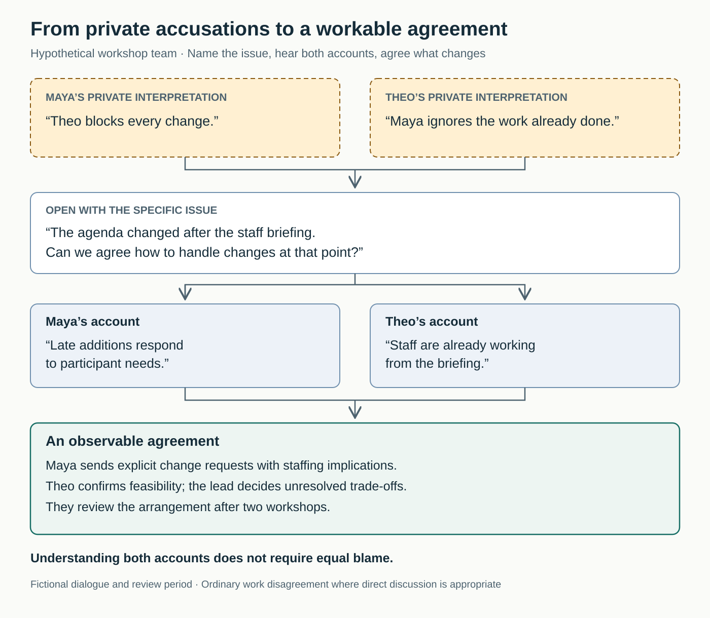

## Everyone knows about the disagreement—except the people having it

Maya tells colleagues that Theo blocks every change. Theo says Maya ignores work already done. Their meetings remain polite, but requests become defensive emails with more people copied in.

The team tries clearer status reports and reminders to communicate respectfully. Neither addresses the disagreement itself: what should happen when workshop plans change after staff have been briefed?

The conflict has become part of everyone’s working environment without becoming a conversation the people involved can actually resolve.

## The core move: bring the disagreement into the open

**Name the specific issue with the people involved, explain its effect, and explore their account before agreeing what should change.**

“Address Conflict Directly” is a plain-language pattern drawing on constructive conflict management and the **learning conversation** described by Douglas Stone, Bruce Patton, and Sheila Heen. Its purpose is to understand differing perspectives while expressing your own clearly enough to support action. [Sheila Heen, interview and transcript](https://workplaces.org/podcast-transcript/transcript-moving-through-the-tunnel-a-harvard-experts-guide-to-difficult-conversations-sheila-heen-triad-consulting-group)

Directness concerns the issue, not the volume of the conversation. A private discussion, a facilitated meeting, or an appropriate formal process can each address something directly. Public confrontation is rarely necessary for ordinary work friction.

The aim is a workable way forward. Agreement about every interpretation—or liking each other—is optional.

## Why the problem persists

Avoidance provides immediate relief. Raising a concern might upset a colleague, expose your own contribution, or produce a disagreement you cannot easily settle.

Meanwhile, each person develops an explanation. A missed handoff becomes evidence of carelessness; a request for more notice becomes evidence of control. The explanation can harden before it has been checked.

Heen’s practitioner account distinguishes what people believe happened, the feelings involved, and what the situation seems to imply about their competence or character. It also describes how indirect complaints can circulate while the person concerned never receives useful feedback. These are explanatory tools from practice, rather than a diagnosis of every conflict. [Heen interview](https://workplaces.org/podcast-transcript/transcript-moving-through-the-tunnel-a-harvard-experts-guide-to-difficult-conversations-sheila-heen-triad-consulting-group)

Research also cautions against celebrating conflict indiscriminately. A meta-analysis of 116 studies found consistently negative associations between relationship and process conflict and group outcomes. Disagreement about the substance of work had more conditional relationships with performance. This does not establish that a particular conversation technique will improve results; it challenges the assumption that more conflict is inherently useful. [De Wit, Greer, and Jehn, 2012](https://pubmed.ncbi.nlm.nih.gov/21842974/)

## Two colleagues examine the same event

*The following example is hypothetical.*

Maya coordinates workshop content. Theo arranges rooms and facilitators. Maya sometimes changes the agenda after Theo’s staff briefing. She updates the shared document and assumes everyone will use it. Theo expects the briefing to establish a stable plan.

After another confused workshop, Maya asks for a private conversation:

> “The agenda changed after the staff briefing, and we ended up working from different plans. Can we agree how to handle changes at that point?”

This opening identifies an event and a practical question without declaring either person’s motive.

Theo initially responds, “I’ve already explained this. You keep changing things.”

Maya feels accused. Instead of defending every update, she asks which changes created the difficulty. Theo describes facilitators preparing activities that were subsequently removed. Maya explains that the additions responded to participant requests received late.

They discover a genuine tension: responsiveness to participants requires flexibility; reliable preparation requires stability.

Maya acknowledges that changing the document did not ensure anyone had noticed. Theo acknowledges that he had treated the briefing as a deadline without explicitly agreeing that boundary.

They establish a new arrangement. After the briefing, Maya sends an explicit change request explaining its staffing implications. Theo confirms feasibility. If they cannot resolve the trade-off, the workshop lead decides. They will review the arrangement after two workshops.

For the next workshop, the lead declines one late addition because it would require replacing an already prepared activity. Maya remains disappointed, but understands the reason. Theo accepts that some late changes may still be necessary.

The conversation costs time and exposes shortcomings in both accounts. It produces an observable agreement rather than an instruction to “communicate better.”

## What changes in everyday work

A reasonable first step is to raise one recent, consequential incident before presenting a history of everything that has gone wrong. Choose a time and setting where both people can give it attention.

Prepare enough to distinguish three things: what you observed, the effect on the work or on you, and what you are inferring. “The agenda changed after the briefing” is different from “You don’t respect preparation.”

Stone, Patton, and Heen call one useful opening the **Third Story**: describe the difference in perspectives in terms both people can recognize. The Program on Negotiation explains this as starting from a neutral observer’s account rather than prosecuting your own version. [Harvard Program on Negotiation](https://www.pon.harvard.edu/daily/conflict-resolution/telling-the-third-story/)

Then make room for information that could change your understanding. Ask what the other person was responding to. Check your summary with them. Explain your concern plainly; curiosity does not require concealing your position.

Separate intention from impact. You may know what their action caused without knowing why they took it. Heen explicitly cautions that good intentions cannot always be assumed: uncertainty about motive still leaves the impact available for discussion. [Heen interview](https://workplaces.org/podcast-transcript/transcript-moving-through-the-tunnel-a-harvard-experts-guide-to-difficult-conversations-sheila-heen-triad-consulting-group)

Close with something people can recognize in practice: a changed handoff, a behavior to stop, a decision to obtain, or a boundary to respect. Name who will act and when you will check whether it helped.

An individual can initiate this discussion and change their own behavior. A manager may need to resolve incompatible priorities, adjust workloads, or enforce standards. Conversation cannot create resources or authority that neither participant possesses.

If emotions make listening difficult, pause and agree when to return. A pause with a return point protects the discussion from becoming another indefinite postponement.

## When direct conversation needs support

This pattern helps with recurring friction, conflicting expectations, untested assumptions, and disagreements that keep resurfacing through other people.

A smaller difference may need only a brief clarification. For example, two colleagues who disagree about a report’s audience might compare the intended readers and choose an appropriate level of detail without discussing their relationship.

More entrenched conflict may benefit from an impartial facilitator. Acas describes workplace mediation as voluntary and focused on helping participants agree how to work together in the future. The mediator supports the process rather than imposing the outcome. [Acas, workplace mediation](https://www.acas.org.uk/mediation)

Do not make a private confrontation a prerequisite for getting help. Where there are threats, retaliation, serious misconduct, or an unsafe power imbalance, use appropriate organizational support. Acas allows problems to be raised formally when informal steps have failed or the matter is too serious for that approach. [Acas, raising a problem at work](https://www.acas.org.uk/how-to-raise-a-problem-at-work)

Coaching, representation, and reporting are legitimate forms of support. “Talk directly” should never become a rule that isolates someone.

## Failure modes and signs of progress

**Directness becomes permission to attack.** Labels such as “lazy” or “controlling” leave little to investigate. Describe the behavior and concern precisely.

**Listening becomes an interrogation.** Questions asked solely to expose inconsistencies will rarely produce exploration. Be willing to explain your own reasoning and revise it.

**Shared contribution becomes compulsory equal blame.** Understanding an interaction does not require assigning equal responsibility. Acknowledging a mistake does not excuse someone else’s harmful conduct.

**The conversation ends with goodwill alone.** An apology may matter, but repeated work problems also need changed behavior or arrangements.

**Every disagreement becomes a compromise.** Sometimes the next step is a decision by an authorized person, a clearer standard, or an investigation.

Look beyond whether the meeting felt pleasant. Useful signs include:

- People can describe the disagreement without caricaturing each other.
- Agreements lead to observable changes.
- The same issue creates fewer surprises or less rework.
- Necessary disagreements still surface.
- Participants know what to do if the agreement fails.

These are practical indicators, not a validated scorecard. A quieter team might be cooperating better—or suppressing concerns. Check experiences on both sides and examine what actually changes in the work.

## Connections to neighboring patterns

[[teamwork-make-it-safe-to-speak-up|Make It Safe to Speak Up]] reduces the expected cost of raising a concern. Addressing conflict directly gives people a way to handle the disagreement that follows.

[[teamwork-check-shared-understanding|Check Shared Understanding]] helps distinguish a substantive disagreement from different interpretations of an instruction or commitment.

[[teamwork-clarify-decision-rights|Clarify Decision Rights]] resolves questions that conversation alone cannot settle: who is authorized to choose when informed colleagues still disagree?

## Best starting source

[*Difficult Conversations: How to Discuss What Matters Most*](https://www.penguin.co.uk/books/24713/difficult-conversations-by-heen-bruce-pattondouglas-stonesheila/9780140277821), by Douglas Stone, Bruce Patton, and Sheila Heen. It provides the central approach behind this article. For a free introduction in a coauthor’s own words, use [Sheila Heen’s interview transcript](https://workplaces.org/podcast-transcript/transcript-moving-through-the-tunnel-a-harvard-experts-guide-to-difficult-conversations-sheila-heen-triad-consulting-group).
