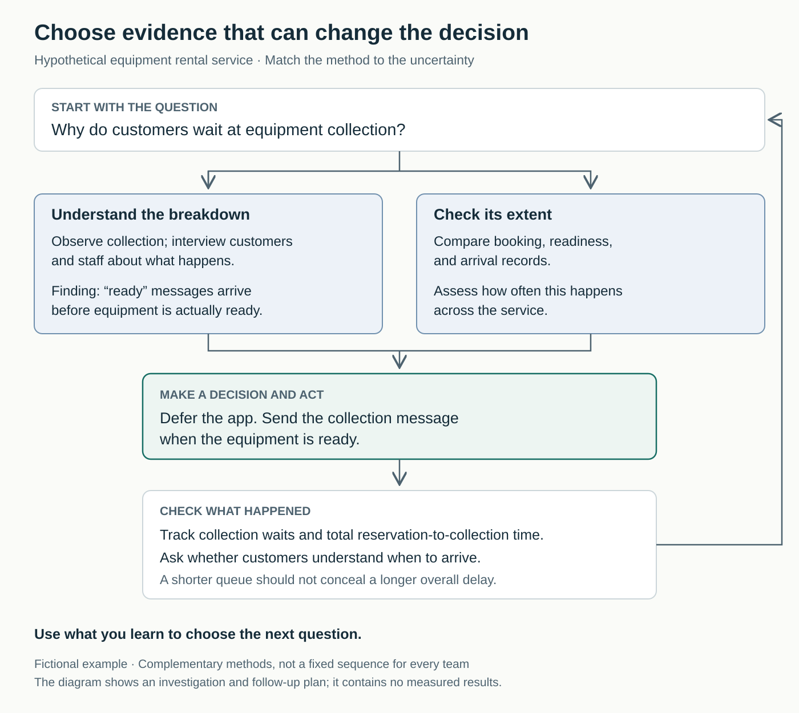

## Plenty of feedback, little direction

An equipment rental team receives complaints about slow collection. Its satisfaction survey confirms that customers want faster service. Someone proposes an express-check-in app; another suggests more staff.

The team sends another survey. Customers enthusiastically endorse convenient collection. Neither proposal becomes easier to assess.

The problem is not a shortage of opinions. The team has not established what it needs to learn, which evidence could answer that question, or how the answer will change its work.

## The core move: design the route from question to action

**Choose a feedback loop around a decision: what you need to learn, whose experience matters, how to gather suitable evidence, who will respond, and when you will check the result.**

This title describes a practical synthesis of **user-research method selection** and **closed-loop customer feedback**. Choosing the loop includes deciding how it will operate; closing it means following through.

A useful loop looks like this:

**Question → suitable evidence → interpretation → decision and action → check the outcome → next question.**

The UK Government Service Manual recommends starting with research questions, identifying relevant user groups, and choosing activities that provide reliable answers with proportionate effort. It also advises connecting findings to the team’s actual decisions. [GOV.UK, *Plan User Research for Your Service*](https://www.gov.uk/service-manual/user-research/plan-user-research-for-your-service)

Here, “customer” includes the people using or affected by the service. The purchaser, everyday user, and person seeking assistance may have different experiences.

## Different questions need different evidence

A team may default to the method it already knows: surveys, customer calls, analytics, or demonstrations. Each can be useful while leaving an important question unanswered.

Christian Rohrer’s research-method guide distinguishes people’s reported attitudes from observed behavior, qualitative understanding from quantitative measurement, and different contexts of use. These distinctions help explain why asking whether someone likes an idea cannot establish whether they can use it. [Nielsen Norman Group, *When to Use Which User-Experience Research Methods*](https://www.nngroup.com/articles/which-ux-research-methods/)

A practical starting map is:

| Question | Useful evidence |
|---|---|
| What are people trying to accomplish, and what obstructs them? | Interviews about specific experiences and observation in context |
| Can people complete this task with our proposed design? | Usability testing with a realistic task |
| How common is a behavior or reported experience? | Suitable operational data, analytics, or a carefully sampled survey |
| Did one version produce a better outcome? | A controlled comparison, when feasible |

This is an orientation, not a rigid classification. Methods can overlap and complement one another.

The choice also includes timing. Feedback arriving after a major commitment offers fewer options. Conversely, asking immediately after an interaction cannot establish an outcome that takes months to emerge.

## The collection problem turns out to start earlier

*The following example is hypothetical.*

The rental team initially frames its question as “Would customers use express check-in?” Its service lead, Elena, reframes the immediate decision: “Before investing in an app, what is causing the wait?”

A researcher observes collection sessions and holds short conversations with customers and staff. The team includes first-time and repeat customers rather than relying only on regular survey respondents.

They discover a specific breakdown: the system sends a “ready for collection” message when an order enters preparation. Customers interpret it as permission to arrive immediately. Counter staff then handle customers whose equipment is still being assembled.

That observation identifies a plausible cause. It does not establish how widespread the problem is. An operations colleague compares notification, readiness, and arrival records to assess its extent across bookings.

The developer who proposed the app is frustrated: implementation could already have started. Elena postpones that investment and chooses a smaller change. The collection message will be sent when equipment is actually ready. Staff must temporarily confirm readiness manually, adding work.

The team tests the revised message with customers to check what they understand about arrival time. After introducing it, they review collection waits, related enquiries, and total time from reservation to collection. They want to avoid making the counter look faster simply by shifting the delay elsewhere.

In subsequent observed sessions, the misleading message no longer prompts early arrival, but queues still form during busy periods. The team retains the notification change and investigates counter capacity next.

The loop produces a narrower decision than “build an app” or “hire more staff.” It also reveals that solving one cause does not settle the whole problem.

## How to establish a useful loop

Begin with one decision approaching the team, not a general ambition to “listen more.” Describe the uncertainty that could change the choice.

Agree who needs to participate. Customers provide experience; frontline colleagues contribute operational context; a researcher or suitably skilled teammate helps gather and interpret evidence. Include someone authorized to change the work.

Choose the lightest method that can credibly answer the question. Existing support records may reveal recurring issues. Observing a task may explain a confusing handoff. A survey may help measure a defined experience once the questions and population are understood.

Then establish how findings will enter a decision. In the rental example, Elena owns the response and reviews evidence with operations and the researcher each week during the change. Another team might need a different rhythm. Match the interval to how quickly relevant experience accumulates and how soon the team can act.

Separate **responding to an individual** from **improving the underlying service**. A customer may need help now even while the team investigates a recurring cause. Bain’s “inner loop” guidance emphasizes timely, specific feedback reaching relevant employees, followed by appropriate customer follow-up. That principle can be used without adopting its wider Net Promoter System. [Bain, *The Inner Loop*](https://www.netpromotersystem.com/about/net-promoter-system-framework/inner-loop/)

Explain what happened to consequential feedback: what changed, what remains under investigation, or why a request was declined. Acknowledgment need not promise a feature.

An individual can bring an unresolved customer question to planning and propose appropriate evidence. Access to participants, operational data, specialist skills, and capacity to make changes may require leadership support. Research also needs time for recruitment and interpretation; an apparently cheap questionnaire can create expensive uncertainty.

## When the loop needs a different design

This pattern helps when teams argue from anecdotes, collect feedback without acting, discover usability problems after release, or treat requests from a vocal customer as representative demand.

It works before building as well as during operation. A prototype test can inform an early design decision; support cases and service data can reveal what happens under everyday conditions.

Consider who the convenient channel misses. A survey sent only after successful completion excludes people who abandoned the service. Digital-only recruitment may miss people who need assistance. The Service Manual explicitly recommends including varied users, disabled people, and people with support needs. [GOV.UK, research planning](https://www.gov.uk/service-manual/user-research/plan-user-research-for-your-service)

Some questions require more expertise or evidence than the team initially expects. A/B testing, for example, needs suitable random allocation, enough participants, and an appropriate duration; a small stream of visitors may not support a useful comparison. [GOV.UK, *A/B Testing: Comparative Studies*](https://www.gov.uk/guidance/ab-testing-comparative-studies)

Nor should a team delay correcting an obvious failure until a survey confirms that customers dislike it.

## Failure modes and signs of progress

**The method becomes the goal.** “We interview customers every Friday” says little about whether those interviews inform a decision.

**Requests become instructions.** “Build an app” may express a need for reliable collection. Explore the experience behind the proposed solution.

**A small study becomes a population estimate.** Observing a breakdown establishes that it can happen. Estimating prevalence requires evidence suited to that purpose.

**A dashboard replaces understanding.** Numbers can locate a problem without explaining it. Official service guidance recommends combining performance measures with user research and other sources, including contact-centre data. [GOV.UK, *Measuring the Success of Your Service*](https://www.gov.uk/service-manual/measuring-success/measuring-the-success-of-your-service)

**The chosen measure improves while the experience worsens.** Fewer support calls might mean clearer instructions—or a harder-to-find phone number. Check the wider journey.

Assess progress through both learning and results:

- Important uncertainties become more specific.
- Decisions visibly use relevant evidence.
- Significant findings lead to an action or an explained choice.
- Follow-up examines the customer outcome.
- The team notices when its participants, method, or measures are inadequate.

These are suggested indicators, not a validated scorecard. More feedback and faster reporting demonstrate activity. Better customer outcomes require a separate check.

## Connections to neighboring patterns

[[teamwork-deliver-small-slices|Deliver Small Slices]] creates opportunities to learn before committing to a larger solution. Choose the feedback loop determines what evidence each slice should produce.

[[teamwork-run-one-improvement-experiment|Run One Improvement Experiment]] tests a particular change. This pattern helps decide when an experiment is appropriate and when understanding the problem should come first.

[[teamwork-optimize-the-whole|Optimize the Whole]] keeps the loop focused on the customer’s complete experience, so improving one team’s measure does not conceal a delay elsewhere.

## Best starting source

[Christian Rohrer’s *When to Use Which User-Experience Research Methods*](https://www.nngroup.com/articles/which-ux-research-methods/). It provides the clearest foundation for matching the evidence-gathering method to the question your team needs to answer.
